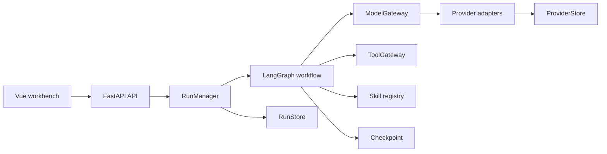

# Work Harness

**Language / 语言:** English | [简体中文](README.zh-CN.md)

[](https://github.com/1ceS1amese/work-harness/actions/workflows/ci.yml)
[](https://github.com/1ceS1amese/work-harness/releases/latest)
[](https://github.com/RichardLitt/standard-readme)
[](LICENSE)
[](pyproject.toml)

A controlled, observable, and testable multi-agent workflow harness.

Work Harness combines a bounded LangGraph workflow, a FastAPI API, and a Vue workbench for
planning, parallel execution, independent review, repair, human approval, and synthesis. Its
Provider layer targets custom OpenAI-compatible model endpoints rather than a single vendor.
OpenAI protocol and DeepSeek dialects can use either Chat Completions or Responses, while the
root agent and every assignable child agent can have independent Provider and model routes.

The current release is alpha software. It is usable for local development, contract testing,
single-instance deployment, and manual real-model evaluation. It is not yet a multi-tenant or
horizontally scalable production service.

## Table of Contents

- [Security](#security)
- [Background](#background)
- [Install](#install)
- [Usage](#usage)
- [Architecture](#architecture)
- [Provider and Skill Compatibility](#provider-and-skill-compatibility)
- [Deployment](#deployment)
- [Project Status](#project-status)
- [API](#api)
- [Acknowledgements](#acknowledgements)
- [Contributing](#contributing)
- [License](#license)

## Security

Never place model credentials in YAML, Provider Profiles, frontend build variables, logs, or
SQLite records. Provider Profiles store only environment variable names. Use `secure` or
`production` with HTTPS before exposing the service outside a trusted machine.

The built-in API Key is a shared deployment secret, not user identity or tenant isolation.
SQLite is supported for one application process only. See [SECURITY.md](SECURITY.md) for the
supported versions, private reporting process, and deployment boundary.

## Background

Multi-agent systems often bind workflow nodes directly to vendor SDKs, model names, tools, and
process-local state. That makes providers difficult to swap and makes partial failures hard to
inspect or recover. Work Harness separates those concerns:

- LangGraph owns bounded workflow transitions.
- Pydantic models define machine-readable contracts.
- logical models keep workflow roles independent from vendor model IDs.
- Provider and Tool registries support adapters and Python entry points.
- Skills declare capabilities, tools, compatible Providers, and preferred routes.
- Checkpoint, RunStore, and ProviderStore own distinct persistent state.

The default Mock Providers are deterministic engineering fixtures. Passing the included
evaluation proves workflow behavior, not real-model answer quality.

## Install

### Dependencies

For the recommended container installation, install Docker Engine 24+ and Docker Compose v2.24+.
For source development, install Python 3.11+, [uv](https://docs.astral.sh/uv/), Node.js 22+, and
npm.

### Docker Compose

From a repository checkout:

```bash
./scripts/compose.sh up
```

This builds both applications, creates the persistent volume, starts one non-root application
container, and waits for the liveness probe. No key is needed for the default Mock profile.

To deploy a versioned image from the repository's GitHub Packages page, set its complete GHCR
reference as `WORK_HARNESS_IMAGE` in `.env`, then run:

```bash
./scripts/compose.sh install
```

`install` pulls the declared image and refuses the default local-only tag. It does not build from
the checkout.

### Source

```bash
uv sync --extra dev --locked
npm --prefix frontend ci
npm --prefix frontend run build
uv run work-harness check-config
uv run work-harness serve
```

### GitHub Release wheel

Release wheels contain the backend and built-in runtime configuration, prompts, schemas, and
Skills. Download the wheel from the [latest GitHub Release](https://github.com/1ceS1amese/work-harness/releases/latest).
The browser UI is distributed in the container image and source checkout.

```bash
python -m pip install work_harness-0.1.0-py3-none-any.whl
work-harness check-config
work-harness serve --host 127.0.0.1 --port 8000
```

## Usage

Open `http://127.0.0.1:8000/` after a source or Compose installation. Create a conversation,
choose allocation mode and Skills, optionally route individual agents, and submit a task. Runs
stream snapshots over SSE and fall back to bounded polling after a connection failure.

### CLI

```bash
# Validate all cross-references.
uv run work-harness check-config

# Inspect Provider, Tool, and Skill compatibility.
uv run work-harness check-compatibility

# List or validate installed Skills.
uv run work-harness skills list
uv run work-harness skills validate

# Run one task and optionally pin a Skill to a Provider.
uv run work-harness run \
  --goal "Audit this delivery plan" \
  --skill risk-audit@mock-secondary

# Run the deterministic workflow evaluation.
uv run work-harness eval
```

When using an installed wheel, omit `uv run`. Use `--project-root PATH` to load a custom project
instead of the packaged defaults.

### Custom Providers

Provider settings can be staged in the web UI without storing a credential value:

1. choose `openai` or `deepseek` protocol behavior;
2. choose `chat_completions` or `responses`;
3. allowlist real model IDs;
4. map logical models, the main coordination group, and individual `worker-*` agents;
5. reference Base URL and API Key environment variable names;
6. add those variables to the runtime environment;
7. enable the Profile and restart the service.

The `main` agent binding expands to the normalizer, planner, reviewer, judge, and synthesizer.
Specific child-agent bindings override the logical model's default route. A task-level Skill
Provider pin has the highest priority.

## Architecture



The workflow is:

```text
Normalize → Plan → Worker → Validate → Review → Judge
          → Repair / Human Gate → Synthesize
```

Four homogeneous workers share the same contracts, budgets, and tool permissions. Their behavior
changes through per-task functions and routes, not permanent professions. See the
[architecture decisions](docs/architecture_decisions.md), [persistence contract](docs/persistence.md),
and [security boundary](docs/security_boundary.md).

## Provider and Skill Compatibility

Every enabled Provider must satisfy the same portable capability baseline:

```text
chat + structured_output + tool_calling
```

Startup fails closed when Provider declarations, adapter behavior, logical routes, or Skill
requirements disagree. The built-in adapter supports:

| Protocol behavior | API family | Endpoint suffix |
| --- | --- | --- |
| OpenAI-compatible | Chat Completions | `/chat/completions` |
| OpenAI-compatible | Responses | `/responses` |
| DeepSeek dialect | Chat Completions | `/chat/completions` |
| DeepSeek dialect | Responses | `/responses` when supplied by the custom endpoint |

`openai_compatible` describes a wire-protocol adapter, not an OpenAI-hosted service. Endpoint,
model, and credential variables are user-defined. See
[Provider, Tool, and Skill compatibility](docs/provider-skill-compatibility.md).

## Deployment

The Compose deployment intentionally runs one application instance because Checkpoint, RunStore,
and ProviderStore currently use SQLite.

```bash
./scripts/compose.sh status
./scripts/compose.sh logs
./scripts/compose.sh backup
./scripts/compose.sh reload
./scripts/compose.sh update
./scripts/compose.sh install
./scripts/compose.sh down
```

For public HTTPS, create `.env` and `deploy/runtime.env`, select `secure` or `production`, configure
a real domain and deployment API Key, then run:

```bash
./scripts/compose.sh public
```

Use `./scripts/compose.sh install-public` instead when `WORK_HARNESS_IMAGE` points to a released
GHCR image.

The public command refuses the local profile, an example domain, or an empty deployment key.
Read the complete [Docker Compose deployment guide](docs/docker-deployment.md) before exposing a
host. Do not use `docker compose down -v` unless you explicitly intend to delete durable state.

## Project Status

Version `0.1.0` currently provides:

- 56 backend tests and 13 frontend tests;
- a 10/10 deterministic Mock workflow evaluation;
- durable Provider Profiles and per-agent model routes;
- single-instance restart recovery with leases and heartbeats;
- a read-only workspace Tool and two executable example Skills;
- Compose deployment, optional Caddy HTTPS, liveness checks, and consistent SQLite backups.

Real-provider credentials are intentionally not included. Multi-instance storage, a reliable task
queue, server-side conversations, organization identity, and business Tools remain future work.
See [development status](docs/development-status.md) and [CHANGELOG.md](CHANGELOG.md).

## API

| Method | Path | Purpose |
| --- | --- | --- |
| `GET` | `/health/live` | Unauthenticated process liveness |
| `GET` | `/health` | Provider and storage readiness summary |
| `GET` | `/v1/capabilities` | Agents, functions, models, Tools, and Skills |
| `GET` | `/v1/compatibility` | Provider, adapter, Tool, and Skill report |
| `GET` | `/v1/providers` | Effective and persisted Provider Profiles |
| `PUT` | `/v1/providers/{name}` | Validate and stage a Provider Profile |
| `DELETE` | `/v1/providers/{name}` | Delete a persistent Provider override |
| `POST` | `/v1/runs` | Create or idempotently reuse a run |
| `GET` | `/v1/runs` | List durable run summaries |
| `GET` | `/v1/runs/{run_id}` | Read a complete run result |
| `GET` | `/v1/runs/{run_id}/events` | Stream run snapshots using SSE |
| `POST` | `/v1/runs/{run_id}/resume` | Resolve a human approval gate |
| `DELETE` | `/v1/runs/{run_id}` | Cancel a run |

```bash
curl --request POST http://127.0.0.1:8000/v1/runs \
  --header 'Content-Type: application/json' \
  --data '{"goal":"Create a bounded implementation plan","task_type":"planning"}'
```

Interactive OpenAPI documentation is available at `/docs` when enabled by the selected profile.

## Acknowledgements

Work Harness is built with [FastAPI](https://fastapi.tiangolo.com/),
[LangGraph](https://github.com/langchain-ai/langgraph), [Pydantic](https://docs.pydantic.dev/),
[Vue](https://vuejs.org/), and [Element Plus](https://element-plus.org/). Its README follows
[Standard Readme](https://github.com/RichardLitt/standard-readme).

## Contributing

Questions, bug reports, and focused pull requests are welcome. Read
[CONTRIBUTING.md](CONTRIBUTING.md) before starting, use the repository's issue templates, and
follow [CODE_OF_CONDUCT.md](CODE_OF_CONDUCT.md). Security reports must use the private process in
[SECURITY.md](SECURITY.md).

By contributing, you agree that your contribution is licensed under the MIT License.

## License

[MIT](LICENSE) © 2026 Work Harness contributors
