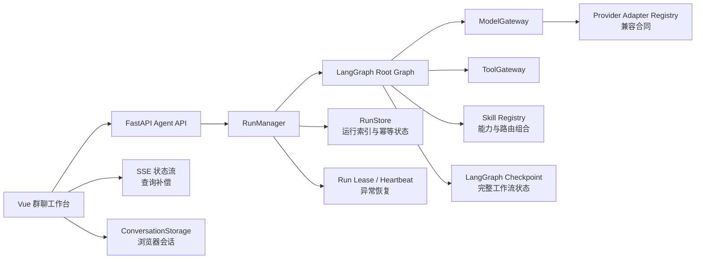

# Work Harness

Work Harness 是一个面向实际接入的多 Agent 编排框架。后端使用 FastAPI、LangGraph 和 Pydantic，前端使用 Vue 3、TypeScript 与 Element Plus，提供类群聊式任务指派、并行执行、交叉复核、人工审批、运行恢复和持久化保存能力。

当前版本重点完成“可控框架”，默认使用确定性的 Mock Provider 验证工作流，不对真实模型回答质量作提升声明。

## 当前完成进度

| 模块 | 状态 | 当前实现 |
|---|---|---|
| Root Graph | 已完成 | Normalize → Plan → Worker → Validate → Review → Judge → Repair/Human Gate → Synthesize |
| 同构 Agent | 已完成 | 四个同构智能成员，按任务选择分析、研究、执行、风险功能 |
| 结构化合同 | 已完成 | Task、Plan、Artifact、Review、Decision、RunResult 均由 Pydantic 校验 |
| 模型接入层 | 框架完成 | Mock 可运行；OpenAI-compatible 已有生产 Profile、错误映射和契约测试，待真实凭据验收 |
| Provider 兼容合同 | 已完成 | 协议版本、基线能力、能力全等和真实声明在启动时强校验；Adapter 支持入口点扩展 |
| 模块化 Skill | 已完成 | Skill 声明逻辑模型、能力、Tool、兼容/首选 Provider，支持组合和任务级选择 |
| Tool 层 | 已完成只读闭环 | 模型工具调用、白名单、Schema、超时、审计摘要及受限 `workspace_read` 已贯通 |
| 状态恢复 | 已完成单实例闭环 | Checkpoint + 运行租约/心跳/启动扫描，可恢复有 Checkpoint 的异常中断运行 |
| 运行持久化 | 已完成 | Memory / SQLite RunStore 保存索引、幂等、租约和恢复尝试次数 |
| 浏览器会话保存 | 已完成 | localStorage 适配器封装，保存群聊、消息和当前会话 |
| Agent API | 已完成 | 创建、查询、SSE 事件、列表、取消、审批恢复、能力查询和健康检查 |
| 群聊工作台 | 已完成 | 成员、功能、Skill、Provider 选择，及 `@成员`、进度、详情、审批、取消 |
| 评估基线 | 已完成 | 10 条固定 Mock 契约用例，统计 P95、解析错误、Token、工具调用和 bad case |
| 生产能力 | 待接入 | 真实模型、业务工具、身份系统、多租户、服务端会话同步和生产数据库 |

当前回归基线：后端 41 项测试、前端 8 项测试全部通过，类型检查、代码检查、10/10 Mock 评估和生产构建通过。

## 核心架构



三类状态互不混用：

- Checkpoint 保存 Graph State、计划、产物、复核和人工中断点；
- RunStore 保存可查询的运行索引、状态、时间和哈希指纹；
- ConversationStorage 保存当前浏览器的群聊展示状态，不保存 API Key。

详细设计见 [Provider/Tool/Skill 兼容性](docs/provider-skill-compatibility.md)、[持久化设计](docs/persistence.md) 和 [架构现状](docs/architecture_review.md)。

需要迁移到本机虚拟机继续开发时，参见 [虚拟机开发环境接续指南](docs/vm-handoff.md)。

## 快速开始

### 1. 安装后端

需要 Python 3.11 或更高版本，并安装 `uv`：

```powershell
uv sync --extra dev
uv run work-harness check-config
uv run work-harness export-schemas
uv run pytest
```

### 2. 启动 API

```powershell
uv run work-harness serve
```

默认地址为 `http://127.0.0.1:8000`，接口文档为 `http://127.0.0.1:8000/docs`。

### 3. 启动前端

开发模式：

```powershell
cd frontend
npm install
npm run dev
```

生产构建：

```powershell
cd frontend
npm ci
npm run build
cd ..
uv run work-harness serve
```

FastAPI 会自动托管 `frontend/dist`，浏览器访问 `http://127.0.0.1:8000/`。

## 同构 Agent 与功能分配

可指派成员统一命名为：

- 智能成员一：`worker-01`；
- 智能成员二：`worker-02`；
- 智能成员三：`worker-03`；
- 智能成员四：`worker-04`。

四个成员使用完全相同的模型、工具权限、预算、输入输出 Schema 和复核策略。成员编号只是可追踪的执行槽，不代表永久职业。每次任务通过 `functions_by_agent` 选择本轮功能：

```json
{
  "mode": "cross_functional",
  "assignees": ["worker-01", "worker-03"],
  "functions_by_agent": {
    "worker-01": ["analysis", "research"],
    "worker-03": ["execution"]
  },
  "cross_review": true
}
```

分配模式：

- `auto`：结合功能标签和当前负载自动选择成员；
- `direct`：按照成员选择或 `@成员` 的顺序绑定子任务；
- `cross_functional`：识别子任务所需功能，再选择具备该功能且负载最低的成员。

计划中的 `assigned_function` 会记录实际功能，`Artifact.producer` 会记录实际成员。旧版专职成员 ID 会自动迁移到新的同构成员。

## 持久化保存模式

默认配置位于 `config/runtime.yaml`：

```yaml
checkpoint:
  backend: sqlite
  path: var/checkpoints.sqlite
run_store:
  backend: sqlite
  path: var/runs.sqlite
```

支持两种模式：

| 模式 | 用途 | 特性 |
|---|---|---|
| `memory` | 单元测试、离线评估、临时运行 | 进程结束后清空 |
| `sqlite` | 本地开发、单实例服务 | 自动建表、WAL、原子幂等预留、重启后可查询 |

可以用环境变量覆盖数据库位置：

```powershell
$env:WORK_HARNESS_CHECKPOINT_PATH = "D:\work-harness\checkpoints.sqlite"
$env:WORK_HARNESS_RUN_STORE_PATH = "D:\work-harness\runs.sqlite"
uv run work-harness serve
```

RunStore 不重复保存原始 Prompt、上下文或幂等键，只保存 SHA-256 指纹。完整任务状态保留在 Checkpoint 中，列表 API 不返回内部指纹。执行时使用有期限租约和心跳确保唯一 owner；启动扫描只续跑已有 Checkpoint 的过期运行，没有 Checkpoint 的孤立索引会安全失败而不会猜测性重放。

浏览器群聊通过 `ConversationStorage` 接口保存到 localStorage。该适配器已经隔离浏览器存储调用，后续可以实现服务端会话适配器，而无需重写会话状态管理。

## API 概览

| 方法 | 路径 | 用途 |
|---|---|---|
| `GET` | `/health` | Provider、Checkpoint 和 RunStore 状态 |
| `GET` | `/v1/capabilities` | 模型、工具、成员、功能和任务类型 |
| `GET` | `/v1/compatibility` | Provider 合同、Adapter 与 Skill 兼容性报告 |
| `POST` | `/v1/runs` | 创建运行；支持 `idempotency_key` |
| `GET` | `/v1/runs` | 分页查询持久化运行索引 |
| `GET` | `/v1/runs/{run_id}` | 查询完整运行结果 |
| `GET` | `/v1/runs/{run_id}/events` | SSE 运行快照；断线后用查询接口补偿 |
| `POST` | `/v1/runs/{run_id}/resume` | 审批或拒绝人工中断 |
| `DELETE` | `/v1/runs/{run_id}` | 取消运行 |

创建任务示例：

```powershell
$body = @{
  goal = "分析需求并形成实施计划"
  task_type = "planning"
  idempotency_key = "planning-2026-001"
  assignment = @{
    mode = "cross_functional"
    assignees = @("worker-01", "worker-03")
    functions_by_agent = @{
      "worker-01" = @("analysis")
      "worker-03" = @("execution")
    }
    cross_review = $true
  }
  skills = @(
    @{ skill_id = "risk-audit"; provider = "mock-secondary" }
  )
} | ConvertTo-Json -Depth 6

Invoke-RestMethod `
  -Method Post `
  -ContentType "application/json" `
  -Body $body `
  -Uri http://127.0.0.1:8000/v1/runs
```

相同幂等键和相同请求会返回原 run_id；相同幂等键用于不同请求时返回 HTTP 409。

## 模块化 Skill 与 Provider 选择

运行时 Skill 位于 `skills/<skill-id>/`，由标准 `SKILL.md` 和 `agents/work-harness.yaml` 组成。后者声明逻辑模型、能力、工具、兼容 Provider 和首选顺序。前端可直接选择 Skill 和 Provider；CLI 可使用：

```powershell
uv run work-harness skills list
uv run work-harness skills validate
uv run work-harness check-compatibility
uv run work-harness run --goal "审计交付风险" --skill risk-audit@mock-secondary
```

编写新 Skill 时使用 `skills/create-provider-skill`，完整规则见 [兼容性设计](docs/provider-skill-compatibility.md)。

## 配置真实模型

默认 `config/models.yaml` 启用两个等能力 Mock Provider，用于验证选择和路由。接入真实服务时：

1. 配置并启用 `compatible` Provider；
2. 将实际模型加入 `allowed_models`；
3. 为逻辑模型配置候选顺序；
4. 设置 `MODEL_BASE_URL` 和 `MODEL_API_KEY`；
5. 保证所有启用 Provider 的能力集合相同，并通过 `check-compatibility`；
6. 先执行配置检查、测试和离线评估，再切换生产 Profile。

模型密钥只从环境变量读取。工作流节点只引用逻辑模型，不直接依赖供应商 SDK 或密钥。

仓库提供 `config/profiles/production/models.yaml`：设置 `WORK_HARNESS_PROFILE=production` 后会禁用 Mock、启用兼容 Provider，并由环境变量注入端点和密钥。将占位的 `configured-model` 换成实际模型后，先运行 Provider 契约测试和真实评估再部署。

## 受限只读工具

`workspace_read` 支持在项目根目录内读取、列目录和文本搜索。它限制行数、文件大小、扫描文件数和结果长度，拒绝目录逃逸、符号链接越界、`.env`、私钥以及依赖/运行目录。模型只能调用 Planner 写入子任务且 Agent 配置允许的工具；调用记录只保存输入 SHA-256、输出摘要、耗时和截断标记。

## 测试与评估

后端：

```powershell
uv run ruff check src tests
uv run pytest
uv run work-harness eval
```

前端：

```powershell
cd frontend
npm run type-check
npm run test -- --run
npm run build
```

`evaluation/reports/latest.json` 是 Mock Provider 工作流烟雾评估，只用于验证拓扑、Schema、恢复、审批和运行稳定性，不能解释为真实模型质量指标。

## 项目结构

```text
config/                         Agent、模型、工具、运行时和 API 配置
prompts/                        带版本的 Prompt
schemas/                        Pydantic 导出的 JSON Schema
skills/                         可选择的 Skill 包与 Skill 编写指南
src/work_harness/
  api/                          FastAPI Agent API
  config/                       配置加载与交叉引用校验
  domain/                       Task、Plan、Artifact、Review 等合同
  llm/                          ModelGateway 与 Provider Adapter
  skills/                       Skill 加载、兼容校验与组合路由
  storage/                      RunStore 接口、Memory/SQLite 实现与工厂
  tools/                        Tool Registry、Gateway 与实现
  workflow/                     LangGraph Root Graph、节点与状态
  observability/                Trace、日志与脱敏
frontend/src/
  components/                   群聊式 UI 组件
  composables/                  会话状态管理
  services/                     API 与 ConversationStorage 适配器
evaluation/                     固定评估集、baseline 和报告
tests/                          单元、API、存储与工作流测试
docs/                           架构、安全、迁移和持久化说明
```

## 扩展持久化后端

新增 PostgreSQL、Redis 或托管数据库时：

1. 实现 `RunStore` 的 `initialize`、`reserve`、`get`、`update_status`、`list`；
2. 在 `storage/factory.py` 注册新 backend；
3. 在配置合同中增加允许值；
4. 保持 `reserve` 对幂等键的原子唯一约束；
5. 运行存储合同、重启恢复、并发幂等和 API 回归测试。

业务代码和 LangGraph 节点不应直接依赖 SQLite 或具体数据库驱动。

## 当前已知边界

- 默认 Mock Provider 只验证工程行为；
- 当前 RunStore SQLite 适合单实例或低并发部署，生产多实例建议接入 PostgreSQL；
- 单实例异常运行支持租约过期后自动恢复；多实例仍需共享数据库和生产任务队列；
- 浏览器群聊尚未同步到服务端账户，当前为单浏览器 localStorage 保存；
- 身份认证、多租户、限流和生产队列需要在外部网关或后续模块中完成；
- 除受限工作区读取外，真实业务工具、审批人和数据驻留策略仍需按部署环境配置。

## 安全提示

- 不要把 API Key、Token、Cookie 或私钥写入配置、前端变量、日志和持久化索引；
- 对外部署前必须开启 API 鉴权并使用 HTTPS；
- `var/` 默认被 Git 忽略，但数据库文件仍应设置目录权限、备份和保留周期；
- 任何写入、执行或外部通信工具都应经过审批、权限校验、幂等和审计。
