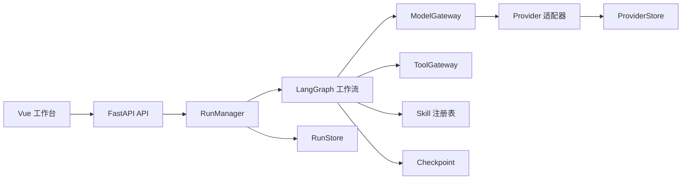

# Work Harness

**Language / 语言：** [English](README.md) | 简体中文

[](https://github.com/1ceS1amese/work-harness/actions/workflows/ci.yml)
[](https://github.com/1ceS1amese/work-harness/releases/latest)
[](https://github.com/RichardLitt/standard-readme)
[](LICENSE)
[](pyproject.toml)

A controlled, observable, and testable multi-agent workflow harness.

Work Harness 是一个受控、可观测、可测试的多 Agent 工作流框架。它组合了有边界的
LangGraph 工作流、FastAPI API 与 Vue 工作台，可执行规划、并行任务、独立审查、修复、
人工审批与最终汇总。

Provider 层面向用户自定义的 OpenAI 协议端点，而不是绑定单一厂商。OpenAI 协议行为与
DeepSeek 方言均可通过 Chat Completions 或 Responses 接入；主 Agent 与每个子 Agent 也可
分别选择 Provider 和模型路由。

当前版本是 Alpha，适合本地开发、协议测试、单实例部署和手动真实模型验证；暂不适合作为
多租户或横向扩容的生产服务。

## 目录

- [安全](#安全)
- [背景](#背景)
- [安装](#安装)
- [使用](#使用)
- [架构](#架构)
- [Provider 与 Skill 兼容性](#provider-与-skill-兼容性)
- [部署](#部署)
- [项目状态](#项目状态)
- [API](#api)
- [致谢](#致谢)
- [贡献](#贡献)
- [许可证](#许可证)

## 安全

不要把模型密钥写入 YAML、Provider Profile、前端构建变量、日志或 SQLite。Provider Profile
只保存环境变量名。服务暴露到受信任主机之外前，请使用 `secure` 或 `production` 配置并启用
HTTPS。

内置 API Key 是部署级共享密钥，不代表用户身份或租户隔离。SQLite 仅支持单应用进程。
完整边界和私密漏洞报告方式见 [SECURITY.md](SECURITY.md)。

## 背景

多 Agent 系统经常把工作流节点直接绑定到厂商 SDK、固定模型、工具和进程内状态，导致
Provider 难以替换、部分失败难以定位或恢复。Work Harness 将这些关注点拆开：

- LangGraph 管理有边界的工作流跳转；
- Pydantic 模型定义可机器校验的契约；
- 逻辑模型使工作流角色与厂商模型 ID 解耦；
- Provider 与 Tool 注册表支持适配器和 Python entry point；
- Skill 声明能力、工具、兼容 Provider 和首选路由；
- Checkpoint、RunStore 与 ProviderStore 分别管理不同的持久状态。

默认 Mock Provider 是确定性的工程测试夹具。内置评测通过仅证明流程行为满足基线，不代表
真实模型的回答质量。

## 安装

### 依赖

推荐使用 Docker Engine 24+ 和 Docker Compose v2.24+ 部署。源码开发需要 Python 3.11+、
[uv](https://docs.astral.sh/uv/)、Node.js 22+ 与 npm。

### Windows 单文件版

从[最新 GitHub Release](https://github.com/1ceS1amese/work-harness/releases/latest) 下载
`work-harness.exe` 和对应 `.sha256` 文件，校验后双击即可。EXE 已包含后端、浏览器 UI、内置
配置、Prompt、Schema 和 Skill，目标电脑无需安装 Python 或 Node.js。

桌面启动器只监听 `127.0.0.1`，会自动打开浏览器，并把 Checkpoint、运行记录和 Provider
Profile 持久化到 `%LOCALAPPDATA%\WorkHarness`。传入 `work-harness.exe check-config` 等命令时
可直接使用 CLI。校验方式、模型环境变量、自定义数据目录和源码构建说明见
[Windows 单文件版指南](docs/windows-executable.md)。

### Docker Compose

在仓库检出目录运行：

```bash
./scripts/compose.sh up
```

该命令会构建前后端、创建持久化卷、启动非 root 单实例容器并等待存活检查。默认 Mock 配置
无需任何模型密钥。

如需部署仓库 GitHub Packages 页面中的版本化镜像，请把完整 GHCR 引用写入 `.env` 的
`WORK_HARNESS_IMAGE`，然后运行：

```bash
./scripts/compose.sh install
```

`install` 会拒绝默认的本地标签，只拉取已声明镜像，不在当前检出目录构建。

### 源码安装

```bash
uv sync --extra dev --locked
npm --prefix frontend ci
npm --prefix frontend run build
uv run work-harness check-config
uv run work-harness serve
```

### GitHub Release wheel

发布 wheel 包含后端以及内置配置、Prompt、Schema 和 Skill，可从
[最新 GitHub Release](https://github.com/1ceS1amese/work-harness/releases/latest) 下载。浏览器 UI
通过容器镜像和源码分发。

```bash
python -m pip install work_harness-0.2.0-py3-none-any.whl
work-harness check-config
work-harness serve --host 127.0.0.1 --port 8000
```

## 使用

源码或 Compose 启动后访问 `http://127.0.0.1:8000/`。创建会话、选择分配模式和 Skill，按需为
单个 Agent 指定路由，然后提交任务。运行状态通过 SSE 推送；连接失败后会退回有边界的轮询。

### CLI

```bash
# 校验全部配置引用。
uv run work-harness check-config

# 检查 Provider、Tool 与 Skill 兼容性。
uv run work-harness check-compatibility

# 列出或校验已安装 Skill。
uv run work-harness skills list
uv run work-harness skills validate

# 执行一次任务，并可把 Skill 固定到某个 Provider。
uv run work-harness run \
  --goal "审查这份交付计划" \
  --skill risk-audit@mock-secondary

# 执行确定性流程评测。
uv run work-harness eval
```

使用 wheel 安装时去掉 `uv run`。可通过 `--project-root PATH` 加载自定义项目配置，而不是包内
默认资源。

### 自定义 Provider

Web 界面可以保存不含密钥值的 Provider 配置：

1. 选择 `openai` 或 `deepseek` 协议行为；
2. 选择 `chat_completions` 或 `responses`；
3. 设置允许使用的真实模型 ID；
4. 映射逻辑模型、主协调组和单独的 `worker-*` Agent；
5. 填写 Base URL 与 API Key 的环境变量名；
6. 将对应变量注入运行环境；
7. 启用 Profile 并重启服务。

`main` 绑定会展开到 normalizer、planner、reviewer、judge 和 synthesizer。单独子 Agent 的绑定
会覆盖逻辑模型默认路由；任务级 Skill Provider 固定具有最高优先级。

## 架构



核心工作流为：

```text
Normalize → Plan → Worker → Validate → Review → Judge
          → Repair / Human Gate → Synthesize
```

四个同构 Worker 共享契约、预算和工具权限，以任务函数和路由区分行为，而不是固化为永久职业。
参见[架构决策](docs/architecture_decisions.md)、[持久化契约](docs/persistence.md)与
[安全边界](docs/security_boundary.md)。

## Provider 与 Skill 兼容性

所有启用的 Provider 必须满足同一套可移植能力基线：

```text
chat + structured_output + tool_calling
```

Provider 声明、适配器行为、逻辑路由或 Skill 要求不一致时，启动会直接失败。内置适配器支持：

| 协议行为 | API 系列 | 端点后缀 |
| --- | --- | --- |
| OpenAI 兼容 | Chat Completions | `/chat/completions` |
| OpenAI 兼容 | Responses | `/responses` |
| DeepSeek 方言 | Chat Completions | `/chat/completions` |
| DeepSeek 方言 | Responses | 自定义端点提供时使用 `/responses` |

`openai_compatible` 表示线协议适配器，不表示服务由 OpenAI 官方托管。端点、模型与密钥变量均
由使用者定义。详见 [Provider、Tool 与 Skill 兼容说明](docs/provider-skill-compatibility.md)。

## 部署

由于 Checkpoint、RunStore 和 ProviderStore 当前使用 SQLite，Compose 部署会明确限制为一个
应用实例。

```bash
./scripts/compose.sh status
./scripts/compose.sh logs
./scripts/compose.sh backup
./scripts/compose.sh reload
./scripts/compose.sh update
./scripts/compose.sh install
./scripts/compose.sh down
```

公网 HTTPS 部署需创建 `.env` 和 `deploy/runtime.env`，选择 `secure` 或 `production`，设置真实
域名与部署 API Key，然后运行：

```bash
./scripts/compose.sh public
```

`WORK_HARNESS_IMAGE` 指向已发布 GHCR 镜像时，改用
`./scripts/compose.sh install-public`。

`public` 会拒绝本地 Profile、示例域名或空部署密钥。对外开放主机前请完整阅读
[Docker Compose 部署指南](docs/docker-deployment.md)。除非确定要删除持久状态，否则不要执行
`docker compose down -v`。

## 项目状态

版本 `0.2.0` 当前包括：

- 61 个后端测试与 13 个前端测试；
- 10/10 的确定性 Mock 工作流评测；
- 可持久化的 Provider Profile 与按 Agent 划分的模型路由；
- 基于租约和心跳的单实例重启恢复；
- 一个只读工作区 Tool 与两个可执行示例 Skill；
- 一个将持久化数据置于包外的 Windows x64 单文件 EXE；
- Compose 部署、可选 Caddy HTTPS、存活检查与一致性 SQLite 备份。

仓库不会包含真实 Provider 密钥。多实例存储、可靠任务队列、服务端会话、组织身份和业务 Tool
仍属于后续工作。参见[开发状态](docs/development-status.md)与 [CHANGELOG.md](CHANGELOG.md)。

## API

| 方法 | 路径 | 用途 |
| --- | --- | --- |
| `GET` | `/health/live` | 无需认证的进程存活检查 |
| `GET` | `/health` | Provider 与存储就绪状态 |
| `GET` | `/v1/capabilities` | Agent、函数、模型、Tool 与 Skill |
| `GET` | `/v1/compatibility` | Provider、适配器、Tool 与 Skill 报告 |
| `GET` | `/v1/providers` | 生效和持久化的 Provider Profile |
| `PUT` | `/v1/providers/{name}` | 校验并暂存 Provider Profile |
| `DELETE` | `/v1/providers/{name}` | 删除持久化 Provider 覆盖 |
| `POST` | `/v1/runs` | 创建或幂等复用一次运行 |
| `GET` | `/v1/runs` | 列出持久化运行摘要 |
| `GET` | `/v1/runs/{run_id}` | 读取完整运行结果 |
| `GET` | `/v1/runs/{run_id}/events` | 通过 SSE 推送运行快照 |
| `POST` | `/v1/runs/{run_id}/resume` | 处理人工审批门 |
| `DELETE` | `/v1/runs/{run_id}` | 取消运行 |

```bash
curl --request POST http://127.0.0.1:8000/v1/runs \
  --header 'Content-Type: application/json' \
  --data '{"goal":"创建一份有边界的实施计划","task_type":"planning"}'
```

所选 Profile 启用文档时，可在 `/docs` 查看交互式 OpenAPI 文档。

## 致谢

Work Harness 基于 [FastAPI](https://fastapi.tiangolo.com/)、
[LangGraph](https://github.com/langchain-ai/langgraph)、[Pydantic](https://docs.pydantic.dev/)、
[Vue](https://vuejs.org/) 与 [Element Plus](https://element-plus.org/) 构建。README 遵循
[Standard Readme](https://github.com/RichardLitt/standard-readme)。

## 贡献

欢迎提出问题、提交缺陷报告和聚焦的 Pull Request。开始前请阅读
[CONTRIBUTING.md](CONTRIBUTING.md)，使用仓库 Issue 模板并遵守
[CODE_OF_CONDUCT.md](CODE_OF_CONDUCT.md)。安全问题必须按 [SECURITY.md](SECURITY.md) 中的
私密流程报告。

贡献即表示你同意将贡献内容按 MIT License 授权。

## 许可证

[MIT](LICENSE) © 2026 Work Harness contributors
