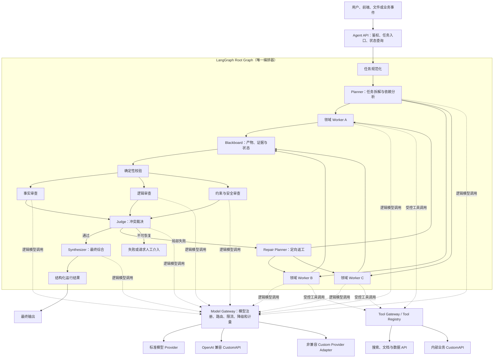

# 通用多 Agent 协作系统设计指南

## 1. 报告目标

本文面向研究、文档、数据分析、方案决策、代码、业务流程等通用任务，设计一套轻量、可二次开发、可并行、可交叉审查的多 Agent 系统。

系统目标不是让多个 Agent 自由聊天，而是建立一套可控制、可恢复、可观测、可评估的协作机制，使每个 Agent 都有明确职责、输入、输出和终止条件。

核心目标包括：

- 支持复杂任务的结构化拆解；
- 支持多个专业 Agent 并行完成子任务；
- 支持事实、逻辑、约束和安全等维度的交叉审查；
- 支持冲突裁决和局部返工；
- 支持模型、工具和专业 Agent 的可替换接入；
- 支持运行状态持久化、失败恢复和过程回放；
- 支持基于统一评估集验证多 Agent 是否真正优于单 Agent；
- 在保证可维护性的前提下控制延迟、Token 和服务成本。

## 2. 总体方案

采用：

> **LangGraph 统一编排 + 结构化状态 + Blackboard 共享产物 + 并行 Worker + 交叉 Reviewer + Judge 仲裁**

其中：

- LangGraph 是唯一编排器、唯一状态机和统一运行生命周期的管理者；
- Normalizer、Planner、Worker、Reviewer、Judge 和 Synthesizer 全部注册为 LangGraph 节点或子图；
- LangChain `create_agent` 仅作为可选的节点内部实现，不能在 LangGraph 之外另建一套总流程；
- Pydantic 负责任务、产物、审查结果和裁决结果的数据协议；
- Model Gateway 负责官方模型、第三方模型和私有 CustomAPI 的统一接入；
- Tool Gateway / Tool Registry 负责搜索、数据库、文档和业务 CustomAPI 的注册、参数校验、权限、超时和审计；
- Agent API 负责向用户、前端和业务系统暴露统一任务入口，不直接暴露内部模型密钥和供应商协议；
- Blackboard 负责在 Agent 之间传递结构化产物；
- Checkpoint 负责保存运行状态并支持中断恢复；
- OpenTelemetry 或 LangSmith 负责链路追踪和评估。

最终形成的是一个“确定性工作流控制、Agent 灵活完成语义任务”的系统，而不是依赖多个 Agent 自由对话碰运气。

系统必须区分三类 API：

1. **Agent API**：系统对外提供的任务创建、状态查询、恢复和取消接口；
2. **Model API**：Model Gateway 向第三方模型供应商或私有模型服务发起的推理请求；
3. **Tool API**：Agent 访问搜索、数据库、文件、浏览器和内部业务系统的工具接口。

三类 API 可以采用相似的 HTTP 技术，但职责、权限、超时、重试和审计规则不能混用。

## 3. 框架选型结论

### 3.1 总编排内核

选择 **LangGraph Core** 作为唯一的总编排内核。

主要原因：

- 原生支持顺序、分支、循环和并行执行；
- 支持 fan-out、fan-in 和动态 Worker；
- 支持共享状态及并行结果归并；
- 支持 Checkpoint、中断恢复和人工审批；
- 可以把普通函数、模型调用、完整 Agent 或外部系统作为节点；
- 工作流结构显式，便于测试、追踪和回放；
- 不要求绑定某个模型供应商或某个第三方 Agent 框架。

### 3.2 节点与 Agent 实现层

Planner、Worker、Reviewer 和 Synthesizer 都由 LangGraph 统一调度。节点内部可以直接调用模型，也可以使用 LangChain `create_agent` 实现标准 Agent Loop。

LangChain Agent 本身运行在 LangGraph Runtime 上，因此两者不是竞争关系：

- LangChain 提供较高层的 Agent Loop、模型、工具、结构化输出和中间件；
- LangGraph 统一决定节点何时运行、运行多少次、如何并行、何时终止以及如何恢复；
- 完整 Agent 必须作为 LangGraph 节点或子图嵌入，不能绕过统一状态自行推动全局流程；
- 不需要 Agent Loop 的分类、校验、路由和格式化任务应直接实现为普通 LangGraph 节点。

### 3.3 第三方 Agent 的定位

不建议同时使用 CrewAI、Agno、AutoGen 等多个框架共同管理流程。多套运行时会带来重复 Agent Loop、状态不一致、消息格式转换、取消和恢复困难、Trace 分散等问题。

第三方 Agent 只作为专业能力插件接入，例如：

- Pi 作为代码修改和测试 Worker；
- 专业浏览器 Agent 作为网页操作 Worker；
- 专业数据分析 Agent 作为统计或建模 Worker；
- 企业内部已有 Agent 通过 API、MCP 或消息协议接入。

第三方 Agent 不得成为第二个总调度器，也不直接决定整个任务的终止状态。

### 3.4 统一编排约束

LangGraph Root Graph 是系统唯一的控制平面，统一管理：

- 任务进入、状态初始化和运行标识；
- 节点路由、依赖、fan-out 和 fan-in；
- Worker 与 Reviewer 的最大并发数；
- 全局步骤、轮次、时间、Token 和成本预算；
- Checkpoint、中断、恢复、取消和人工审批；
- Artifact、Review、Decision 和错误状态归并；
- 最终成功、部分成功、失败和终止状态；
- 全链路 Trace、指标和评估结果。

任何 Agent、工具或第三方服务只能返回局部结果或路由建议，最终状态变更必须由 Root Graph 中的明确节点完成。

## 4. 总体架构



## 5. 系统分层

```text
任务接入层
  用户请求、API、文件、事件或业务系统触发
  ↓
Agent API 层
  鉴权、请求校验、run_id、幂等、状态查询和流式事件
  ↓
任务规范化层
  输入校验、目标识别、约束提取、风险分类
  ↓
工作流编排层
  LangGraph、路由、并发、重试、终止和恢复
  ↓
Agent 执行层
  Planner、Worker、Reviewer、Judge、Synthesizer
  ↓
模型网关层
  逻辑模型、能力路由、OpenAI 兼容 API、私有 Adapter、限流和成本
  ↓
工具网关层
  搜索、文档、数据库、数据分析、代码和业务 CustomAPI
  ↓
状态与产物层
  Blackboard、Artifact Store、Checkpoint、短期记忆
  ↓
可观测与评估层
  Trace、日志、成本、回放、评估集和 bad case
```

### 5.1 Root Graph

Root Graph 表达一次任务从进入到结束的完整生命周期。它拥有全局 Run State，并且是唯一可以宣布任务成功、失败、暂停或取消的组件。

Root Graph 中应明确包含：

- 输入规范化节点；
- 规划和任务路由节点；
- Worker 动态派发与归并节点；
- 确定性校验节点；
- Reviewer 动态派发与归并节点；
- Judge 和条件路由节点；
- 局部返工循环；
- 人工介入和失败终止节点；
- 最终综合与输出节点。

### 5.2 子图

当某类任务内部存在多个稳定步骤时，可以封装为 LangGraph 子图，例如研究子图、数据分析子图、文档子图或代码子图。

子图必须遵守以下边界：

- 由 Root Graph 启动和取消；
- 接收明确的 Subtask 和有限上下文；
- 只能写入授权的局部状态或返回 Artifact；
- 不能直接修改全局计划、预算和最终状态；
- 使用独立的最大步骤和超时限制；
- 通过父图统一记录 Trace 和 Checkpoint；
- 子图失败时返回标准错误，由父图决定重试、降级或终止。

### 5.3 Adapter 节点

外部 Agent、MCP 服务、远程任务和现有业务能力统一包装成 Adapter 节点。Adapter 负责协议转换、超时、取消、权限、错误映射和结果校验，使外部能力在 Root Graph 看来只是一个受控 Worker。

Adapter 不应把外部框架的内部消息历史直接写入全局 State，只返回标准 Artifact、Evidence、状态和必要的运行摘要。

### 5.4 Agent API

Agent API 是系统对外的稳定边界，负责把用户或业务请求转换为一次 LangGraph 运行。第一版建议仅设计以下能力：

| 接口能力 | 责任 |
|---|---|
| 创建运行 | 校验任务输入、生成 `run_id` 和幂等键、启动 Root Graph |
| 查询运行 | 返回阶段、状态、预算、错误和最终结果摘要 |
| 订阅事件 | 输出节点状态、进度和已经脱敏的事件，不输出模型隐藏推理 |
| 恢复运行 | 为中断点提交人工输入或审批结果 |
| 取消运行 | 发出取消信号，由 Root Graph 和 Adapter 协作释放资源 |
| 查询能力 | 返回支持的任务类型和逻辑模型能力，不暴露供应商密钥 |

Agent API 请求只能选择公开的任务策略或逻辑模型，不能允许调用方临时提交任意 Provider 地址、密钥、系统 Prompt 或不受控工具。同步接口只适用于短任务，通用多 Agent 任务默认采用异步运行标识和状态查询或事件订阅。

## 6. Agent 角色与职责

### 6.1 Normalizer

负责把用户输入转换为统一任务描述，识别目标、上下文、限制条件、输出格式、风险等级和是否需要补充信息。

Normalizer 不负责任务求解，也不生成最终答案。

### 6.2 Planner

负责：

- 理解总目标；
- 拆分可执行子任务；
- 标记子任务依赖关系；
- 选择所需 Worker 类型；
- 指定每个子任务的验收条件；
- 为每个子任务分配工具、模型和预算；
- 判断哪些任务可以并行，哪些必须顺序执行。

Planner 只能创建有界任务计划，不允许无限动态生成 Agent。

### 6.3 Worker

负责执行具体子任务。Worker 可以是研究、文档、数据、代码、浏览器或其他领域 Agent。

每个 Worker 必须返回：

- 子任务结果；
- 使用的证据和来源；
- 关键假设；
- 未解决问题；
- 置信度；
- 成功、部分成功或失败状态。

Worker 不得直接发布面向用户的最终答案，也不得修改其他 Worker 的产物。

### 6.4 Validator

在调用 Reviewer 前执行确定性校验，包括：

- 数据结构是否有效；
- 必填字段是否存在；
- 是否满足明确的格式和范围要求；
- 工具调用是否成功；
- 引用或证据是否存在；
- 是否违反预算、权限或业务规则。

可以通过程序判断的问题不应优先交给 LLM Reviewer。

### 6.5 Reviewer

Reviewer 独立检查 Worker 产物，不直接修改原产物。

建议至少支持以下审查维度：

- **Fact Reviewer**：事实、引用、数据和来源一致性；
- **Logic Reviewer**：推理链、前后矛盾、遗漏和结论合理性；
- **Constraint Reviewer**：用户约束、输出格式、权限、安全和合规；
- **Domain Reviewer**：特定专业领域的质量标准。

Reviewer 必须输出明确的问题、证据、严重程度、建议和通过状态。

### 6.6 Judge

负责综合确定性校验和多个 Reviewer 的结果，决定：

- 直接通过；
- 指定局部子任务返工；
- 因信息不足请求用户或人工介入；
- 因超出预算、安全限制或不可恢复错误而终止。

Judge 只负责裁决，不应隐藏地重新执行全部任务。Reviewer 意见一致且确定性规则足够时，可以不调用 LLM Judge。

### 6.7 Repair Planner

根据 Judge 的裁决生成最小返工范围，只重新派发失败或证据不足的子任务。

返工任务必须携带：

- 原始验收条件；
- 上一版产物；
- 审查问题；
- 需要修复的明确范围；
- 剩余预算和最终轮次。

### 6.8 Synthesizer

基于已经通过的产物生成最终输出，负责内容组织、去重、格式统一和用户表达。

Synthesizer 不重新搜索、不重新执行工具，也不引入未在已审核产物中出现的新事实。

## 7. Agent 协作模式

### 7.1 并行执行

没有依赖关系的子任务由多个 Worker 并行处理，以降低总延迟。并行数量由运行配置控制，而不是由 LLM 无限决定。

### 7.2 交叉审查

交叉审查不是让 Agent 自由讨论，而是将 Worker 产物分配给不同 Reviewer：

- 产物生产者不能审查自己的产物；
- 不同 Reviewer 使用不同审查维度；
- 高风险任务可以使用不同模型家族进行交叉验证；
- Reviewer 只提交审查结果，不覆盖原始内容；
- Judge 统一处理冲突。

### 7.3 局部返工

审查未通过时，只返工存在问题的子任务。成功产物保留在 Blackboard 和 Checkpoint 中，避免整体重跑。

### 7.4 人工介入

以下情况应暂停工作流并请求人工确认：

- 高风险写入、删除、发送或执行操作；
- 用户目标存在实质性歧义；
- Reviewer 对关键结论持续冲突；
- 需要新增权限或访问外部敏感系统；
- 已达到返工、成本或时间上限。

## 8. Blackboard 与数据契约

Agent 之间通过 Blackboard 共享结构化产物，不共享所有 Agent 的完整聊天记录。

### 8.1 核心对象

| 对象 | 主要内容 |
|---|---|
| Task | 用户目标、限制、输出要求和风险等级 |
| Plan | 子任务、依赖、角色、工具、预算和验收标准 |
| Subtask | 单个可执行任务及其上下文边界 |
| Artifact | Worker 产物、版本、证据、假设和状态 |
| Evidence | 来源、工具调用、引用位置和可验证信息 |
| Review | 审查维度、问题、严重程度、建议和结论 |
| Decision | 通过、返工、终止或人工介入的裁决 |
| Run State | 当前阶段、轮次、成本、错误和最终结果 |

### 8.2 Artifact 最小字段

每个产物至少应包含：

- `artifact_id`；
- `run_id`；
- `subtask_id`；
- `producer`；
- `version`；
- `content` 或产物引用；
- `evidence`；
- `assumptions`；
- `confidence`；
- `status`；
- 创建时间和耗时。

### 8.3 Review 最小字段

每条审查至少应包含：

- 被审查的 `artifact_id` 和版本；
- Reviewer 身份和审查维度；
- `pass`、`revise` 或 `reject`；
- 问题列表及严重程度；
- 支撑证据；
- 修改建议；
- Reviewer 置信度。

### 8.4 状态更新原则

- 并行节点只追加自己的产物，不覆盖其他节点状态；
- 产物通过版本号更新，不直接修改历史版本；
- 所有状态应可序列化，以支持 Checkpoint 和回放；
- 写入操作包含幂等键，避免恢复执行时重复产生副作用；
- 最终输出必须能够追溯到通过审查的 Artifact 和 Evidence。

## 9. 上下文与记忆设计

### 9.1 上下文隔离

每个 Agent 只接收完成当前职责所需的信息：

- 当前任务或子任务；
- 必要的上游产物；
- 当前角色 Prompt；
- 允许使用的工具；
- 验收条件和剩余预算。

不应默认传递完整用户历史、其他 Agent 的全部推理过程或无关工具输出。

### 9.2 记忆分层

- **Run State**：当前一次运行的工作状态；
- **Short-term Context**：当前 Agent 调用所需上下文；
- **Artifact Store**：本次任务生成的结构化产物；
- **Long-term Memory**：经过验证、确有复用价值的长期信息；
- **User Preference**：与任务事实分离存储的用户偏好。

第一版只需要 Run State、短期上下文和 Artifact Store，不急于建设复杂长期记忆。

## 10. 模型策略

### 10.1 多模型优先于多框架

如果希望获得认知差异和交叉验证效果，优先让不同角色使用不同模型或不同模型家族，而不是为同一能力引入多个 Agent 框架。

例如：

- Planner 使用规划和结构化输出稳定的模型；
- Worker 根据领域选择质量、速度或成本更合适的模型；
- Reviewer 使用与 Worker 不同的模型家族减少同源偏差；
- Judge 使用稳定性较高的模型，并结合确定性规则；
- 简单分类、格式化和摘要使用低成本模型。

### 10.2 Model Gateway

所有模型通过统一 Model Gateway 接入。Gateway 负责：

- 模型供应商适配；
- 模型和参数配置；
- 超时、限流、重试和降级；
- 结构化输出校验；
- Token、成本和耗时统计；
- 敏感信息处理；
- 模型版本和 Prompt 版本记录。

工作流和 Agent 角色不直接依赖具体模型 SDK。

### 10.3 Model Gateway 的架构边界

Model Gateway 是模型调用的数据平面，不是第二套 Agent 平台，也不参与任务拆解、节点跳转、返工裁决和全局状态管理。

建议采用三层结构：

```text
LangGraph 节点
  只提交逻辑模型、所需能力、预算和标准消息
  ↓
项目自有的轻量 ModelGateway 接口
  固定项目内部契约，隔离第三方网关变动
  ↓
LiteLLM Proxy 或 Provider Adapter
  完成供应商协议转换、密钥、限流、重试和计量
  ↓
OpenAI、Anthropic、Gemini、云平台、私有模型或 CustomAPI
```

保留一层项目自有的轻量接口十分必要。LangGraph 节点依赖该接口，而不是直接依赖 LiteLLM、LangChain Provider 或具体厂商 SDK。这样可以在不修改工作流的情况下替换网关实现。

### 10.4 CustomAPI 分类与接入方式

接入前必须先判断 CustomAPI 属于模型还是工具：

| CustomAPI 类型 | 接入位置 | 说明 |
|---|---|---|
| OpenAI Chat Completions 兼容模型 API | Model Gateway 配置 | 通常只需配置 `base_url`、密钥环境变量和模型名 |
| 非 OpenAI 兼容的私有模型 API | Custom Provider Adapter | 负责请求、响应、流式事件、Tool Call 和错误码转换 |
| 搜索、数据库、文件、浏览器 API | Tool Gateway | 按工具权限、参数 Schema、超时和结果长度管理 |
| 写入、执行、发送类业务 API | Tool Gateway + 审批 | 必须增加风险等级、幂等键、审计和人工确认 |
| 已有完整第三方 Agent API | Agent Adapter 节点 | 作为受控 Worker 接入，不进入 Model Gateway |

如果 CustomAPI 已兼容 OpenAI 的标准 Chat Completions 格式，应优先使用配置接入。只有出现私有鉴权、私有消息结构、异步任务、特殊流协议或非标准 Tool Call 时，才开发专用 Adapter。

对于变化频繁、协议复杂或由其他语言团队维护的内部模型服务，可以在其前方增加独立协议转换 Sidecar，由 Sidecar 对 Model Gateway 暴露稳定的 OpenAI 兼容接口，避免私有协议侵入主工程。

### 10.5 逻辑模型注册表

Agent 角色不得直接引用厂商模型名称。工作流只引用逻辑模型：

| 逻辑模型 | 建议角色 | 核心能力要求 |
|---|---|---|
| `planner-strong` | Planner、复杂 Repair Planner | 强推理、长上下文、结构化输出 |
| `worker-fast` | 普通并行 Worker | 低延迟、低成本、基础 Tool Calling |
| `worker-research` | 研究与资料 Worker | 长上下文、引用处理、工具调用 |
| `reviewer-independent` | Fact / Logic Reviewer | 与主要 Worker 尽量异源、结构化审查稳定 |
| `judge-stable` | Judge | 低随机性、结构化输出、约束遵循稳定 |
| `synthesizer-general` | Synthesizer | 长文本组织、格式遵循和稳定表达 |
| `vision-general` | 多模态 Worker | 图像或文档理解能力 |

每个逻辑模型配置一个有序候选池，而不是单一模型。候选项至少记录：

- Provider 和实际模型名；
- 是否启用；
- Chat、Streaming、Tool Calling、Structured Output、Vision 和 Embedding 能力；
- 最大上下文和最大输出 Token；
- 请求超时；
- RPM / TPM 限制；
- 输入、输出和缓存价格；
- 数据驻留或敏感等级；
- 允许承担的 Agent 角色；
- fallback 顺序和熔断条件。

模型选择必须先满足能力、安全和上下文约束，再比较成本、延迟和当前负载。不能因为价格低就把 Tool Calling 任务降级给不支持工具调用的模型。

### 10.6 Model Request 契约

LangGraph 节点提交给 Model Gateway 的标准请求至少包含：

| 字段 | 说明 |
|---|---|
| `run_id` / `trace_id` | 关联一次任务运行和调用链路 |
| `node_name` / `agent_role` | 标识调用来源和角色 |
| `logical_model` | 逻辑模型，不是供应商模型名 |
| `messages` | 标准化消息，不携带供应商私有对象 |
| `required_capabilities` | Tool Calling、结构化输出、视觉等硬约束 |
| `tools` / `response_schema` | 本次允许的工具与输出 Schema |
| `timeout` / `deadline` | 单次超时和任务剩余时间 |
| `token_budget` / `cost_budget` | 本次调用预算 |
| `risk_level` | 数据和操作风险等级 |
| `metadata` | 任务类型、Prompt 版本和评估标签 |

统一响应至少包含：

- 文本内容或结构化结果；
- 标准化 Tool Calls；
- `finish_reason`；
- 输入、输出和缓存 Token；
- 估算成本；
- 首 Token 延迟和总耗时；
- Provider、实际模型和供应商请求 ID；
- 重试、fallback 和错误摘要；
- 原始响应的受控引用，而不是把完整私有响应写入全局 State。

### 10.7 Custom Provider Adapter 契约

非兼容模型 API 的 Adapter 只承担协议适配，不承担业务决策。每个 Adapter 应明确支持以下能力中的哪些：

- 同步 Chat；
- 流式 Chat；
- Tool Calling；
- Structured Output；
- Embedding；
- 图像、音频或文件输入；
- Token 统计；
- 取消请求；
- 健康检查。

Adapter 的固定职责包括：

1. 标准消息转换为供应商请求；
2. 从 Secret Manager 或环境变量读取鉴权信息；
3. 将供应商响应转换为统一响应；
4. 将供应商错误映射为限流、超时、认证、参数、内容策略、上下文超长和服务端错误；
5. 对流式事件进行顺序、结束原因和 Tool Call 片段归并；
6. 输出可计量、可审计且已经脱敏的调用元数据；
7. 保证超时、取消和连接资源能够被释放。

Adapter 不得虚报能力。例如上游 API 不支持严格 JSON Schema 时，应声明为不支持或采用明确的 Prompt + 校验策略，不能伪装为供应商原生结构化输出。

### 10.8 路由、重试与降级

第一版使用确定性路由，不使用另一个 LLM 选择模型。推荐决策顺序：

```text
逻辑模型
  → 必需能力
  → 数据安全和区域限制
  → 上下文容量
  → 角色允许范围
  → 预算
  → 健康状态与限流
  → 延迟和价格
```

只对临时性错误自动重试，包括网络中断、超时、429 和部分 5xx。认证错误、参数错误、内容策略拒绝、Schema 不兼容和业务校验失败不得盲目重试。

fallback 只能进入能力等价的候选池。发生模型切换时必须记录原模型、目标模型、原因、额外成本和是否可能影响结果一致性。

流式调用在已经向上游输出内容后发生失败时，默认不自动切换模型重新生成，以免重复或冲突输出；需要由上层根据幂等和用户体验策略决定是否重启整个调用。

### 10.9 LiteLLM 的推荐位置

LiteLLM 适合作为默认的轻量模型代理，用于统一第三方模型 API、密钥、限流、预算、重试、fallback 和调用日志。它不能取代项目自有的 ModelGateway 契约，也不能成为第二个 Agent 编排器。

推荐演进方式：

| 阶段 | 方案 | 适用条件 |
|---|---|---|
| 本地验证 | 项目 ModelGateway + Mock / 单一 Provider | 无真实密钥也能验证工作流和 Schema |
| 单应用 MVP | 项目 ModelGateway + LangChain Provider 或轻量 HTTP Adapter | 只有一至两个供应商，治理要求较低 |
| 多模型正式环境 | 项目 ModelGateway + LiteLLM Proxy | 多供应商、统一密钥、预算、限流和降级 |
| 高并发或多团队 | 独立网关集群 + Redis / 数据库 +集中可观测 | 需要共享配额、多租户和动态路由 |

不要在第一版同时引入多个模型网关。只有评估或运行指标证明现有网关无法满足吞吐、治理或协议需求时才替换。

### 10.10 密钥、数据与成本治理

供应商密钥只存在于 Model Gateway 或 Secret Manager。LangGraph、Prompt、Blackboard、Checkpoint、Artifact、普通日志和 Agent API 响应都不得保存供应商密钥。

至少实施以下治理规则：

- Agent API 使用系统内部身份，不允许调用者直接提交任意 `base_url` 和 API Key；
- Provider 和模型必须来自受控注册表，禁止请求临时指定未知地址；
- 内网地址、云元数据地址和本机管理端口需要 SSRF 防护；
- 日志只记录模型别名、供应商请求 ID、Token、成本、耗时和脱敏错误；
- 按运行、用户、项目和逻辑模型设置预算；
- 超出预算后停止扩展并由 Root Graph 决定降级、部分返回或终止；
- 敏感任务只允许路由到满足数据区域和保留策略的 Provider；
- 缓存默认仅用于确定性、无敏感信息且缓存键完整的请求，Agent 动态步骤不默认缓存。

## 11. 第三方能力接入原则

### 11.1 第三方模型

推荐通过项目自有 ModelGateway 接口接入，下层可选择 LangChain Provider、LiteLLM Proxy、OpenAI 兼容 CustomAPI 或专用 Provider Adapter。模型是 Agent 效果差异的主要来源之一，应支持按角色配置和替换，但不得让 Agent 节点感知供应商密钥和私有协议。

### 11.2 第三方工具

推荐通过 Tool Registry、MCP 或明确的 API Adapter 接入。搜索、数据库、浏览器、文档和业务系统属于工具能力，不应各自成为新的编排框架。

### 11.3 第三方 Agent

只有同时满足以下条件才接入：

- 在某个专业任务上具有明确优势；
- 能接受标准 Task 或 Subtask；
- 能返回标准 Artifact；
- 支持超时、取消和错误状态；
- 可以限制工具和数据权限；
- 可以纳入统一 Trace；
- 在评估集上证明优于现有 Worker。

### 11.4 Pi 的位置

Pi 适合作为 Coding Worker，负责读取仓库、修改文件、执行测试和生成代码产物。Pi 不负责通用任务的总规划、跨领域调度、全局状态和最终裁决。

## 12. Tool Gateway、Tool Registry 与安全边界

Tool Gateway 是工具执行入口，Tool Registry 是工具元数据、Schema 和权限目录。小型部署中两者可以位于同一进程，但职责仍需区分：Registry 决定“有哪些工具、谁能用”，Gateway 负责“如何安全执行和记录”。

业务 CustomAPI 必须包装为工具，不能伪装成模型 Provider。模型 API 与工具 API 使用不同的凭据、连接池、超时、重试、预算和审计策略。

每个工具必须具有：

- 唯一名称和清晰描述；
- 严格参数和返回值 Schema；
- 风险等级；
- 允许使用的 Agent 角色；
- 超时时间；
- 是否可重试；
- 是否幂等；
- 输出长度和脱敏策略。

建议将工具分为：

- **Read**：查询、读取、搜索；
- **Network**：访问外部网络和服务；
- **Write**：修改文件、数据库或业务对象；
- **Execute**：运行代码、命令或自动化操作；
- **External Communication**：发送消息、邮件或发布内容。

Write、Execute 和 External Communication 默认需要更严格权限。代码执行和不可信内容处理应运行在沙箱或容器中。

系统不得在日志中记录 API Key、Token、Cookie、密码、私钥或未经脱敏的个人敏感信息。

## 13. 运行控制与失败恢复

### 13.1 默认运行限制

第一版建议：

- Worker 最大并发数为 4；
- Reviewer 最大并发数为 3；
- 最大返工轮次为 1；
- 单 Agent 最大步骤数为 8～12；
- 每个工具设置独立超时；
- 整体任务设置时间、Token 和成本预算；
- 动态 Agent 数量设置硬上限。

这些限制必须由程序执行，不依赖 Prompt 自觉遵守。

### 13.2 错误分类

| 错误类型 | 处理策略 |
|---|---|
| 临时网络、限流或服务错误 | 有界重试和退避 |
| 结构化输出错误 | 返回校验反馈并重试一次 |
| 工具业务错误 | 记录失败产物，由 Judge 判断是否返工 |
| 权限或安全违规 | 不自动重试，终止或请求审批 |
| 质量不达标 | 定向返工对应子任务 |
| 预算超限 | 停止扩展，返回失败或已有部分结果 |
| 不可恢复系统错误 | 从最近 Checkpoint 恢复或终止 |

### 13.3 Checkpoint

Checkpoint 至少在以下位置保存：

- 任务规范化完成后；
- Planner 输出计划后；
- 每组并行 Worker 完成后；
- Reviewer 完成后；
- Judge 裁决后；
- 最终输出生成后。

恢复执行时不得重复运行已经成功且具有副作用的节点。

## 14. 可观测性与运行日志

每次运行至少记录：

- `run_id` 和父子 Trace 关系；
- 输入摘要和任务类型；
- Agent 角色与版本；
- Prompt 名称和版本；
- 模型、参数和供应商；
- 工具名称、参数摘要和结果摘要；
- 每个节点的开始时间、结束时间和状态；
- Token、成本和耗时；
- 计划、产物、审查和裁决引用；
- 重试、返工和人工介入；
- 错误类型和脱敏后的错误信息；
- 最终输出和评估结果。

LangSmith 可以作为可选调试和评估平台；如果希望供应商中立，可使用 OpenTelemetry 配合自建日志和指标系统。

## 15. 评估体系

多 Agent 架构不能仅凭主观观察判断有效，必须与单 Agent baseline 对比。

### 15.1 对比版本

建议依次评估：

1. 单个强模型 Agent；
2. Planner + 并行 Worker；
3. Planner + Worker + 交叉 Reviewer；
4. 完整流程：Reviewer + Judge + 定向返工；
5. 在特定任务上加入专业第三方 Agent。

只有新增组件带来稳定收益时才保留对应复杂度。

### 15.2 最小评估集

评估集应覆盖：

- 信息检索和多来源事实核验；
- 文档生成和格式约束；
- 数据分析和结果解释；
- 多方案比较和决策；
- 代码或自动化任务；
- 工具失败和部分结果；
- 来源冲突和 Reviewer 分歧；
- 缺少必要输入；
- 危险或越权操作；
- 长任务中断和恢复。

### 15.3 核心指标

- `success_rate`；
- 结构化产物有效率；
- 事实和约束满足率；
- Reviewer 缺陷召回率；
- Reviewer 误报率；
- Judge 裁决准确率；
- 工具调用准确率；
- 失败恢复成功率；
- 平均步骤数；
- 延迟 P50/P95；
- Token 和成本；
- bad case 数量及类型分布。

## 16. 实施前的设计与配置文件

本节定义正式开发前需要准备的文件及其职责。本阶段只确定文件边界和配置契约，不要求立即生成代码目录或可执行启动文件。

### 16.1 建议文件清单

```text
project_root/
  agent.md                     # 总体架构、边界、原则和验收标准
  .env.example                 # 仅列环境变量名和说明，不包含真实密钥
  config/
    agents.yaml                # Agent 角色、模型、工具、预算和输出协议
    models.yaml                # Provider、逻辑模型、能力、价格和 fallback
    tools.yaml                 # 工具 Schema、权限、风险、超时和幂等配置
    runtime.yaml               # 并发、轮次、Checkpoint、预算和终止条件
    api.yaml                   # Agent API 鉴权、限流、请求大小和事件策略
  prompts/
    normalizer.md
    planner.md
    worker.md
    reviewer.md
    judge.md
    synthesizer.md
  schemas/
    task.schema.json
    plan.schema.json
    artifact.schema.json
    review.schema.json
    decision.schema.json
    model_request.schema.json
    model_response.schema.json
  evaluation/
    eval_cases.jsonl           # 固定最小评估集
    baseline.json              # 单 Agent 基线版本和指标
  docs/
    architecture_decisions.md  # 关键架构决策及替代方案
    security_boundary.md       # 密钥、数据、工具和网络安全边界
    migration_plan.md          # 后续从设计到实现的阶段计划
```

以上是目标文件清单，不要求第一轮全部创建。最小前置集合为 `agent.md`、`.env.example`、`agents.yaml`、`models.yaml`、`runtime.yaml` 和 `eval_cases.jsonl`。

### 16.2 `agents.yaml` 设计

每个 Agent 角色应配置：

- 唯一角色 ID 和版本；
- 职责、禁止事项和终止条件；
- 使用的逻辑模型；
- 允许使用的工具集合；
- 输入、输出 Schema；
- 最大步骤、超时、Token 和成本；
- 上下文选择策略；
- 产物验收条件；
- 需要哪些 Reviewer 审查；
- 是否允许作为返工目标。

Agent 配置只声明能力和约束，不声明 LangGraph 的任意跳转。节点连接和条件路由属于 Root Graph，避免 Agent 配置变成隐藏编排器。

### 16.3 `models.yaml` 设计

模型配置分为 Provider 和 Logical Model 两层：

- Provider 层记录 API 类型、`base_url`、密钥环境变量名、鉴权方式、能力、超时和健康检查；
- Logical Model 层记录候选模型、角色范围、能力要求、预算和 fallback 顺序；
- 配置文件只出现密钥环境变量名称，不出现真实密钥；
- 本地、测试和生产使用独立 Profile；
- 测试 Profile 必须支持 Mock Provider，以便无外部 API 时验证工作流；
- CustomAPI 是否兼容 OpenAI 协议必须明确声明；
- 非兼容 CustomAPI 必须指定 Adapter 名称和版本。

### 16.4 `tools.yaml` 设计

工具配置至少记录：

- 工具名称、版本、描述和参数 Schema；
- Adapter 类型和目标服务标识；
- 允许角色和风险等级；
- Read、Network、Write、Execute 或 External Communication 分类；
- 超时、最大返回长度、重试和幂等策略；
- 是否需要人工审批；
- 输入输出脱敏策略；
- 可访问域名或资源白名单。

模型 Provider 不应出现在 `tools.yaml`，业务 API 也不应出现在 `models.yaml`。

### 16.5 `runtime.yaml` 设计

运行配置负责程序强制执行的全局边界，包括：

- Worker 和 Reviewer 最大并发；
- 最大规划子任务数；
- 最大返工轮次；
- 单节点和全局截止时间；
- 单次运行 Token 和成本预算；
- Checkpoint 后端和保存时机；
- 中断、取消和恢复策略；
- Artifact 与工具输出大小限制；
- Trace 采样率和日志等级；
- 失败、部分成功和人工介入的终止规则。

这些规则不能只写在 Prompt 中，后续实现时必须由 Root Graph 和运行时强制执行。

### 16.6 `.env.example` 设计

`.env.example` 只列变量名、用途和是否必填，至少覆盖：

- Agent API 的内部鉴权密钥变量；
- LiteLLM 或其他模型网关地址；
- 各 Provider API Key 的环境变量名；
- Checkpoint 和 Artifact Store 连接信息；
- Trace / OpenTelemetry 导出地址；
- 默认运行环境和配置 Profile；
- 日志等级。

真实 `.env`、云凭据和证书必须被版本控制忽略。生产环境优先使用 Secret Manager，而不是长期维护 `.env` 文件。

### 16.7 配置加载优先级

推荐固定优先级，避免配置来源互相覆盖而无法复现：

```text
代码内安全默认值
  < 通用配置文件
  < 环境 Profile 配置
  < 环境变量和 Secret Manager
  < 受控的单次运行参数
```

单次运行参数只能收窄权限和预算，不能提高系统硬上限、开启未知 Provider 或绕过审批。

所有运行必须记录最终生效配置的版本和摘要，但必须排除密钥和敏感连接信息。

### 16.8 启动前检查与启动顺序

未来启动程序应按以下顺序初始化：

1. 加载环境和配置 Profile；
2. 校验配置 Schema、引用关系和版本；
3. 检查必需密钥是否存在，但不输出密钥内容；
4. 初始化 Model Gateway 和 Provider 健康状态；
5. 初始化 Tool Registry 并验证权限、域名和参数 Schema；
6. 初始化 Checkpoint、Artifact Store 和 Trace；
7. 构建并编译唯一的 LangGraph Root Graph；
8. 执行最小自检任务；
9. 最后开放 Agent API 健康检查和任务入口。

以下情况应启动失败，而不是带病运行：

- Agent 引用了不存在的逻辑模型、工具或输出 Schema；
- fallback 模型缺少必需能力；
- 非兼容 CustomAPI 没有对应 Adapter；
- 生产环境仍启用 Mock Provider；
- Checkpoint 不可用但配置要求可恢复；
- 密钥被直接写入配置文件；
- 写入或执行工具没有风险等级和审批策略；
- Root Graph 无明确终止条件或预算上限。

## 17. 第一版范围

第一版建议保持克制：

- 1 个 Normalizer；
- 1 个 Planner；
- 2～4 个并行 Worker；
- 2～3 个交叉 Reviewer；
- 1 个 Judge；
- 1 个 Synthesizer；
- 1 个统一 LangGraph Root Graph；
- 最大返工 1 次；
- 单机 Checkpoint；
- 项目自有轻量 ModelGateway 接口；
- 1 个 OpenAI 兼容 CustomAPI 或 LiteLLM Proxy 接入；
- 逻辑模型注册表、能力校验和有界 fallback；
- 统一 Tool Gateway 和 Tool Registry；
- 最小 Agent API：创建运行、查询状态和提交人工恢复信息；
- 最小 Trace 和离线评估集。

第一版暂不包含：

- 自由 GroupChat；
- 无限动态创建 Agent；
- Agent 自主修改权限；
- 复杂长期记忆；
- 无边界递归委派；
- 任何绕过 LangGraph Root Graph 的第二套编排流程；
- 尚未证明必要的分布式消息队列；
- 多网关并存、智能动态模型路由和跨区域流量调度；
- 允许调用方提交任意模型地址、API Key 或未注册工具；
- 未经安全验证的第三方 CustomAPI；
- 未经评估的自动 Prompt 优化。

## 18. 演进路线

### 阶段零：冻结前置契约

确认 `agent.md`、Agent 角色、状态对象、逻辑模型、CustomAPI 分类、配置边界、安全要求和最小评估集。进入实现前完成配置 Schema 评审。

### 阶段一：建立单 Agent baseline

完成统一任务协议、项目 ModelGateway、一个受控 Provider、工具接口、Trace 和最小评估集。

### 阶段二：增加并行 Worker

验证任务拆解、动态派发、并行归并、最大并发和部分失败处理。

### 阶段三：增加交叉审查

引入确定性 Validator、多个 Reviewer、Judge 和一次定向返工。

### 阶段四：增强可靠性

完善 Checkpoint、超时、幂等、审批、错误分类、恢复和 bad case 回放。

### 阶段五：专业能力扩展

根据评估结果接入专业模型、MCP 工具或第三方 Agent，并保持统一数据协议。

### 阶段六：生产化

根据实际并发量升级持久化、任务队列、权限隔离、监控告警和多租户能力。

## 19. 主要风险

| 风险 | 控制方式 |
|---|---|
| Agent 数量增加但效果没有提升 | 与单 Agent baseline 持续对比 |
| 上下文和 Token 快速膨胀 | 上下文隔离、产物摘要和字段裁剪 |
| 多个 Worker 结果互相覆盖 | 追加式状态、版本化 Artifact 和 Reducer |
| Reviewer 同源偏差 | 使用不同审查维度或不同模型家族 |
| Judge 成为新的单点错误 | 确定性规则优先、保留裁决证据 |
| 返工循环失控 | 最大轮次、预算和终止条件 |
| 工具产生重复副作用 | 幂等键、Checkpoint 和人工审批 |
| 第三方 Agent 破坏统一状态 | Adapter、标准 Schema 和权限隔离 |
| CustomAPI 能力声明与实际不符 | 接入测试、能力探测和失败即关闭对应能力 |
| fallback 后结果语义发生变化 | 仅在能力等价池内降级并记录切换原因 |
| Model Gateway 成为单点故障 | 健康检查、熔断、无状态部署和受控降级 |
| 配置、Prompt 和运行版本漂移 | 启动校验、版本摘要和运行记录 |
| 运行过程无法定位问题 | 全链路 Trace、Prompt 版本和回放 |

## 20. 验收标准

第一版系统至少应满足：

- 能将一个通用任务拆分为有依赖关系的结构化子任务；
- 能由同一个 LangGraph Root Graph 管理全部节点、子图和外部 Agent；
- 能并行运行多个 Worker，并正确汇总结果；
- 能对产物执行至少两个独立维度的交叉审查；
- 能检测冲突并只返工失败子任务；
- 能在达到轮次、时间或成本限制时可靠终止；
- 能从 Checkpoint 恢复，不重复已成功的副作用操作；
- 能追踪每个 Agent、模型、Prompt、工具和产物；
- LangGraph 节点只引用逻辑模型，不直接引用供应商 SDK、密钥和私有协议；
- 能通过配置接入一个 OpenAI 兼容 CustomAPI；
- 能通过统一 Adapter 替换非兼容模型、工具或专业 Agent；
- CustomAPI 缺少必需能力时能在启动或路由阶段明确失败；
- 临时错误可以有界重试，认证、参数和权限错误不会盲目重试；
- 模型 fallback、实际模型、Token、成本和耗时可以追踪；
- 能运行固定评估集并与单 Agent baseline 对比；
- 不在日志和 Agent 上下文中泄露敏感凭据。

## 21. 最终结论

推荐以 **LangGraph Core 作为唯一编排器、唯一状态机和统一控制平面**，通过 **Pydantic 数据协议、Blackboard 产物交换、并行 Worker、交叉 Reviewer 和 Judge 裁决**构建通用多 Agent 系统。LangChain Agent 只是可选的节点内部实现方式，不构成第二层编排体系。

系统能力的扩展优先级应为：

1. 提升模型和 Prompt 的任务适配度；
2. 接入高质量工具和可靠数据源；
3. 改善上下文隔离和结构化数据协议；
4. 完善评估、Trace 和错误恢复；
5. 最后才按实际收益接入专业第三方 Agent。

第三方 Agent 应作为受控 Worker Adapter，而不是新的总调度器。多模型、多工具和专业能力可以异构，但整个系统只能有一个 LangGraph Root Graph，以及一套统一的状态、生命周期、权限、Trace 和评估体系。

模型接入推荐采用 **LangGraph 节点 → 项目自有 ModelGateway → LiteLLM 或 Provider Adapter → 第三方模型 / CustomAPI**。业务 CustomAPI 则进入 Tool Gateway。该边界既保持首版轻量，也为后续的多供应商路由、异源交叉审查、成本治理和网关替换保留扩展能力。

## 22. 参考资料

- [LangGraph](https://github.com/langchain-ai/langgraph)
- [LangChain Agents](https://docs.langchain.com/oss/python/langchain/agents)
- [LangChain Multi-agent](https://docs.langchain.com/oss/python/langchain/multi-agent)
- [LangGraph Custom Workflow](https://docs.langchain.com/oss/python/langchain/multi-agent/custom-workflow)
- [LangGraph Persistence](https://docs.langchain.com/oss/python/langgraph/persistence)
- [LangChain MCP](https://docs.langchain.com/oss/python/langchain/mcp)
- [LangChain Model Integrations](https://docs.langchain.com/oss/python/langchain/models)
- [LangChain Providers and Models](https://docs.langchain.com/oss/python/concepts/providers-and-models)
- [LiteLLM](https://docs.litellm.ai/)
- [LiteLLM Custom Provider](https://docs.litellm.ai/docs/providers/custom_llm_server)
