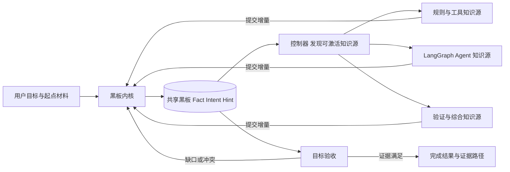

# 黑板架构设计与实施计划

日期：2026-10-22。状态：阶段 1 至 6 已完成。新 Run 默认使用 blackboard，保留显式 legacy 与回退入口；费用与累计 Token 额度不参与执行或验收，Token 仅记录实际用量。验证范围为源码下的 SQLite 与 PostgreSQL 16 API/Worker。

Work Harness 以共享黑板作为多知识源协作的中心。黑板只包含 **Fact、Intent、Hint**
三类对象；知识源读取已提交状态，提出增量，由黑板内核验证并提交。下一次激活由新的板面
决定，逐步从起点证据生长出满足目标的知识与成果。

当前默认运行引擎为 `blackboard-v8`；兼容旧引擎 `agent-subgraphs-v2` 仍可显式选择，见
[旧版多 Agent 实现](multi-agent-design.md)。黑板内核、有界并行控制图、产品入口与分布式
恢复已接通。具体实施与验证记录见第 13 节。

方案的核心决策如下：

- **共享知识只通过黑板交换。** Agent 私有消息留在各自子图中，协作依靠已提交对象及其版本。
- **推进由板面决定。** 控制器根据事实、目标缺口和提示选择知识源；知识源提交增量后重新匹配。
- **确认与探索分别表达。** Fact 必须经过相应验证，Hint 引导探索，Intent 记录尚待解决的问题。
- **知识图逐步生长。** 根 Intent 固定目标，起点 Fact 提供依据，新增对象保留来源与目标贡献关系。
- **分步交付。** 先完成可恢复的单机闭环，再增加并发和产品入口，之后验证分布式运行与默认切换。

实施时沿用现有黑板核心，按以下顺序补齐交付；具体任务与验收见第 13 节：

| 顺序 | 交付内容 | 当前状态 |
| --- | --- | --- |
| 阶段 1、2，步骤 3.1 至 3.7 | 三类对象、状态驱动协作、SQLite 恢复、有界并行与时间唤醒 | 已实现，并由 4.1 接入可选运行入口 |
| 3.8 → 3.9 | 提交与完成结算共同事务；区分目标进展和单纯对象变化 | 已完成 |
| 4.1 → 4.3 | 可选运行引擎、查询与事件、人工补充及取消接续 | 已完成 |
| 4.4 → 4.5 | 对象和目标视图、可追溯的知识关系图 | 已完成；第一版单机产品范围已接通 |
| 5.1 → 5.3 | PostgreSQL 黑板存储、租约事务校验、多 Worker 接管 | 已完成；API/Worker 可显式选择黑板引擎 |
| 6.1 → 6.4 | 历史兼容、真实任务对照、备份回退、默认切换 | 已完成；按不含费用的规则重判通过，默认切换与回退已验证 |

每项交付固定对象合同、代码落点和可观察的完成条件。按用户最新要求，本轮不开展单价补齐、
费用比较、成本优化或金额预算验收，也不以费用未知阻塞实施。累计 Token 额度同样取消；保留质量、用量完整性、单次输出长度、
调用次数、并发、时间限制和恢复要求；已有调用与用量账本继续保留。第 13 节的 6.4 已按
顺序完成，已完成阶段不重新列项或重复实施。

第 3 至 9 节定义对象、协作、提交与运行机制，第 10 节给出生长示例，第 11、12 节映射现有
代码和产品接口，第 13 节列出逐项实施与验收，第 14 节规定升级及回退。阶段状态与目标设计
分别描述，拟议能力不表示已经交付。

## 1 设计边界

第一版采用“一次 Run、一块黑板、一个根 Intent”。同一黑板内可有多个并行探索方向；
不同 Run 隔离。跨 Run 经验库在后续提供，导入经验默认作为 Hint，重新验证后才能形成 Fact。

系统遵循以下约束：

1. 板面对象类型严格限定为 Fact、Intent、Hint。关系和证据是对象字段；提交、调用、租约、
   费用和审批记录属于运行控制数据，不增加第四类板面对象。
2. Fact 必须具有与主张范围匹配的证据及确认方式。模型自报高置信度不能充当确认。
3. Intent 表达尚待解决的问题、方向或目标，可以被多个知识源接续，也可以动态细化。
4. Hint 提供经验、候选解释或策略，可引用待核验材料；它只能影响探索，不能直接证明目标成立。
5. 所有知识源通过同一读写协议协作，允许各自使用规则、工具、独立 LangGraph 子图或人工输入。
6. 控制器根据板面选择当前有意义的动作。完整业务路径随知识增长形成。
7. 对象历史、因果引用和提交结果可追溯；并发、恢复、取消都遵循同一提交边界。
8. 成功必须由根目标验收证据支持；无可运行知识源只说明当前无法继续。

“知识源”是能力单元，“Agent”是其中一种实现，“Worker 实例”是执行资源。知识源名称不与
`worker-01` 等成员身份绑定。已有文档中的“所有 Agent 共享同一内部逻辑”约束将调整为
“共享接入、权限和提交协议”，以支持本次要求的异构知识源。

## 2 总体结构与两种图



**控制图**承载读取、激活、执行、提交、评估和等待等运行机制，拓扑保持稳定。
**知识图**由三类对象及其关系组成，随每次提交生长。新增探索分支通常只新增对象和引用，
无需动态修改已编译的 LangGraph 拓扑。

控制器不预先规定“必须规划、再执行、再审查”。例如，已有足够证据时可以直接综合；出现
新冲突时可以激活验证；信息缺失时可以生成新的 Intent。某个知识源内部可以有固定步骤。

| 组成 | 责任 | 主要输入与输出 |
| --- | --- | --- |
| Blackboard Store | 保存对象版本、提交日志、当前投影和索引 | 一致快照、原子提交 |
| Blackboard Kernel | 校验类型、证据、引用、权限、并发前提及目标状态 | 提交提案 → 接受或拒绝回执 |
| Knowledge Source Registry | 注册能力、触发条件、适配器和版本 | 能力清单及可运行候选 |
| Controller | 选择候选、记录用量、限制并发、处理等待和终止 | 激活记录与运行状态 |
| Knowledge Sources | 读取上下文，提供观察、探索、验证或综合能力 | 黑板视图 → 增量提案 |
| Runtime | 托管执行、租约、检查点、取消和外部接口 | Run、执行记录、事件流 |

## 3 三类对象的合同

### 3.1 公共字段

| 字段 | 含义 |
| --- | --- |
| `id`、`kind`、`schema_version` | 稳定对象身份、三类类型判别、数据格式版本 |
| `board_id`、`revision` | 所属黑板、对象修订号 |
| `created_at`、`created_by` | 内核写入的时间和知识源身份 |
| `origin_activation_id` | 对应控制面的调用记录；初始化和人工输入另记来源 |
| `scope` | 适用对象、环境、时间、仓库版本等边界 |
| `topic`、`tags` | 检索和订阅路由提示 |
| `derived_from` | 产生本对象时实际参考的版本化输入，记录来源关系 |
| `links` | 对目标的贡献、细化、支持、反驳或替代等关系 |
| `content_digest` | 规范化内容摘要，用于完整性和精确去重 |

引用统一为 `{object_id, revision}`，并校验同一黑板及引用存在性。业务正文变化不能覆盖旧
版本。生命周期变化也追加修订并产生事件，以便重建指定时刻的板面。

`created_by`、版本、身份和验证回执由内核赋值，不能相信模型填写的身份或时间。
`scope` 是证据适用范围，不替代访问控制；第一版仍需保持已有部署权限边界。

### 3.2 Fact 已确认的事实

| 字段 | 用途 |
| --- | --- |
| `statement` | 单一、可核查的主张 |
| `claim_type` | 区分用户陈述、文件内容、工具观察、推导、评估与交付，限制证据能证明的范围 |
| `claim_key` | 同一对象、属性与范围的结构化键；可抽取时用于冲突检测 |
| `value` | 可选的结构化值 |
| `evidence` | 来源位置、内容摘要、工具调用或检查结果引用 |
| `verification` | 验证方法、验证器版本、结果、覆盖范围及事实前提 `premise_refs` |
| `valid_from`、`valid_until` | 适用时间；没有确定失效时间时允许为空 |
| `lifecycle` | `valid / contested / stale / superseded / expired / retracted` |

Fact 的含义是“在声明的范围与确认规则下成立”。它不承诺永远正确。旧事实失效时保留历史；
更正主张创建新的 Fact 并声明 `supersedes`，不直接改写旧主张。

当前验收只能使用 valid 且证明前提仍成立的 Fact。stale 表示前提变化后需要重新验证；
其它非 valid 状态在历史视图中可见，不再作为当前已确认事实计数。

确认规则按证据类型配置：

| 来源 | 可以确认的 Fact | 仍需验证的部分 |
| --- | --- | --- |
| 用户输入 | 用户提出某目标、约束，或用户提供了某项陈述 | 用户陈述所描述的外部世界是否属实 |
| 文件读取 | 指定摘要的文件在指定位置包含某内容 | 文件中的观点是否真实、是否仍适用 |
| 工具或测试 | 指定环境、版本、命令和结果所支持的观察 | 超出工具覆盖范围的推论 |
| 确定性推导 | 有效 Fact 加已注册规则得到的结论 | 前提未支持的外推 |
| 语义评估 | 指定评估者依据某规则给出某结论 | 不能只凭第二个模型同意就确认外部事实 |

普通知识源可以提出待提交的 Fact，但内核只有收到相应验证器的有效凭据才接受。不能验证的
主张由知识源显式提交为 Hint，或产生求证 Intent；内核不静默把一种对象改成另一种。

对交付文档，Fact 可以表述“指定摘要的文档已生成，且通过这些验收检查”。文档中的事实性
断言还需各自引用证据；“文件存在”不能证明“全文正确”。大正文作为不可变内容附件保存，
板上对象仅引用附件摘要和地址，附件不成为第四类知识节点。

### 3.3 Intent 待探索的方向

| 字段 | 用途 |
| --- | --- |
| `objective` | 希望回答的问题或达到的局部目标 |
| `root_intent_ref`、`parent_intent_ref` | 根目标和可选的细化来源 |
| `acceptance` | 类型化验收条件、约束和所需证据 |
| `priority` | 目标侧优先级，知识源只能提出调整建议 |
| `status` | `open / satisfied / blocked / abandoned` |
| `satisfied_by` | 满足条件的当前有效 Fact 引用 |
| `blockers` | 缺失输入、待解冲突或外部条件的引用与说明 |

根 Intent 的目标和验收条件由用户请求及系统模板建立。影响目标含义的歧义需要人工澄清；
知识源不能通过降低验收条件宣告完成。子 Intent 可按新信息动态提出，必须说明对根目标的
贡献，不以“必须由某 Agent 在第几步完成”定义自身。

验收条件采用有限的结构化操作，例如事实存在、字段约束、版本匹配、明确的检查通过及
用户指定的人工接受；禁止将模型生成的表达式直接作为代码执行。无法形式化的要求保留
语义评估及其证据边界，并将适用策略固定在 Run 创建时。

`running` 属于某次激活的状态，不属于 Intent。一个 open Intent 可以同时被多个知识源
从不同方向推进。`satisfied` 只能由内核验收计算；依赖失效后，运行中的 Intent 可以重新
变为 open。blocked 的前提变化时可重新激活，不能永久饿死。

子 Intent 可因方向不再适用而 abandoned，需记录原因；放弃局部方向不能删减根目标的
验收要求。根目标的实质变更或取消只能来自用户授权输入。

### 3.4 Hint 经验提示

| 字段 | 用途 |
| --- | --- |
| `suggestion` | 经验、候选解释、方法或核验建议 |
| `applies_when` | 适用条件和目标范围 |
| `rationale`、`source_refs` | 提示由来及相关信息 |
| `confidence` | 可选的自报可信度，仅供排序参考 |
| `expires_at` | 可选的过期条件 |
| `status` | `active / consumed / dismissed / expired` |

Hint 经验证后生成新的 Fact，并保留原 Hint 的引用。Hint 本身不改类型；不采纳提示也
需要可追踪的原因。Hint 必须说明提示的用途和适用条件，不能成为任意未验证文本的容器。
草稿正文保存在私有执行状态或受控附件中；需要其它知识源接续时，发布核验 Intent 或
带附件引用的 Hint，明确建议检查什么。

## 4 知识图如何从起点生长

初始化写入根 Intent、已确认的输入事实，以及可选的经验 Hint。根 Intent 是目标锚点；
`derived_from` 记录起点至新增对象的因果路径，`contributes_to` 指向所服务的目标。

关系存放在三类对象内部，图索引只是这些字段的投影：

| 关系 | 约束与用途 |
| --- | --- |
| `derived_from` | 指向已提交版本或同批可拓扑排序的新对象；形成产生关系 |
| `contributes_to` | 指向 Intent，说明工作与目标的关联 |
| `refines` | 子 Intent 指向父 Intent，禁止形成父子环 |
| `supports / contradicts` | 表达证据支持或冲突，不自动代表确认 |
| `supersedes` | 新 Fact 替代旧 Fact，保留旧版历史 |
| `satisfied_by` | Intent 的验收见证，必须指向有效 Fact |

`derived_from` 形成的产生关系必须可拓扑排序。同批新对象使用提交内临时引用，由内核
分配正式 ID、检查无环并原子写入；因此一批可以同时发布事实及由它引出的探索方向。
其它语义关系可以构成图，不能把所有关系都当作 DAG。

来源与证明前提分别记录：`derived_from` 说明为什么想到这件事，
`verification.premise_refs` 说明哪些有效 Fact 是结论成立的必要前提。只有后者与
`satisfied_by` 驱动事实失效传播；Hint 被消费或 Intent 改变状态，不应使独立验证过的
观察失效。

知识源有两种推进方式：根据已有事实发现新结论；根据目标缺口提出局部求证方向。两者都
要留下板面对象。仅增加 Hint 数量、改写相同内容或产生无关分支，不计为目标进展。

## 5 知识源接口与首批能力

知识源只获取与本次激活相关的不可变 BoardView。视图包含当前 Intent、相关事实、Hint、
必要的反证，以及这些内容的版本；完整正文按授权查询。摘要用于检索，验收必须回查原始
证据。知识源共享同一黑板，不等于每次向模型发送整张黑板。

拟议接口：

```text
KnowledgeSourceSpec
  id, version, input_topics, accepted_kinds, emitted_kinds
  activation_rule, allowed_tools, model_route, limits, adapter_type

match(board_view, change_set) -> ActivationCandidate[]
execute(activation_context, board_view) -> BlackboardDelta
```

当前实现中，知识源先返回私有 `KnowledgeOutput`，提供对象提案、状态变更请求和执行结果；
控制器补全读取版本、身份及幂等键后组成 `BlackboardDelta`。知识源不能自定控制器身份和提交版本。

`match` 首先执行确定性条件筛选，不能每次轮询所有 Agent 并调用模型询问是否想工作。
需要模型判断相关性时，用单独的计入执行次数的独立激活产生 Hint，不能藏在免费匹配函数里。

`BlackboardDelta` 是提交信封，包含新对象提案、合法状态变更请求、读取版本与谓词前提、
幂等键、证据和用量引用；它不存为第四类板面对象。知识源不能直接调用数据库写入接口，
也不能自行覆盖 Run 状态或将根目标标记成功。

| 能力 | 典型激活条件 | 可提交的内容 |
| --- | --- | --- |
| 输入与观察 | 新材料、需要获取可读证据的 Intent | 观察 Fact；无法满足时提出局部 Intent |
| 探索与推理 | open Intent 且存在相关事实或提示 | Hint、细化 Intent、有凭据的推导 Fact |
| 验证 | 有待验证 Hint、证据变化或可核验的冲突 | 检查 Fact、反证、进一步求证 Intent |
| 综合 | 某目标已有可用证据且尚缺交付物 | 候选文档的核验 Intent/Hint、带证据的交付 Fact |
| 经验匹配 | 出现适用主题或失败模式 | 具有适用范围的 Hint |
| 人工输入 | 存在明确缺失条件或需批准的动作 | 用户确认 Fact、约束修订、探索提示 |

这是能力清单，不是固定六步。首个可运行版本实现观察、探索、验证/综合三个适配器即可。
经验与人工接入复用同一协议。不同能力可以由同一个 Agent 承担，也可以采用完全不同的
LangGraph 内部状态和节点组织。

## 6 激活与调度机制

控制器以已提交的变化集为触发入口，并在恢复和进入静止态前做完整校准扫描，防止通知
丢失或订阅规则过窄漏掉可执行方向。

过期时间、重试时间和外部输入也可以唤醒控制器。时间条件记录为可恢复的控制元数据，
唤醒后先更新板面有效性；等待期间不通过反复调用模型维持活跃。

步骤 3.7 已实现 `timing.py` 与控制图的 `wait` 节点。每次评估和批次归并后保存下一次
生效、过期、重试或截止时间及原因，恢复入口根据当前板面和账本重新校准。等待节点绑定
原板面版本和唤醒时间；恢复时条件已经改变就立即重新评估。等待期间至多每秒读取一次
板面状态，以补偿取消或输入通知丢失，不运行知识源匹配或模型调用。单独的运行截止时间
不延长已经无法推进的任务；截止时间之后的条件不作为继续等待的依据。

每轮执行以下控制步骤：

1. 读取最新黑板快照和事件游标，更新因过期、撤销或反证产生的有效性变化。
2. 对根目标及受影响的 Intent 重新验收；满足结束条件时进入封板流程。
3. 根据对象类型、主题、目标缺口、读取前提和知识源能力生成候选激活。
4. 排除重复、权限不足、前提不成立、执行次数已达上限或仍在冷却中的候选。
5. 选择有限数量候选，持久化激活记录并预留资源，交给对应知识源执行。
6. 收集提案，经内核校验后原子提交，释放执行名额并记录用量；回到最新板面继续判断。
7. 无候选时区分可等待条件、需人工输入、无法推进和目标已完成，输出明确状态。

首版采用可解释的排序：先处理影响验收的冲突，再处理关键证据缺口，之后考虑根目标
优先级、候选等待时长及稳定 ID。并发按 Intent 分配配额，限制单一
分支长期占满资源。排序依据记录在控制面，不能由 Agent 自报的重要性无限加权。

配额与等待公平性分别控制：配额限制同一分支同时占用的名额；公平性为持续满足前提、
执行条件允许却连续未被选中的分支保留轮转机会。仅将等待时长放在优先级之后不能保证公平，
因此需要配置最大让行批次数，并持久化等待轮次及最近调度位置。达到让行上限时优先取得
一个可用名额，其余名额沿用上述排序；并发上限为 1 时同样执行这一规则。公平性只适用于
有限候选且资源允许的情况，不越过执行次数、权限、超时或事实有效性要求。

激活去重键包含：

```text
board_id + knowledge_source_id/version + intent_id/revision
+ effective_input_fingerprint + strategy_version
```

`effective_input_fingerprint` 取相关输入版本和查询前提，不使用全局 board revision，
避免无关提交使所有知识源再次执行。同一输入已成功或确认无进展时不会重复激活；临时
故障允许同一激活有界重试，重试不创建新的业务任务身份。新证据、输入或策略版本才会
打开新的探索机会。

精确去重使用规范化摘要和结构化目标键。语义相似只生成合并建议，不自动抹掉可能不同的
主张。限制每个 Intent 的新增分支数、同输入尝试次数及全局对象数量；达到上限时返回
仍未解决的缺口，不能用新 ID 无限绕开限制。

Token 用量是观测数据，不是派发额度。每次调用按 `activation_id + attempt + call_id`
记录输入、输出和缓存命中；缓存属于输入的一部分，总量只计算输入加输出。已知用量立即
持久化，提案被拒绝、重试、取消或租约失效不会删除用量；重复回执不重复累加。缺失或
不完整的响应用量显式标为未知，保留已知分量；可信完整回执可一次性补全同一记录。
汇总同时提供 `usage_complete`、未知调用数与未对账尝试数，不能用零伪装未知用量。

不预留或扣减 Token、金额额度，也不按额度排序。旧 `reserved_tokens/reserved_cost_usd`
汇总字段兼容返回零。`max_output_tokens` 仅限制单次输出，输入与先前调用不会减少它；
旧角色、请求与子任务的 `token_budget` 可读取为该字段，旧 Run 的累计额度字段仅保留为
历史元数据。设置页已移除累计 Token/金额额度；执行仍受次数、步数、并发及超时限制。

当前执行版本为 `blackboard-v8` / `agent-subgraphs-v2`。旧 Run 可查看，恢复仍要求原执行
版本与指纹匹配；不在升级时修改历史检查点、执行身份或冻结的评估报告。

## 7 提交、确认与冲突处理

### 7.1 提交事务

内核按以下顺序处理提案：

1. 检查当前 Run 执行租约、取消与封板状态、知识源身份和允许写入类型。
2. 检查幂等键；已提交返回原回执，相同键不同正文拒绝。
3. 校验三类对象 Schema、同板引用、目标关联、读取版本和查询前提。
4. 对 Fact 校验证据覆盖、来源完整性、验证凭据和当前前提有效性。
5. 计算冲突、失效传播和 Intent 状态变化；不允许降低根目标标准。
6. 在一个事务中保存对象修订、事件、当前投影、提交回执与调用结算记录。
7. 提交后发布唤醒通知；客户端和控制器按持久事件序号读取变化。

同一提案原子接受或拒绝，避免只发布一半证据。语义审查或模型调用在事务外完成；事务
内只验证它们的已登记回执、绑定版本及规则，不持有数据库锁等待模型。

步骤 3.8 已将对象、事件、提交回执、激活完成状态及可释放预留纳入共同事务。Memory 在
同一写锁内准备并发布两侧状态；SQLite 在同库事务中提交。待提交提案继续占用预留，完成
结算时释放已确定可释放部分；未知用量继续独立对账。该事务不包含独立文件中的 LangGraph
Checkpoint；旧版先提交、后结算留下的记录仍通过原回执恢复。

提案被拒绝、超时或取消，已发生的用量仍需记账。用量报告可独立提交到控制账本，以
`activation_id + attempt + call_id` 去重；板面回滚不能免除实际成本。一次逻辑激活的
不同重试调用分别计费，重放同一调用的回执不重复计费。

### 7.2 并发和过期读取

首个内存闭环以整个黑板版本作 CAS 校验。步骤 3.5 已完成对象与查询前提校验，控制器生成
的知识源提案使用 `concurrency=inputs`；初始化、刷新等宿主命令默认保留 `snapshot` 模式。
步骤 3.6 已实现“多个知识源并行计算、每块黑板由唯一持写入权的内核串行提交”。不同 Run 可以
分布在不同 Worker 上。

并发提交携带对象级 `read_set`，以及“尚无匹配 Fact”等查询前提。只验证已读对象版本
无法发现新增记录引起的前提变化，因此查询条件也必须在提交事务中重新求值。

当前合同只支持以下有限条件，不接受可执行表达式：

| 前提 | 事务内检查 |
| --- | --- |
| 对象读集 | 每个对象仍为读取时的版本；包括根目标和完整的已提供视图 |
| Fact 查询 | 指定主张键、类型及范围的有效 Fact 存在或不存在 |
| Hint 查询 | 指定主题的有效 Hint 存在或不存在 |
| 视图成员 | 按原分支、主题和类型条件重新选择，成员及版本与读取时一致 |
| 目标开放 | 根目标及当前 Intent 仍允许探索，且当前有效证据尚未满足验收 |

查询与激活复用同一视图选择逻辑，包含目标分支、根级公共证据和必要的证明前提。
知识源可读取整个提供给它的视图，因此视图内新增相关对象也会使旧提案失效；不属于该
视图的独立分支或主题可以共存。查询在事务中使用当前时间判断事实和提示有效性，时间
变化不依赖整板 revision 先发生改变。步骤 3.7 已加入持久定时唤醒。

内核先读取不可变验证凭据、历史引用和附件；进入 Memory 写锁或 SQLite 写事务后，
基于最新板面验证前提、应用增量、处理冲突与限额，再一起保存对象、事件和提交回执。
不会用计算开始时的整张板面覆盖新状态，也不持有事务等待模型或工具。

如果其它提交只改动无关对象，当前提案可通过校验；如果实际输入失效或目标已满足，则
拒绝过期部分对应的整个提案，重新匹配或有界重算。不能将旧证据强行标成新版本。
重算仍计入执行次数并记录用量，连续冲突会触发冷却或串行化该方向。

### 7.3 事实冲突与失效传播

同一 `claim_key`、重叠范围下出现不同值时，先检查时间和环境是否不同。真正相互排斥的
证据不能通过“后写覆盖前写”解决，也不能将自报置信度当成投票权。

存在两个已通过各自确认规则、但结论相斥的 Fact 时，将其标为 contested，并为冲突
产生去重的求证 Intent。Hint 提出怀疑时先记录提示并激活验证；仅凭一个无证据 Hint
不能撤销全部已有事实。

用于验收的事实发生撤回、过期或争议时，沿 `verification.premise_refs` 和 `satisfied_by`
计算依赖闭包。依赖它的结论标为 stale，暂不参与当前验收，相关 Intent 重新开放；具有
仍然有效的独立证明路径的结论可以保留。第一版采用单条证明链、保守失效和重新验证。

新 Fact 替代旧 Fact 后，旧证据路径仍可查。长时间无法解决的冲突保持可见，必要时要求
用户补充信息；不能为了完成目标自动选择一个说法。

## 8 LangGraph 的职责与实现方式

Root Graph 拟采用稳定的机制循环：

```text
bootstrap_or_reconcile
  → assess_and_match
  → dispatch_selected
  → knowledge_source subgraphs / adapters
  → commit_and_reconcile
  → assess_and_match

assess_and_match → wait_for_input / finish / stop_with_gaps
```

这里的循环是执行机制。具体选中哪些知识源、运行多少次、产生哪些分支，由板面决定。
`bootstrap` 只建立起点和根目标；完整任务计划不作为必经节点。

注册的 LangGraph 知识源在构图时接入为可发现子图，派发时用 `Send` 传入本次激活和相关
BoardView。内部 Schema 不同时使用输入输出适配层。LangGraph 的条件边和 `Send` 支持
按运行时输入决定分发对象，见[Graph API 文档](https://docs.langchain.com/oss/python/langgraph/graph-api#send)。

各子图采用每次调用隔离的状态，继承父检查点，以便并行和调用内恢复；共享知识经黑板
提交，私有消息保留在子图检查点中。此方式对应
[子图持久化文档](https://docs.langchain.com/oss/python/langgraph/use-subgraphs#subgraph-persistence)。

当前实现通过 `workflow/blackboard_runner.py` 的 `BlackboardRunner.run()` 进入或恢复
控制图。恢复前先核对持久记录，再进入已保存的子图执行位置；仅在 Root Graph 的起点增加
节点无法覆盖直接从子图检查点恢复的情况。板面提交与激活完成已共同落账；旧记录通过幂等
回执补齐结算，独立的 Checkpoint 文件也经对账接续，不构成跨文件的原子事务。

Root Graph 只保存 `board_id`、已观察事件序号、激活引用、待提交提案引用和控制状态。
完整黑板不反复复制到 reducer。待提交内容由子图检查点或受控提案存储持久化，归并依据
稳定激活 ID；reducer 合并完成通知不等于事实已被接受。

第一版并发使用有界批次：一批知识源执行完成后归并提交，再匹配下一批。LangGraph 以
super-step 推进，不能把 `Send` 描述成任意完成顺序的独立事件总线；该执行边界见
[图执行机制](https://docs.langchain.com/oss/python/langgraph/graph-api#graphs)。慢知识源通过
独立超时和小批次控制影响。以后若要求完成一个便立即触发下游，可将激活托管到独立任务
队列并经黑板事件唤醒控制器，这是另一个实施阶段。

知识源输出正常业务错误时形成执行回执并保留用量，不让一个探索方向的失败自动判定
整个目标失败。基础设施崩溃继续通过 Checkpoint 和运行队列恢复。

## 9 存储、恢复及运行终态

### 9.1 状态归属

| 数据 | 唯一权威来源 | 其它存储的作用 |
| --- | --- | --- |
| 三类对象、有效性和目标验收 | Blackboard Store | UI、检索和图索引是投影 |
| 激活、提交回执及用量账本 | 黑板侧控制表 | Checkpoint 保存引用 |
| 执行位置、私有消息、工具游标 | LangGraph Checkpointer | 用于续跑，不覆盖已提交板面 |
| Run 接纳、队列、租约、取消 | 现有 RunStore / ReliableRunStore | Run 状态按提交结果对账 |
| Provider、Prompt、设置 | 现有配置及配置存储 | 固定本次运行的有效版本 |

LangGraph 将线程检查点与图外应用数据存储区分，见
[持久化文档](https://docs.langchain.com/oss/python/langgraph/persistence)。本项目选择独立
Blackboard Store 是为满足原子提交、版本校验和事件重放；通用 Store 不自动提供这些合同。

第一版后端为 Memory 和 SQLite；5.1 已增加 PostgreSQL 存储合同，分布式运行仍待联通。
单机黑板对象、提交回执、
事件和执行控制表放在同一 SQLite 数据库中；与 Checkpoint 文件之间通过幂等提交对账。
SQLite 模式限定单进程托管，通过独占运行锁防止重复启动；黑板控制表保存本地写入代次及
取消屏障，并在提交事务内校验。取消先阻止黑板写入，再对账 Run Index；崩溃恢复时先
核对两边状态，不能在尚未核对取消结果时启动知识源。
PostgreSQL 黑板表已由迁移命令安装到 RunStore 数据库。5.2 已在提交事务内锁定 Job 和
Run，验证租约身份、数据库时间、取消及封板状态。队列托管的黑板使用固定租约的存储
句柄，事务前查询只用于提前报错，不能授权发布；5.3 已联通分布式运行入口并完成故障验证。

拟议存储结构：

```text
boards                      根目标引用、最新事件序号、封板版本
board_object_revisions      三类对象的不可变修订历史
board_objects_current       当前版本和可检索投影
board_events                追加事件、持久游标与回放
board_commits               幂等提交键、正文摘要和结果回执
board_activations           激活去重、尝试次数、状态和执行名额
board_activation_attempts   各次尝试的输入、私有提案、期限与结果
board_usage                 按激活、尝试和调用去重的实际用量
board_verification_receipts 验证器签发的确认结果及其主张绑定
board_contents             按黑板隔离、以摘要寻址的不可变附件
board_control              写入代次、取消屏障、恢复与唤醒状态
```

以上是逻辑存储划分；具体建表可合并字段，但验证凭据、待提交提案、未知用量预留和运行
期限都必须可恢复。不能只保存三类对象，而在重启后丢失它们的确认依据或重置执行计数。

边索引从对象字段生成。证据与大内容以摘要引用受控附件；附件访问随所属 Run 的权限约束。
首版保留所有运行内事件，后续压缩须保留可恢复快照与其后的日志。备份同时覆盖黑板、附件
和检查点，保留引用一致性；敏感私有消息不放到公共板面或默认 SSE 中。

### 9.2 崩溃窗口

| 退出位置 | 恢复行为 |
| --- | --- |
| 激活已登记、尚未开始计算 | 复用激活身份，从检查点恢复或有界重试 |
| 子图已生成提案、黑板未提交 | 读取持久提案，重新检查前提并提交 |
| 黑板已提交、父图检查点未更新 | 相同幂等键返回原回执；从最新板面继续 |
| 事件已持久化、通知未发出 | 按序号补读；周期校准发现遗漏 |
| 执行者租约被接管 | 旧 token 的提交被拒绝，新执行者按账本和检查点恢复 |
| 外部工具已完成、记录尚未持久化 | 可能重试；工具必须自行支持业务幂等或结果对账 |

运行语义是至少一次执行、幂等提交，不承诺任意外部副作用恰好一次。工具授权绑定具体
操作与参数；板上的 Hint、Prompt 文本或其它知识源输出不能扩大权限。现有只读工具可
优先接入，新增写工具时必须同时设计审批、幂等和取消后的结果对账。

每次知识源调用固定 `activation_id`、`attempt`、知识源版本、输入版本和写入代次；恢复时
从持久记录取回这些身份，不能在发布时临时读取“最新尝试”来替换旧调用的归属。接管后的
恢复由新控制器重新校验提案前提并提交；旧调用不能借用新控制器的写入资格。检查点记录
执行位置，提交回执证明板面是否已接受结果，两者不一致时先对账，再决定续跑或重算。
LangGraph 的节点恢复可能重新执行节点函数，因此提交和外部操作需明确幂等边界，见
[节点重执行说明](https://docs.langchain.com/oss/python/langgraph/graph-api#re-execution-and-idempotency)。

人工信息先经 API 转为受验证的板面提交，再唤醒控制器；LangGraph `interrupt` 负责执行
暂停。批准某操作只确认用户授权该操作，不代表相应业务结论已被证实。

人工提交通过同一个内核执行：等待状态下 API 获取短期板面写入权，活跃运行中交由当前
控制器接纳。补充输入与待唤醒标记原子保存，扫描器补偿“补充已提交但恢复通知未送达”的
窗口；不能让 API 与 Worker 同时无租约写入。

### 9.3 完成与停止

成功要求同时满足：根 Intent 当前验收通过；所用事实有效且覆盖目标范围；目标相关的
阻塞冲突已解决；交付物存在并绑定证据；没有可能继续修改这些结果的有效执行权。

进入完成时停止派发、撤销或收拢未完成激活，再在提交事务中复核目标并封板，记录
`finalized_at_revision`。封板后拒绝晚到写入，最终输出引用该快照。完成后新增目标或更新
证据创建后续 Run，历史成功表示“在该快照与验收标准下完成”。

| 情况 | Run 状态与原因 |
| --- | --- |
| 目标满足且已封板 | `succeeded` |
| 缺少明确人工输入或批准 | `waiting_human`，列出待解 Intent |
| 暂时性错误，仍有重试次数 | `running`，有界退避 |
| 没有可行候选，或执行次数/时间达到上限但已有可用成果 | `partial`，附 `blocked / budget / timeout` 等原因 |
| 无可用成果且无法推进，或不可恢复系统错误 | `failed`，附具体原因 |
| 用户取消 | `cancelled`，废止执行权并保留已有板面 |

终止原因是运行元数据，不另建一种板面对象。第一版沿用已有 RunStatus 枚举，避免将
`blocked` 同时当成新的 Run 终态；Intent 仍可以有 blocked 状态。

无进展判定结合有效新证据、验收缺口变化、冲突消解和候选输入指纹。单次失败或一轮没有
新 Fact 不代表死局：有效的新 Intent 或验证 Hint 仍可能打开路径。达到配置的无进展
尝试上限后，输出缺口及已尝试方向，禁止无限互相生成提示。

步骤 3.9 已通过 `progress.py` 区分知识变更与目标进展。首次覆盖相关证据要求、关闭根目标
验收缺口，或用有效证据消解冲突，计为目标进展并重置无进展计数。相关性依据根验收条件
及注册知识源声明的 `required_facts`；首版不通过模型推测任意文字与目标的关系。

结构化证据要求、验收条件和冲突消解按 Run 记录已计入的键。相同主张换对象 ID、描述或
额外范围字段，不能再次获得同一份进展；撤回再恢复同一证据也不能反复重置计数。提示的
建议文字、子 Intent 的 ID 和验收描述不参与方向身份；方向由知识源及策略版本、目标的
结构化要求、声明的输入值和激活条件确定。

新 Intent 或 Hint 只有打开此前不存在、满足声明激活条件且与目标相关的求证方向，才
使用一次探索机会。本轮不增加无进展计数，也不清空此前计数。`max_explorations` 默认 4，
在 Run 创建时固定；分支、进展或重启均不补充额度。无关变化、重复方向或额度耗尽后的
探索增加无进展计数。匹配仍沿用原激活身份和调度规则，进展摘要只负责判定与解释。

进展摘要、剩余额度和单次判定理由与接受提案的结算共同保存。恢复旧提交回执时比较该次
提交前后的历史快照，重复对账不重复计入；较旧回执不会覆盖较新的进展视图。停止结果保存
未满足条件与已尝试方向，人工等待的返回内容也包含这些信息。

## 10 一次运行的生长示例

示例目标：解释某接口在指定环境中的延迟来源，并给出有证据支持的优化建议。以下是一种
可能出现的轨迹，不作为运行模板。

| 板面变化 | 此时被激活的能力 | 新增内容 |
| --- | --- | --- |
| I0 根目标；F0 用户提供了指定日志和代码版本 | 观察 | F1 该日志中一段数据库调用耗时占比较高 |
| F1 与 I0 同时存在 | 探索 | H1 可能存在重复查询；I1 核查查询次数与参数 |
| I1、H1 和可读代码存在 | 代码分析与记录检查并行 | F2 请求路径执行多次查询；F3 多次查询参数相同 |
| F2、F3 支持 H1 的部分内容 | 探索 | H2 可以尝试批量查询；I2 验证返回结果及延迟变化 |
| I2 具备授权测试环境 | 工具验证 | F4 指定测试样本中结果一致且延迟下降，附范围 |
| F1 至 F4 覆盖解释与验证要求 | 综合 | H3 建议核验候选文档，附草稿和证据引用 |
| H3 可按 I0 验收检查 | 验证 | F5 指定文档通过验收；I0 的 satisfied_by 指向 F5 及支撑事实 |

如果 F3 发现参数实际不同，H1 的解释需要收窄，系统会形成新的探索方向；如果没有可用
测试环境，I2 会 blocked，并明确请求相应条件。此前有效观察继续保留。

由此产生的知识图能够说明：从哪些起点出发、为什么探索某方向、什么证据推翻了假设、
最终哪些事实满足了目标。知识源之间不需要预先约定下一位接收者。

## 11 对现有项目的改造映射

| 当前模块或概念 | 黑板方案中的变化 |
| --- | --- |
| `workflow/graph.py` 固定阶段根图 | 保留为旧引擎；新增黑板控制图并按运行版本选择 |
| `workflow/state.py` 中完整计划、产物和复核列表 | 新引擎保存黑板和激活引用；三类知识在 Blackboard Store |
| `workflow/routing.py` 的任务依赖派发 | 按订阅、前提、目标缺口及去重规则生成激活 |
| `Plan / SubtaskSpec` | 可作为某知识源的私有推理内容；共享探索方向转换为 Intent |
| `Artifact` | 经确认的观察或交付可为 Fact；草稿留在附件，并用 Intent/Hint 指明核验方向 |
| `Review` | 已核查结果为 Fact；疑点和建议为 Hint；新增求证方向为 Intent |
| `Judge / RepairPlan` | 验收内核、冲突处理和沿证据依赖的失效传播 |
| `WorkerAgent / ReviewAgent` | 包装为知识源或拆出可复用子图，允许其它内部实现 |
| `AgentServices` | 复用网关、工具限制、Prompt、Skill 和用量记录 |
| `RunManager`、队列、租约、取消 | 保留生命周期管理，增加板面提交 fencing 和状态对账 |
| `RunResult`、SSE、前端详情 | 增加黑板摘要、引用、持久事件与目标进展视图 |

现有核心目录与后续扩展落点：

```text
src/work_harness/blackboard/
  models.py           Fact / Intent / Hint / ObjectRef
  protocol.py         Delta / CommitReceipt / 查询前提与写入合同
  kernel.py           提交与状态更新
  verification.py     证据确认策略
  goals.py            目标验收
  progress.py         结构化进展比较与有界探索额度
  activation.py       相关视图、条件匹配与稳定激活身份
  queries.py          视图选择与事务内读取前提校验
  controller.py       评估、派发、归并、等待与终止
  execution.py        批次选择、执行限制、用量和激活账本
  timing.py           生效、过期、重试与截止唤醒
  control.py          写入权、取消屏障与封板规则
  projections.py      冲突、依赖失效与目标状态投影
  store.py            BlackboardStore 接口
src/work_harness/knowledge_sources/
  base.py             知识源合同、BoardView 与私有输出
  registry.py         注册与版本
  execution.py        单次调用身份、发布与用量边界
  adapters/           规则、观察、验证与 Agent 子图
src/work_harness/workflow/
  blackboard_graph.py  黑板控制循环
  blackboard_state.py  引用与运行状态
  blackboard_runner.py 检查点核对与恢复入口
src/work_harness/storage/
  blackboard_memory.py           内存板面存储
  blackboard_sqlite.py           SQLite 对象、事件与提交事务
  blackboard_execution_sqlite.py SQLite 激活、用量与验证凭据
  blackboard_lock.py             单进程托管锁
  blackboard_postgres.py         已实现的 PostgreSQL 共享存储
```

阶段 4 在现有 `runtime.py`、`service.py`、`api/app.py`、配置和前端目录接入上述核心。
人工输入经过 API 与内核转换为受验证提交；不要求它拥有和 Agent 相同的私有执行图。

`config/runtime.yaml` 的 `workflow.engine=legacy|blackboard` 为迁移开关，默认 `blackboard`，
也可用 `WORK_HARNESS_WORKFLOW_ENGINE` 设置。Run 创建时固定；已经创建的 Run
不能靠切换全局配置变成另一种引擎。板面 Schema 版本、控制图 revision 和知识源版本
分别管理，执行指纹包含有效 Prompt、确认策略、调度策略和知识源注册配置。

4.1 已在 Memory/SQLite 的嵌入式服务接通 `POST /v1/runs` 的 `engine` 选项和基础结果查询。
请求用 `blackboard.acceptance` 明确根目标验收条件，服务不让模型替用户改写条件。原始输入
与版本索引共同持久化，初次 Checkpoint 前中断也能恢复；输入在板上作为带附件的 Hint，
不自动当作已核验事实。新旧 Run 根据各自版本恢复。配置或 Prompt 不兼容时保留运行状态，
恢复匹配配置后再执行；完成历史可继续读取，不要求重新装配原知识源。

首批产品知识源包括独立 Worker Agent 草稿子图和保存内容验证器。`draft.content` 的
`delivery` Fact 只证明附件非空、摘要和长度正确且可读取，确认范围为
`verification=stored_content_only`，检查名为 `content_stored`。它不证明内容真实性、质量或
外部任务已完成；需要这些证据的目标保持未满足。`workflow.blackboard.agent_roles` 配置默认
Agent；请求也可选择成员和每个成员的单一功能。多个功能的单成员映射尚不支持。
阶段 5 已接通 PostgreSQL 黑板执行；6.4 后 API/Worker 新请求也默认使用黑板，旧引擎可显式选择。

例如，明确只要求保存候选草稿的请求为：

```json
{
  "engine": "blackboard",
  "goal": "起草项目说明并保存候选草稿",
  "blackboard": {
    "topic": "document",
    "acceptance": [{
      "id": "saved-draft",
      "description": "候选草稿已保存且可读取，不证明内容准确性",
      "claim_key": "draft.content",
      "claim_type": "delivery",
      "scope": {"verification": "stored_content_only"},
      "required_checks": ["content_stored"]
    }]
  }
}
```

`workflow.blackboard.path` 或 `WORK_HARNESS_BLACKBOARD_PATH` 指定单机黑板文件。
知识源配置、执行限制、Prompt 和策略改变后需重建运行环境；当前版本不自动载入历史配置。
基础取消会先封板再停止执行。4.2 已接通事件续读和详细对象查询，4.3 已接通类型化人工
输入、持久暂停及唤醒补偿；4.4、4.5 已接通对象、目标与知识关系图视图。

## 12 API 与界面计划

保持现有提交、查询、取消、恢复入口，按版本增加以下能力：

- 查询板面快照，返回 revision、三类对象计数、根目标状态和分页游标。
- 按类型、状态、Intent 和主题检索对象；所有分页绑定同一板面快照。
- 查询对象修订、证据与因果路径。
- 按事件序号获取增量；SSE 使用持久事件 ID 断线续读，日志被压缩时明确要求重新取快照。
- 提交人工信息或授权，带请求幂等键和预期版本，由内核校验；不开放任意数据库式更新。

路由如下，沿用现有 `/v1/runs` 的 Run 边界。运行入口、读取、类型化输入与单机恢复对账
均已实现；分布式联通仍按阶段 5 实施。

| 接口 | 输入与返回重点 |
| --- | --- |
| `POST /v1/runs` | 显式选择黑板引擎；建立根 Intent、验收条件和起点材料，固定本次引擎版本 |
| `GET /v1/runs/{run_id}/blackboard` | 快照版本、根目标、对象计数与缺口摘要 |
| `GET /v1/runs/{run_id}/blackboard/objects` | 按类型、主题、状态和目标筛选；分页游标固定快照版本 |
| `GET /v1/runs/{run_id}/blackboard/objects/{object_id}` | 当前对象或指定修订；返回证据与关系引用 |
| `GET /v1/runs/{run_id}/blackboard/objects/{object_id}/revisions` | 修订历史和对应事件 |
| `GET /v1/runs/{run_id}/blackboard/events` | 按持久游标分批读取事件、返回当前高水位和是否还有下一批 |
| `GET /v1/runs/{run_id}/blackboard/content/{digest}` | 只读取指定快照中已提交对象引用的附件，保留原始文本字节 |
| `GET /v1/runs/{run_id}/events` | 复用 SSE 入口；黑板运行按持久事件 ID 续读，事件包含类型和对象引用 |
| `POST /v1/runs/{run_id}/inputs` | 类型化人工补充、明确的目标修订或操作授权；返回提交回执与唤醒状态 |
| 现有 `resume` 与取消接口 | 恢复前先对账；取消先废止写入权，再更新 Run 状态 |

4.2 的查询实现位于 `blackboard/query.py` 和 `api/blackboard.py`，由 `api/app.py`
接入现有认证和 Run 边界；Memory/SQLite 提供事务内的有界事件与历史读取。
`GET /v1/runs` 的摘要包含 `engine` 和 `execution`；没有版本元数据的历史 Run 仍返回
`execution=null`。响应模型由 OpenAPI 发布。

快照返回 `revision`、`counts`、`root_intent`、`goal`、`evaluated_at`、`finalization`、
`objects_cursor` 和 `event_cursor`。先读取快照，再用 `objects_cursor` 读取该版本全部对象，
最后从 `event_cursor` 订阅后续提交。需要筛选时，首个对象请求带 `at_revision` 和
`kind/status/topic/intent_id`；之后只需传 `next_cursor`，筛选条件与板面版本随游标固定。
显式传入与游标冲突的条件返回 422。分页上限为 200，按对象 ID 排序；Intent 筛选包含
该 Intent、其后代及贡献给这些目标的对象。状态筛选采用已提交的生命周期字段。

对象详情中的 `object_revision` 指对象修订，`at_revision` 指板面版本，两者分别约束。
详情与历史均返回对象和对应提交事件，证据及因果引用保留原对象修订号；历史分页固定
板面版本。附件可用相应事件的 `sequence` 作为 `at_revision` 回看，未被该快照引用的
预存材料返回 404。4.5 为对象详情增加可空的 `activation` 摘要，只返回该对象修订关联的
激活身份、知识源版本、匹配理由和输入对象引用；宿主修订可回溯对象产生时的激活。读取范围
限于所属 Run 且激活早于该修订的提交，缺少记录时返回空，不以当前配置推测历史理由。
私有输出、调用状态、Prompt、模型消息和完整执行视图均不包含在此摘要中。
最新未封板目标按读取时间评估；指定历史版本按提交时间评估，封板后
按封板时间评估，后续事实过期不会改写已保存的终态。

黑板 SSE 的事件名为 `blackboard`，`data` 是已提交的 `BoardEvent`，`id` 是绑定黑板与
持久序号的不透明游标。客户端可通过 `Last-Event-ID` 或 `after` 续读；两者同时提供时
必须一致。游标跨 Run 或格式错误返回 422，超前于持久日志返回 409。日志缺失时在建立
流前返回 410 与 `snapshot_required`；已建立的流发送同名事件和快照地址后关闭，不推进
事件 ID。此版本保留全部日志，缺口处理不代表已经实现日志压缩。

SSE 从持久存储补读，并通过轮询补偿通知丢失；心跳不分配事件 ID。封板后排空事件再
关闭，进入等待等非运行状态时也排空当前提交后关闭，人工接续后重新订阅。首次创建
黑板前，普通查询返回 409 `blackboard_not_initialized`，无历史游标的 SSE 可等待首个
提交。所有公共读取仅访问黑板存储，不读取私有子图消息、检查点或激活输出。

4.3 的输入合同位于 `blackboard/inputs.py`。`POST /v1/runs/{run_id}/inputs` 要求
`idempotency_key`、`expected_revision`、当前 Intent 的 `target` 引用和类型化 `command`：

- `add_information` 保存补充文字及原始请求附件为 Hint，不自动确认外部主张。
- `confirm_statement` 接受 `claim_key`、`statement`、`value` 和可选 `scope`；宿主固定
  `claim_type=user_statement`、`confirmation=user_statement` 和 `user_confirmed` 检查。
  它证明用户明确确认了这项陈述，不能满足要求文件读取或外部工具核验的验收条件。
- `revise_goal` 仅作用于根 Intent，要求完整的新 `objective`、`acceptance` 和 `reason`。
  内核核对用户权限和当前修订，保留目标历史与事件；恢复仍核对最初接纳的目标版本，
  后续执行和结果读取使用当前目标。知识源不能自行降低根目标的验收条件。
- `authorize_operation` 记录 `tool_name`、完整 `arguments`、明确的 `approved` 和
  `expires_at`。授权 Fact 的类型仍为 `user_statement`，主张键为
  `operation.authorization`，绑定参数摘要、Intent 修订及内容摘要；批准与拒绝分别记录
  `operation_authorized`、`operation_denied`。授权不证明操作已执行，也不会自动执行操作
  或扩大现有工具权限；写工具的执行、幂等和对账仍必须遵守第 9.2 节。

输入返回已提交的 `receipt` 和 `wakeup`。同一幂等键与同一请求返回原回执，即使板面已经
继续推进或封板；同键不同内容、过期的预期版本或对象引用返回 409。请求不能自带 Fact
验证凭据。新输入在封板后被拒绝，新增目标或证据需创建后续 Run。

当仍缺少 `user_statement` 验收条件，或存在明确 blocked Intent 且当前没有可推进的
知识源时，控制图进入 `human` 节点并由 LangGraph `interrupt` 持久暂停，运行结果的
`pending_intents` 列出待处理引用。暂停不调用模型。输入提交后重新匹配板面；原运行的
执行计数、调用账本、起始时间和截止时间保留。`POST /resume` 的黑板请求为
`{"engine":"blackboard"}`，只补偿已提交输入的接续，不接受旧引擎的布尔批准作为 Fact。

等待态的 API 在 Run 租约下短期取得板面写入权，完成后立即撤销该代次；活跃态由当前
控制器使用原写入权接纳。输入、提交回执、事件和 `wakeup_revision` 共同提交；只有暂停
检查点已保存且覆盖该输入时才清除标记。队列已满时输入仍可接纳，返回 `pending` 并保留
标记，由扫描器或显式 resume 接续。取消及其他封板同时留下 `status_pending`，Run Index
同步成功后才清除，重启可补偿“已经封板但索引仍显示等待”的窗口。两个标记均为控制
元数据，不增加板面对象类型。控制图 revision 为 `blackboard-v7`，SQLite Schema 为 9；
升级前须用原版本结束活动的旧黑板运行，当前不自动迁移旧控制图的活动执行合同。

创建根 Intent 时，普通自由文本先按任务模板生成明确的验收条件；影响目标含义的歧义
进入一次必要澄清。人工输入入口只接受预定义命令，不接受客户端自行指定 Fact 验证状态。
本阶段增加显式选择新引擎的入口，默认引擎切换留到阶段 6。

前端保留聊天入口，增加三个关联视图：三类对象列表、目标缺口与状态、从起点生长的知识
关系图。选中节点可以查看来源、版本、证据、引出的方向及最近一次激活理由。

界面区分“已确认”“待探索”“经验/假设”，不能把 Hint 渲染为已完成成果。运行详情展示
因何继续、因何停下以及已记录用量。执行日志和私有模型消息不混入知识节点。

历史 Run 继续显示旧任务、产物和复核。兼容字段可以保留为空或标明不可用，不能为了旧 UI
伪造黑板运行不存在的 Plan 或 Review。

## 13 分阶段实施与验收

各阶段按验收条件推进。阶段 0 至 6 已完成；以下保留各步的交付与验证记录。
这些记录中的额度预留、累计 Token 门槛与测试数量描述当时版本；当前记账规则以第 6 节为准，
不重新列计划或将历史模型报告当作本次重构后的真实模型复测。

阶段 1 实现位于 `src/work_harness/blackboard/` 与
`src/work_harness/storage/blackboard_memory.py`，包含三类对象、提交合同、受信任验证凭据、
内存原子存储、目标验收与基础冲突处理；已导出五份 `blackboard_*.schema.json`。
阶段 1 完成时，`tests/test_blackboard_kernel.py` 的 34 项测试通过，后端回归共 152 项通过、
8 项 PostgreSQL 测试按现有环境跳过；这些数字保留为阶段 1 的历史基线。

阶段 2 增加 `knowledge_sources/` 的注册、规则/观察/验证/Agent 适配器，
`blackboard/activation.py` 的视图匹配与稳定激活身份，`blackboard/execution.py` 的预算和
用量账本，以及 `workflow/blackboard_graph.py` 的串行控制图。黑板变化决定调用顺序，
全局 Plan 不参与控制；现有 Worker 子图通过本次激活的私有输入适配接入。
候选文档保存在按黑板隔离的内容存储中，板上只发布带附件引用的 Hint。提交前保留实际
用量，拒绝提案仍计费；重复调用回执不重复计费，未知用量保留预算预留。

阶段 2 完成时，35 项内核测试与 20 项控制器测试通过，覆盖不同起点的不同路径、动态子 Intent、
重复提示、预算拒绝、独立分支失败、重试、超时以及真实 Worker 子图与 Mock Provider 的接入。
最近一次全后端回归为 172 项通过、8 项 PostgreSQL 测试跳过，随后新增的动态分支测试也通过。
已补充知识源与 BoardView Schema。阶段 2 的运行、验证凭据、附件和激活账本使用内存存储；
生产入口仍使用旧引擎。

步骤 3.1 新增 `storage/blackboard_sqlite.py`，对象修订、当前投影、事件和幂等回执在同一
事务中提交，附件按黑板隔离持久化。两种存储均支持按板面版本读取历史快照，拒绝覆盖既有
对象修订或漏记变更事件。附件正文保留首尾空白，确保内容与摘要一致。
步骤 3.1 完成时，103 项黑板相关测试通过，包含内存与 SQLite 的共同内核合同、数据库重开、
跨连接竞争、失败事务回滚及取消存储调用后的连接收尾。

步骤 3.2 新增 `storage/blackboard_execution_sqlite.py`，将验证凭据、各次激活尝试、私有
提案和用量保存到同一黑板数据库。`blackboard/execution.py` 提供两种存储共用的记账规则，
保留各次尝试历史；超预算用量先落账再报错，晚到用量仍归属原尝试，重复回执不重复计费。
未知用量保留预算预留，可信对账完成后才能释放。控制器从账本读取固定的运行期限与预算，
候选等待顺序和无进展计数也可恢复。

步骤 3.2 将 SQLite 黑板 Schema 升至 2，通过增量建表兼容版本 1。当时 122 项黑板相关测试通过，
包含重开数据库后提交原有提案、确认凭据绑定、重试历史与未知预留保留、截止时间不重置、
跨连接预算竞争及结算失败原子回滚。

步骤 3.3 增加 `blackboard/control.py` 与 `storage/blackboard_lock.py`。同一 SQLite 数据库
由一个进程独占托管，同进程连接共享锁；写入代次、取消屏障和封板状态在提交事务内校验。
取消或封板撤销写入资格，旧执行者与晚到提案不能改变板面；已经发生的调用用量仍可补记。
成功封板在事务内重新检查目标，最终输出和见证绑定 `finalized_at_revision`；等待人工输入
保持未封板。步骤 3.3 将 SQLite Schema 升至 3，并支持从版本 1、2 升级。

步骤 3.3 完成时通过 145 项黑板相关测试，覆盖内存与 SQLite 合同、事务内写入权竞争、封板回滚、
取消期间晚到结果、终态历史快照，以及 Linux 子进程独占锁和进程退出后的接管。
Windows 运行锁、PostgreSQL 黑板和真实 Provider 尚未通过本阶段验收。

步骤 3.4 增加 `workflow/blackboard_runner.py`，启动时核对运行版本、知识源合同、线程、
激活尝试、私有提案和提交回执，再恢复控制图或子图。已登记但尚未执行的激活沿用原尝试；
已有提案重新校验后提交；已有提交回执只补齐账本。已封板运行可对账账本并读取原最终快照，
不重新执行知识源。缺少可用检查点或原尝试已超时的调用，保留历史和未知用量，执行有界重试。

调用、发布与完成通知均绑定明确的激活 ID 和尝试号。执行实例固定写入代次，SQLite 在
激活、发布和完成事务内校验资格；旧实例不能借用新实例的 token。Agent 发起模型请求前
登记未决调用，实际用量回执与未决标记的清除一起提交。已知用量限制恢复后的剩余额度；
没有回执的请求不在原尝试中直接重发，按原重试上限和预算决定是否另启尝试，未知预留只有
可信对账才能释放。已写入检查点的工具步骤在兼容的调用恢复中复用。

步骤 3.4 将 SQLite Schema 升至 4，支持从 1、2、3 升级。旧记录未保存执行起始标记时，按可能已经
执行处理，不能假定为免费且尚未开始的调用。当时控制图 revision 升为 `blackboard-v2`，不自动
恢复 `blackboard-v1` 的活动检查点；旧记录的可读性与活动检查点兼容是不同边界。

步骤 3.4 完成时 160 项黑板相关测试通过，新增三个持久化崩溃窗口、封板后的账本对账、尝试隔离、
检查点缺失与过期、版本/线程不匹配、取消恢复、v3 数据升级和用量回执事务回滚测试。使用 SQLite Checkpoint
与 Mock Provider 验证 Worker 子图恢复：已完成工具执行一次，未知模型请求不直接重发。
产品 `RunManager` 入口已由 4.1 接通；本步完成可恢复的串行内核。

步骤 3.5 增加 `blackboard/queries.py` 与有限查询前提合同。控制器从持久的知识源合同及
输入视图生成前提，源输出不能删减这些条件；读集补齐根目标，激活指纹仍不使用全局板面
版本。提交接口改为在存储事务内执行宿主的纯状态变换，因此独立结果可以在最新板面合并，
新冲突、目标满足、对象限额及过期条件也在同一提交边界判断。原整板 CAS 模式仍可显式使用。

步骤 3.5 将 SQLite Schema 升至 5，支持从 1 至 4 升级；`blackboard_delta` 与 `blackboard_view`
Schema 同步更新。当时控制图及激活/提交合同为 `blackboard-v3`，不自动接续 v1/v2 活动检查点。
旧视图没有读取时间时仍可查询历史，不能因此把旧执行合同当作已兼容的新运行。

步骤 3.5 完成时 197 项黑板相关测试通过。新增验证覆盖独立分支共存、SQLite 双连接合并、事务前后
的查询变化、旧对象版本、事实与提示过期、目标满足、跨板查询拒绝、最新板面的冲突和限额，
以及 v4 历史数据读取。原回执可在前提变化后幂等读取；拒绝的提案不留下部分对象。
当时派发仍为串行，步骤 3.6 在此基础上增加有界批次并行。

步骤 3.6 在 `blackboard/execution.py` 增加持久批次、选择理由、分支等待轮次和原子批量
预留。默认并发上限为 4，每 Intent 上限为 2，连续让行 3 批后进入优先轮转；这些参数
固定在 Run 的执行限制中。相同优先级下优先选择共享输入较少的候选，公共根目标不计入
共享输入惩罚。选择、预算、去重和名额复核在同一账本事务中完成；前一批尚未归并时不补派。

根图通过多个 `Send` 执行注册知识源，正常业务失败形成单次调用结果。归并按持久的
预留序号进行，各提案仍独立检查当前输入前提；失败或过期提案不回滚已接受的独立结果。
执行名额释放与未知用量预留分别处理，未知费用不会因某一批结束而被清空。

恢复入口通过批次派发位置、激活尝试和子图检查点逐项核对；即使子图尚未建立检查点，
同一知识源的多个并行调用也有独立身份。来源节点在进入私有子图前检查尝试状态，跳过
过期调用并保留其它子图的原执行位置。部分结果已生成时保留批次边界，等待仍可恢复的
调用结束后按原顺序归并，避免恢复改变提交次序。
同一进程中的 Runner 按黑板身份互斥，SQLite 的多个连接按数据库路径共享这一保护，
避免重复入口将活跃批次误当作需要恢复的工作；正常结束、取消或异常退出后释放入口占用。

步骤 3.6 将 SQLite Schema 升至 6，支持从 1 至 5 升级；当时控制图 revision 为 `blackboard-v4`。
旧对象和执行历史可读，v1/v2/v3 的活动控制图检查点不自动转成批次合同。产品入口仍为
旧引擎；当时尚未实现的黑板侧提交与完成结算共同事务，已在 3.8 补齐。

步骤 3.6 完成时 225 项黑板相关测试通过，无跳过项。覆盖两个存储实现的配额、预算、
等待轮转、同输入去重、批次回滚和失效写入权，SQLite 双连接竞争、部分子图恢复及提交顺序。
使用 Mock Provider 与真实 Worker 子图验证同一个 Agent 的两个并行调用：工具、用量及
检查点隔离，中断恢复后已完成的工具步骤不重复执行。真实 Provider 质量评估仍在阶段 6。

步骤 3.7 增加 `blackboard/timing.py`。最近一次唤醒时间、原因和所依据的板面版本保存在
执行账本中；运行期限及各次尝试的重试、截止时间继续保持原值。控制图增加独立等待节点，
无需新提交即可处理未来事实生效、Fact/Hint 过期和重试到期。等待中能观察取消、板面更新
和写入权变化；恢复时重新校准，即使旧定时记录未写入或已过期也不会漏掉可执行方向。

时间刷新复用内核的完整状态投影，更新证明依赖与目标见证。未来有效的事实在其生效时
参与冲突检查；自身尚未生效不等同于证明前提失效。事实过期后，依赖结论变为 stale、
已满足的相关子目标重新开放，独立事实保留。批次归并和最终封板前也重新检查当前有效性。

调用剩余时间、重试、停止及私有输出时间统一使用宿主时钟。`output_at` 由宿主记录；
截止后产生的提案不进入板面，实际用量仍保存。截止前已保存的提案允许在恢复后继续校验
提交，不因恢复发生在调用截止后而重新执行。明确取消不会被最后一次目标验收改为成功。

步骤 3.7 将 SQLite Schema 升至 7，支持从 1 至 6 升级，当时控制图 revision 为 `blackboard-v5`。
旧历史缺少定时或输出时间字段时仍可读取；v1 至 v4 的活动控制图检查点不自动接续。
本步提供独立黑板 Runner 的定时与恢复能力；产品启动扫描和人工输入入口仍在阶段 4 接通。

步骤 3.7 完成时 262 项黑板相关测试通过，无跳过项。新增可控时钟场景覆盖无新提交时的
生效与过期、证明失效、重试、运行截止、迟到结果、取消、输入与接管，以及 SQLite 重开、
丢失定时记录和错过生效时间后仍有其它未来条件的恢复。静态检查通过。

步骤 3.8 将接受提案的提交和激活完成结算接入共同事务。提交时从持久调用重建信封并核对
尝试号、输入、权限、限额及提案摘要，拒绝过期调用或不匹配的结算。Memory 的多个账本
句柄共享状态和锁；SQLite 允许同库句柄参与同一个提交事务，控制器启动时拒绝异库或混用
Memory/SQLite 的组合。`result_ready` 继续保留预算，结算后才释放可释放部分；实际用量
独立持久化，未知用量等待明确对账。旧版提交回执仍可在封板后补齐完成记录。

步骤 3.8 沿用 SQLite Schema 7 和 `blackboard-v5` 检查点合同。新增 34 项场景覆盖共同回滚、
提交响应丢失、重复提交、晚到用量、身份绑定、取消与接管竞争、双句柄和数据库重开。
步骤 3.8 完成时 296 项黑板测试全部通过，静态检查通过；当时目标进展算法尚待 3.9。

步骤 3.9 增加 `progress.py`，将相关证据覆盖、根目标缺口、冲突和可执行方向归纳为确定性
摘要。`RunExecution` 保存摘要、知识源合同、已计入的语义键及剩余探索额度；各次激活保存
判定与理由。Memory/SQLite 在共同提交事务中计算并保存变化，评估前在存储事务中校准
人工或时间带来的有效证据变化。终态记录增加已尝试方向，仍属于控制数据。

步骤 3.9 完成时 SQLite Schema 为 8，支持从 1 至 7 升级；旧记录缺失进展字段时仍可读取。
当时控制合同为 `blackboard-v6`，不自动接续 v1 至 v5 的活动检查点，避免恢复时重新解释进展或获得新额度。
本步新增 29 项测试，覆盖多次探索后取证、无关提示与分支、重复证据、并行分支、冲突反复、
时间变化、历史回执、SQLite 额度及计数恢复。325 项黑板测试全部通过，静态检查通过。

| 阶段 | 具体步骤与交付 | 退出条件 |
| --- | --- | --- |
| 0 设计基线 | 固定三类对象语义、控制边界、示例轨迹、迁移与验收矩阵 | 本文可用于逐项实现；现有引擎仍正常 |
| 1 黑板内核 | 定义 Pydantic 合同和 Schema；实现 Memory Store、幂等原子提交、证据规则、目标验收、基础冲突处理 | 无真实模型即可验证类型限制、事实确认、引用与目标状态 |
| 2 状态驱动闭环 | 注册观察、探索、验证/综合知识源；实现 match、去重、预算和串行控制图；接入现有 Mock 与 Agent 适配层 | 相同目标在不同初始事实下产生不同激活序列；无需完整 Plan |
| 3 持久化与并发 | 实现 SQLite 事件与对象存储、检查点对账；再增加小批次并行、读集/谓词校验、失效传播和预算预留 | 重启不重复提交；过期推论不被接受；并发不超额派发 |
| 4 产品闭环 | 增加显式选择新引擎的入口，固定 Run 引擎版本；扩展 API、事件续读、人工补充；增加三类对象和目标/知识图视图 | 一次运行可从界面完整解释其证据、探索、阻塞与恢复 |
| 5 分布式可靠性 | PostgreSQL 迁移；提交与租约/取消事务校验；复用 Run 队列；验证两个 Worker 接管、晚到提交及通知丢失 | 只有有效 owner 能提交；故障后板面、费用和 Run 状态可对账 |
| 6 对照评估与切换 | 完善双引擎和历史兼容；Mock 契约回归与真实任务质量评估；备份、排空和回退演练 | 达到质量、时延、非金额资源限制与恢复要求后，新 Run 默认启用黑板引擎；费用不参与判定 |

实施依赖为 1 → 2 → 3 → 4；阶段 5 在阶段 3 的接口稳定后展开，阶段 6 依赖所有目标部署
模式验收。先完成单机可解释闭环，再扩展分布式提交。

**第一版交付范围**截至阶段 4：每 Run 一块黑板、三类对象、三个以上知识源适配器、动态
局部探索、有界并行、事实确认、SQLite 恢复、人工补充及可查看的证据路径。

后续再考虑跨 Run 经验库、知识源跨进程独立领取激活、学习型调度、语义自动合并和更复杂的
多证明真值维护。它们不作为第一版依赖。

### 逐项实施顺序

每个编号是一项独立交付，完成对应检查后继续下一项。阶段 1、2 沿用已有实现；后续步骤
不顺带重写已稳定的 Provider、工具或旧引擎。每步只运行与变更有关的检查，阶段联通后
再做相应集成验证。阶段 1 至 6 已完成，下列完成条件及结果用于后续维护时保持原有合同。

**阶段 3 先恢复，再并发。** 按 3.1 → 3.9 执行，先确保串行运行可恢复，再扩展调度。
3.8 和 3.9 分别落实第 7.1 节的结算事务要求与第 9.3 节的目标进展要求，独立交付。

| 步骤 | 本步工作与主要落点 | 完成条件 |
| --- | --- | --- |
| 3.1 黑板持久化（已完成） | 扩展 `blackboard/store.py`，新增 SQLite 实现；保存对象修订、投影、事件、提交回执和附件 | 关闭数据库再打开后，快照、历史、附件和原提交回执保持一致；失败事务不留下半批对象 |
| 3.2 执行记录持久化（已完成） | 为 `verification.py` 和 `execution.py` 接入可持久化存储；保存凭据、各次尝试、私有提案、预算与期限 | 未提交提案可重读；恢复不重置预算与截止时间；同一调用回执不重复收费，真实重试分别收费 |
| 3.3 写入权与终态（已完成） | 增加单进程独占锁、本地写入代次、取消屏障和封板事务；由内核验证写入资格 | 第二进程不能同时托管；过期执行者及取消、封板后的晚到提案不能改变板面；最终输出绑定封板版本 |
| 3.4 检查点恢复（已完成） | 增加恢复入口及启动对账节点；协调板面、激活账本与子图 Checkpoint；派发和发布绑定明确的尝试身份 | 覆盖激活后、提案后、提交后这三个崩溃窗口；提交回执可复用，旧尝试不能覆盖新尝试的结果 |
| 3.5 并发前提校验（已完成） | 在 `protocol.py`、`queries.py`、`kernel.py` 定义读集和查询前提；由存储事务校验并应用增量 | 无关提交可以共存；已读事实变化或“尚不存在”的事实后来出现时，旧提案被拒绝 |
| 3.6 有界并行调度（已完成） | 扩展 `controller.py` 与 `blackboard_graph.py`，批量预留后用 `Send` 派发；增加分支配额与等待公平性 | 并发数和预留预算受限；一条分支失败不丢失其它合法提案；同输入不反复派发 |
| 3.7 时间与依赖更新（已完成） | 将已有事实失效传播接入持久唤醒、恢复和批次提交；结算后重新验收目标 | 撤回、冲突或过期使相关结论失效并重开目标；无关事实保留；恢复后到期条件仍生效 |
| 3.8 提交与结算原子性（已完成） | 扩展内核和账本的同库事务接口，将提案提交回执、激活完成状态及可释放预留一起落账；未知用量保留独立对账 | 故障注入后对象、回执和该次完成结算全部提交或全部回滚；已发生用量不因拒绝或回滚丢失 |
| 3.9 目标进展判定（已完成） | 在目标验收与控制器之间增加确定性的进展比较，记录缺口变化和有界探索机会 | 无关 Hint、同义改写和无效分支不能无限延长运行；有意义的探索不会因暂未产生 Fact 被立即终止 |

3.3 先完成黑板侧的写入屏障和终态能力；与产品 `RunManager` 的取消及恢复入口在 4.1、
4.3 接通。并行提案各自原子提交，一批中的部分提案被拒绝，不回滚已经接受的独立提案。

**步骤 3.4 的交付顺序（已完成）：**

1. 固定单次调用的身份：将尝试号、输入和知识源版本、写入代次绑定到派发及发布合同，验证
   旧尝试不能借用新尝试的身份提交结果。
2. 增加启动对账：先读取取消与封板状态，再核对板面、激活账本、持久提案、提交回执和
   Checkpoint；保留原预算、截止时间和未知用量预留。
3. 接续未完成调用：提案未生成时从兼容检查点续跑；已有提案时重新校验后提交；已有提交
   回执时只补齐激活完成记录，避免再次修改板面。原提交已成功而完成标记尚未写入的窗口
   必须可通过回执对账，不能重新派发一次业务调用。
4. 验证恢复边界：分别在激活后、提案持久化后和板面提交后中断并重开数据库，检查结果、
   尝试归属、用量和期限一致；已封板运行只读取最终快照。

3.4 交付可恢复的串行运行，3.5 完成事务内的读取前提校验。3.6 在此基础上批量
预留预算与并发名额，通过 `Send` 派发，并验证分支失败隔离、配额和等待公平性。

**步骤 3.6 的交付顺序（已完成）：**

1. **固定批次合同。** 在 `execution.py` 增加运行并发上限、每 Intent 配额、让行上限和
   批次记录。每个批次项绑定 `activation_id + attempt + source_id`、输入视图、预算预留
   和截止时间；这些均属于控制数据。根图保存批次引用，不保存整张黑板或各 Agent 的消息。
2. **原子预留整批资源。** 在一个账本事务中复核写入权、同输入去重、已有占用、分支配额
   和剩余预算，保存实际选中的有限批次。不能在事务外先逐个计算余额再同时派发。未执行
   记录可在恢复时接续；未知调用费用继续占用预算，不能因执行名额释放而一并清空。
3. **实现轮转与可解释选择。** 按第 6 节的排序和让行规则选择，持久化候选等待状态及选择
   理由。优先组合输入互不影响的候选；这只减少冲突，提交是否有效仍由内核事务决定。
4. **接入并行执行与归并。** `dispatch` 返回多个 `Send`，各知识源使用独立的调用状态和
   超时。批次完成后按持久序号逐个处理提案，业务失败只影响本次调用。其它提案仍须通过
   当前板面校验；前一提交已使根目标满足时，后续探索结果可以被拒绝，实际用量仍保留。
5. **扩展批次恢复。** `blackboard_runner.py` 按每个派发项与子图检查点对应恢复，不能将
   根状态里的单个激活身份当作所有子图的身份。某一尝试过期时保留其它可恢复调用；已生成
   的提案复用，已持久化的工具结果不因整批重启而重复执行。新的控制合同须明确版本兼容边界。
6. **验证完成条件。** 在 Memory、SQLite 和真实 SQLite Checkpoint 上验证并发上限、
   预算竞争、分支轮转、重复唤醒、一条分支失败、相关输入失效，以及部分子图完成后崩溃。
   只有这些场景通过后，再进入 3.7 的持久时间唤醒。

**步骤 3.7 至 3.9 的交付边界：**

- **3.7（已完成）** 先保存下一次过期、重试及运行截止时间；再实现启动补偿与到期唤醒；最后验证
  没有新提交时，时间变化仍能更新有效性并重新匹配。使用可控时钟验证边界，等待不调用模型。
- **3.8（已完成）** 先定义单次提案的提交与完成结算合同；再分别实现 Memory 和 SQLite 的共同事务；
  最后注入中途失败及取消竞争，核对回滚、幂等与晚到用量。保留旧记录的回执对账路径。
- **3.9（已完成）** 先定义有效进展和探索机会的比较规则；再持久化计数及理由；最后用不断换措辞的
  Hint、无关 Intent，以及需要多次核验才产生事实的任务验证停止行为。第一版使用规则，
  不引入额外模型评审或学习型评分。

**步骤 3.8 的交付内容（已完成）：**

1. 在提交合同中绑定本次 `activation_id + attempt`、持久提案和写入代次。内核以账本中的
   身份、权限和提案为依据，知识源不能指定其它调用的结算结果。
2. 在 `store.py`、`execution.py` 及两种存储实现中建立共同事务边界。Memory 在同一写锁内
   验证并一次发布板面和账本；SQLite 在同一数据库事务中保存对象、事件、提交回执、激活
   完成状态及可释放预留。启动时拒绝不能共同提交的存储组合。
3. 修改 `kernel.py` 与 `controller.py` 的提案提交路径，使接受结果与完成结算一次生效。
   已发生用量继续独立持久化，未知用量继续占用相应预留；失败的知识提交不能删除费用。
4. 保留已有提交回执的恢复对账。重复提交返回原结果；恢复必须区分“事务未提交”和
   “事务已提交但调用方未收到结果”，不能再次发布对象或重复结算。
5. 在 Memory 与 SQLite 中注入中途失败，并验证数据库重开、取消或接管竞争、重复调用和
   晚到用量。对象、回执与完成结算同时出现或同时缺失，实际用量和未知预留仍可对账。

本步完成后再实施 3.9，不在共同事务改造中同时更换进展算法。

**步骤 3.9 的交付内容（已完成）：**

1. 定义提交前后的目标进展摘要：相关有效证据、验收缺口、未解冲突和可执行的求证方向。
   使用结构化主张、目标引用和输入指纹比较，输出可解释的变化理由。
2. 将结果分为目标进展、有界探索、无进展。相关证据增加、验收缺口减少或冲突解决属于
   目标进展；新 Intent 或 Hint 只有打开相关且可执行的新方向，才能获得探索机会。
3. 在账本中持久化进展摘要、无进展计数和剩余探索机会；由宿主规则计算与更新，恢复不
   重新获得额度。更换对象 ID 或改写措辞不能自动重置计数，创建分支不能自行扩充总额度。
4. 分别验证无关节点持续增长、重复提示、先探索后取证、多分支推进和中断恢复。停止时
   返回未满足的目标条件及已尝试方向；没有候选时仍按第 9.3 节判断等待、部分成果或失败。

**阶段 4 先可调用，再可解释。** 按 4.1 → 4.5 接入现有产品。

| 步骤 | 本步工作与主要落点 | 完成条件 |
| --- | --- | --- |
| 4.1 运行入口（已完成） | 在 `runtime.py`、`service.py` 和配置中增加显式黑板选项；固定 Run 引擎、Schema 和执行配置版本 | 同一服务能创建两类 Run，各自由相应引擎恢复；全局配置变化不改变已有 Run 的引擎 |
| 4.2 查询与事件（已完成） | 在 `api/app.py` 接入 `api/blackboard.py` 和 `blackboard/query.py`，提供快照、对象、历史和事件续读；更新返回合同 | 查询分页不会混用版本；SSE 断线后补齐已提交变化；私有消息不随公共板面返回 |
| 4.3 人工接续（已完成） | `blackboard/inputs.py` 定义用户命令，控制图接入 interrupt；API 与 RunManager 接通输入、临时写入权、持久唤醒与封板对账 | 补充经内核提交后从新板面重匹配；重复请求不重复写入；取消后晚到结果不能改变最终板面 |
| 4.4 目标与对象视图（已完成） | 扩展 `frontend/src/types.ts`、`services/api.ts` 和运行详情；先展示三类对象、缺口、证据与停止原因 | 用户能区分确认事实、探索方向和提示，能看清结果依据及尚缺信息 |
| 4.5 知识关系图（已完成） | 基于对象关系投影增加从起点到目标的图视图、节点详情与历史版本定位 | 能沿结果找到输入、核验与探索路径；新增分支实时可见；旧 Run 仍用旧视图 |

**阶段 5 扩展到多 Worker。** 按 5.1 → 5.3 验证共享写入边界。

| 步骤 | 本步工作与主要落点 | 完成条件 |
| --- | --- | --- |
| 5.1 PostgreSQL 存储（已完成） | 实现与 SQLite 相同的黑板与账本合同，提供增量迁移 | 相同存储合同测试通过；对象、回执、用量和事件在共享数据库中一致 |
| 5.2 租约事务联通（已完成） | 扩展现有 `storage/postgres.py` 与队列接口；黑板提交事务同时检查租约 token、取消和封板状态 | 接管完成后旧 Worker 的提案必定被拒绝，不能依赖事务外的一次状态查询 |
| 5.3 故障接管（已完成） | 联通 Worker 恢复、持久事件及通知补偿；以两个真实 Worker 验证 | 杀死执行进程后新 owner 可续跑；通知丢失能补读；板面、费用与 Run 状态可对账 |

**阶段 6 验证后切换默认入口。** 按 6.1 → 6.4 完成迁移。

| 步骤 | 本步工作与主要落点 | 完成条件 |
| --- | --- | --- |
| 6.1 兼容与回归（已完成） | 固定旧 Run 的解码及续跑路径，核对新旧配置与接口 | 历史可查、旧任务可续跑；不把旧产物或审查通过记录伪装成已验证 Fact |
| 6.2 同条件评估（已完成） | 固定任务集、验收标准、Provider 与非金额资源上限，比较质量、时延、用量及无效激活 | 得到可复核的真实任务结果；Mock 只用于合同验证；费用不参与验收，评估后的政策调整另行记录 |
| 6.3 备份与回退（已完成） | 覆盖黑板、账本、附件、配置和 Checkpoint；演练恢复及新 Run 回退 | 引用关系恢复完整；停止新黑板 Run 后旧引擎仍可接收新请求，已有黑板 Run 保持可恢复 |
| 6.4 默认切换（已完成） | 先同步不含费用的评估规则，再改变新 Run 默认引擎，验证入口与回退，最后同步文档 | 提供验收条件且未指定引擎的新请求默认创建黑板 Run；已有 Run 版本固定，legacy 可显式选择；SQLite 与 PostgreSQL API/Worker 验证通过 |

4.2 验收覆盖分页期间提交、历史修订定位、附件可见性、跨 Run 游标拒绝、持久日志缺口、
无通知时补读、超过单批的终态排空、SQLite 服务重启续读及私有状态隔离。
`test_blackboard_query.py`、`test_blackboard_storage.py`、`test_blackboard_runtime.py`、
`test_api.py`、`test_blackboard_recovery.py` 和 `test_blackboard_control.py` 共 105 项通过；
Ruff 与 OpenAPI 合同检查通过，模型调用仅使用测试 Mock。

4.3 的 `test_blackboard_inputs.py` 包含 22 项专项测试，覆盖四类命令、真实中断恢复、
重复与过期输入、目标历史、未核验信息边界、预算保留、SQLite 中途失败回滚、重启补偿、
活跃 Agent 期间输入与取消、队列已满及临时写入权撤销。专项与相关回归通过，OpenAPI、
JSON Schema 导出及 Ruff 检查通过；没有调用真实模型服务。

4.4 已接入服务端运行记录和独立的黑板详情：显示目标验收条件、缺口与冲突、三类对象、
核验范围和证据、已提交附件、实际用量、停止原因与已尝试方向。`useBlackboardView.ts`
将目标、分页和证据绑定同一快照；轮询发现更新后提示刷新，不自动混入新版本。关闭详情、
切换运行或筛选会取消过时请求。用户陈述、内容保存和 Hint 均明确标注确认边界；旧 Run
继续使用原有详情，黑板运行不显示虚构的分工、完成百分比或布尔审批。
本步为只读视图，创建黑板运行和提交人工输入仍通过现有 API；关系图与历史版本导航由 4.5 补齐。
前端 40 项测试、查询与 API 的 34 项后端测试、类型检查及生产构建通过；Chromium 验证了
桌面与移动端入口、证据和附件、人工补充后的更新提示与目标完成、旧运行详情，未出现页面
脚本错误。浏览器后端使用隔离的内存存储与 Mock Provider，没有调用真实模型服务。

4.5 的 `knowledgeGraph.ts` 按对象字段投影关系，只用 `derived_from` 分层，保留支持、冲突、
核验前提、目标贡献等不同语义。图节点以对象 ID 与修订号共同标识；旧版引用先明确标为
待读取，点击后按精确修订展开，不连接到同名对象的最新版。完整分页读取成功后才显示图。
`BlackboardKnowledgeGraph.vue` 提供缩放、搜索、键盘选点与相邻关系；节点详情展示证据、
激活理由和分页历史，可定位该对象版本提交时的完整板面。历史模式与选点会暂停自动跟随；
返回最新后，从快照事件游标订阅 SSE，连接中断时由轮询补齐，再整体更换快照。
前端 52 项测试、查询与 API 的 36 项后端测试、Ruff、类型检查及生产构建通过。Chromium
验证了带认证的事件订阅、实时新增节点、旧根目标定位、历史隔离、返回最新、激活理由、附件、
键盘选择及桌面/移动端图区域滚动；没有页面脚本错误。新增后端测试覆盖 Memory、SQLite
及 SQLite 重开后的激活摘要；查询不泄露注入的私有输出。图组件按需加载，未增加图形依赖。
本步未改变运行控制合同或存储 Schema；创建与人工接续使用现有类型化 API，4.5 完成时默认引擎仍为旧版。

5.1 的实现位于 `storage/blackboard_postgres.py`、`blackboard_execution_postgres.py`
和 `blackboard_postgres_migrations.py`。三类对象、历史、事件、附件、提交回执、核验凭据、
激活尝试和用量使用同一数据库；提交与激活完成结算共用事务，沿用已有内核与账本规则。
所有同板写入先取得事务锁，再读取并校验状态；只读操作使用一致快照。跨客户端接管必须
显式请求，旧代次立即失效；关闭连接池不会撤销其他客户端的所有权。

PostgreSQL 黑板组件使用独立 Schema 版本 2：步骤 1 建立知识与控制表，步骤 2 增加账本、
核验凭据及持久对账标记。每步 DDL 与版本号同事务保存，失败整体回滚；启动只检查版本，
由 `work-harness migrate` 显式升级。队列与黑板迁移共用引导锁，避免并发创建版本表。
这两个迁移步骤是首次 PostgreSQL 实现的安装序列，不代表此前发布过 PostgreSQL 黑板版本。

本步在隔离的 PostgreSQL 16 实例上完成验证：黑板、队列、API、执行版本和配置回归共
**590 项通过**，其中 **146 项 PostgreSQL 黑板测试**包含 12 项数据库专项测试。
覆盖同板并发 CAS、幂等回放、共享预算、跨客户端显式接管、重开恢复、一致读取、不同板
独立推进，以及异常和任务取消后的完整回滚。实际迁移命令安装队列 Schema 5、黑板
Schema 2 与 Checkpoint；Ruff 全仓检查通过。CI 已将 PostgreSQL 黑板合同纳入数据库任务。

5.2 新增队列 `RunJobLease` 与 `PostgresRunStore.check_job_lease_in_transaction`。
`PostgresBlackboardStore.for_lease(job.lease_ref())` 为每个执行尝试建立独立句柄，复用
根存储的连接池，但不替换旧回调持有的租约。写入事务按 Job → Run → 黑板的顺序锁定，
检查 run/job 身份、owner、token、数据库中的到期时间、执行引擎、只读对账租约限制、
取消字段和板面封板状态；结束前再次检查数据库时间。验证、知识发布与账本结算使用同一
连接和事务，校验失败会回滚所有本次写入。

PostgreSQL 黑板 Schema 升至 **3**，持久保存队列托管标记和写入代次对应的 Job/token。
未绑定租约的句柄不能写入队列托管黑板，新租约也必须重新取得板面写入权；普通单机合同
保持原义。已发生用量通过专门的记账入口按旧尝试保存，不能借此预留、保存提案或完成
激活。宿主取消先持久化队列取消，再封板；若封板先取得事务权，后来的队列取消不覆盖
已确定的结果，原租约可继续确认该终态。

本步真实 PostgreSQL 租约专项 **25 项通过**，覆盖事务前检查后被接管、取消和到期，
写入后到期回滚、跨 Job 恢复绑定、封板与取消竞争，以及晚到费用。数据库锁等待测试
确认取消在发布事务结束前等待其实际会话锁。完整黑板、队列、API、执行版本与配置回归
**621 项通过**；Ruff 全仓检查通过，迁移命令已验证黑板 Schema 3。
本步不改变知识对象合同或控制图版本，两个真实 Worker 的恢复与通知补偿留给 5.3。

5.3 接通 PostgreSQL API/Worker 黑板入口。`workflow/blackboard_worker.py` 按每次 Job
创建固定租约的引擎，`storage/blackboard_checkpoint_postgres.py` 将根图与子图 Checkpoint
写入纳入相同租约事务；旧 Worker 的迟到 Checkpoint 不能覆盖接管者。完成确认同时更新
Run、Job 与黑板控制标记；人工输入和恢复 Job 同事务保存，检查点之后到达的输入继续推进。
`workflow/blackboard_host.py` 和 `storage/blackboard_postgres_reconcile.py` 根据持久终态
补齐索引、队列与账本，也恢复 API 在保存取消后、封板前退出的窗口。扫描器不执行知识源。

实际 PostgreSQL 16 与两个独立 Worker 进程验证：第一个进程保存知识源输出后被 SIGKILL，
第二个在租约到期后接管，使用保存输出完成提交；用量未重复增加，预留额度归零，事件序列
连续，Run 与黑板终态一致。分布式运行及租约专项累计 **41 项通过**，包括完全丢失通知后的
队列推进与 SSE 游标补读、重复人工输入、输入与等待确认竞争、确认凭据写入后的事务回滚、
取消初始化窗口、终态确认补偿及过期 Checkpoint 回滚。全量后端回归发现并修复内存存储
误入分布式角色的入口缺口，受影响的入口、配置和分布式运行 **40 项复测通过**；Ruff
全仓检查通过。测试 Provider 均为 Mock，这些结果证明运行合同，不代替真实模型质量评估。

6.1 以 `tests/test_blackboard_compatibility.py` 固定迁移合同：SQLite 重启后的 HTTP 查询、
幂等重试与人工续跑，以及 PostgreSQL Worker 的相同行为，都覆盖有版本标记和无版本标记
的旧 Run。默认引擎变化不重绑旧任务；旧 Artifact/Review 保持原数据，不产生对应黑板或
确认凭据。不兼容的旧控制图可以查询，但拒绝用当前版本续跑。前端覆盖省略 `engine`
字段的历史响应，继续展示原详情。相关规则已补入第 14 节，并校正当前黑板 revision 为 v7。

新增迁移专项 **5 项通过**；完整后端回归 **728 项通过**（含真实 PostgreSQL），前端
**53 项通过**，类型检查与 Ruff 全仓检查通过。所有这些测试使用确定性 Provider。
**6.2 已完成固定任务集的真实双引擎对照；按最新计划，费用不参与验收。**

执行入口为 `work-harness eval --compare-engines`，默认使用 `evaluation/comparison.json`。
`--cases` 可指定完整清单，`--output` 指定新报告；已有报告拒绝覆盖。离线准备入口
`work-harness eval --prepare-comparison` 仍只生成空模板，不调用模型。

五个逻辑角色统一使用用户选择的 `gpt-5.6-sol`，凭据保存在本地加密 Provider 存储中。
Chat Completions 曾间歇返回 502，严格 Schema 拒绝带默认字段的 Plan/Artifact；当前使用
已完成真实任务调用的 Responses 和 `json_object`，本地 Pydantic 继续校验完整合同。

清单、实现摘要、Prompt 摘要、Agent 配置及运行预算在首次请求前固定；每次调用开始与返回
时原子保存记录，取消时保留已返回用量并将未结算请求标为未知。两引擎使用隔离的内存
存储，交替先后运行，模型调用并发均为 1，禁止 Mock 或候选模型回退参与真实评估。

固定任务为库存计算、报价比较、配置修订、依赖排序、信息缺口和不可信备注六项封闭资料
任务。共同 Run 上限为 50,000 Token、16 次调用、300 秒，单次最多 4,096 输出 Token、
60 秒。Token 包括输入及输出。第 07 轮测得真实提示与上下文超过原 Worker 的 10,000
Token 额度，两引擎均失败；据此将 `setup` 的四个 Worker 上限调整为 20,000，Run 总上限
不变，规划器收到实际上限及累计计费口径。第 08 轮在这套共同配置下执行，保留第 07 轮
失败基线，不改写其评分。完整 JSON 答案由同一独立检查器评分，草稿保存凭据不代表答案
正确；旧引擎剩余五个失败均保留原模型返回及错误信息。

第 08 轮结果保存在 `evaluation/reports/comparison-20261022-sol-08.json`：

| 指标 | 旧引擎 | 黑板引擎 |
| --- | --- | --- |
| 通过任务 | 1/6 | 6/6 |
| 输入 / 输出 Token | 124,420 / 6,472 | 69,245 / 3,518 |
| 总时延 | 344.207 秒 | 111.672 秒 |
| 无效激活 / 激活数 | 无同义指标 | 0 / 12 |
| 费用 | 未知 | 未知 |

预先固定的质量门槛（至少 80% 且不低于旧引擎）、时延门槛（不超过旧引擎 1.5 倍）、
无效激活门槛（不超过 25%）、用量完整性及 Token、调用次数、超时检查均通过。第 08 轮
执行时仍要求费用比例不超过 1.25 倍，单价缺失使该项无法判定，因此原报告中的
`comparison_gates_passed` 和 `eligible_for_default_switch` 为 `false`，当时命令返回 1。
这些原始结果保留，报告中的 `completed` 仅表示对照已执行完毕。

2026-10-22 用户随后明确要求不考虑费用。本计划据此移除费用比例和金额预算验收，费用
字段未知时仍为空，不填成零或“通过”。这是评估后的用户政策调整，不改写第 08 轮的冻结
清单及报告；6.4.1 已同步评估器并按新规则生成独立结论，现有非费用指标作为其证据。

这些结果只支持上述六项任务的一次配对样本，不代表开放研究、普遍质量提升或生产恢复
能力。恢复能力由下述 6.3 独立验证；6.4 的默认入口和部署验证结果见对应记录，费用未知
不构成阻塞。
预算配置、Agent 交互、评估和黑板运行专项 **58 项通过**；旧工作流与历史兼容复测
**20 项通过、2 项 PostgreSQL 专项因本轮未配置测试 DSN 而跳过**。Ruff 全仓与差异检查
通过；这些自动化回归仍属合同证据，真实质量证据来自上面的第 08 轮报告。

### 6.3 备份与回退结果

`scripts/backup_sqlite.py` 现在备份标准数据目录中的 Checkpoint、RunStore、黑板数据库、
Provider 数据库及配对密钥、页面设置，以及当前应用的配置、Prompt、Skill 和存在的部署 env
文件。附件正文、对象修订、事件、提交回执、激活与用量账本、验证凭据随黑板数据库一起保存。
运行时进程锁阻止活动 SQLite 部署被跨库取样；Compose 备份先停止应用，结束后恢复原启动状态。

`scripts/backup_postgres.py` 打包已成功导出的完整数据库及同版本运行资源。
`backup-distributed` 停止 API/Worker 后调用 `pg_dump`，包含队列、所有黑板表和 Checkpoint，
随后恢复原先运行的服务。备份以新目录发布，文件权限为 `0600`；恢复先校验文件与 SQLite
完整性，只解包至不存在的目录，PostgreSQL 导入使用新建的隔离数据库，不自动覆盖现有部署。
详细命令见[部署文档](docker-deployment.md)。

`tests/test_backup_restore.py` 在真实 SQLite 文件上验证三个场景：完成任务及等待任务的完整
恢复；运行时拒绝备份、缺失黑板与损坏文件拒绝恢复；纯旧引擎备份兼容及恢复目录保护。
恢复后逐项读取附件与验证凭据，数据库中历史、事件、账本和 Checkpoint 保持一致，页面设置
与加密凭据可重新载入。`tests/test_postgres_backup_restore.py` 已在独立 PostgreSQL 16 集群
中实际执行 `pg_dump` 与 `psql`，再启动 API/Worker，验证历史结果、事件、激活、用量、附件
和凭据均保留，等待任务可由原引擎继续完成且无重复模型用量。上述四项演练均通过；随后
完整后端回归 **751 项通过**（含真实 PostgreSQL），Ruff 全仓、
shell 语法与差异检查通过。临时 PostgreSQL 集群已停止并清理。

回退设置为 `WORK_HARNESS_WORKFLOW_ENGINE=legacy` 与
`WORK_HARNESS_ACCEPT_NEW_BLACKBOARD_RUNS=false`。新建黑板请求被拒绝，已有幂等请求仍返回
原 Run；两种存储模式均验证新请求通过旧引擎完成，原黑板等待任务经人工输入后继续完成，
执行版本不被改写。两个开关属于接纳策略，不改变已有任务的配置指纹。

验证范围是本机 SQLite 与隔离 PostgreSQL 16 的应用恢复流程，模型使用测试 Mock。
Docker 命令通过 shell 语法检查，本轮没有构建或运行容器恢复演练；Windows 打包运行亦未验证。
自定义文件布局须按实际路径备份，外部 Secret 管理器与仅存在于进程环境中的覆盖值须从原部署
恢复。备份不替代应用镜像，已有任务必须使用匹配的应用版本、Profile 和环境配置续跑。

### 6.4 默认切换的执行顺序

默认引擎已切换为黑板。`/v1/capabilities` 返回默认引擎、新黑板
接纳开关和可用验收模板；聊天入口跟随项目设置或显式选择协作方式。黑板任务须由用户选择
完成条件，界面提交原模板，回退时阻止新黑板任务。成员功能选择在黑板模式下限定为每人一项。

CLI 支持 `--engine`、`--acceptance-template saved-draft` 和 `--blackboard-spec`；缺少验收时
在启动运行环境前报错，不推断用户接受草稿保存作为任务成功。桌面启动器把黑板数据库放入
用户数据目录并保留已有环境覆盖，避免写入发布资源目录。历史路径部署须按原路径续跑或排空，
不迁移活动任务的执行身份。README、架构决策及 Windows 目录说明已同步。

切换前的入口准备专项后端 **51 项通过**；前端全部 **56 项通过**，包含实际聊天组件的提交、未选择
验收时拒绝提交、跟随默认值及回退场景；类型检查和生产构建通过。本轮未追加真实模型调用，
也未重新构建 Windows EXE 或执行容器演练；不能将这些入口测试当作新的质量或部署结论。

2026-10-22 用户最新要求为：**重新调整计划，不需要考虑费用问题**。该要求取代此前因费用
未知延后切换的安排。当前实际配置为 `workflow.engine=blackboard`、
`workflow.accept_new_blackboard_runs=true`；以下四项现已按顺序实施。

以下子步骤顺序执行，完成一项再进入下一项，不重新实施 6.1 至 6.3：

1. **6.4.1 同步评估规则（已完成）。** 修改 `evaluation/comparison.json` 和
   `src/work_harness/evaluation_comparison.py`，使费用及金额预算不参与本次评估结论；保留
   质量、真实调用与用量完整性、时延、无效激活以及 Token、调用次数、超时门槛。基于第 08
   轮原始结果生成独立的新规则判定，注明来源报告及规则变更，原报告不覆盖。完成条件是
   未提供单价不再阻塞，任一保留门槛不满足仍不能通过，Mock 仍不能代替真实模型证据。
   仅因取消费用门槛不重跑真实模型；实现或任务条件变化时才补充相应对照。
2. **6.4.2 切换新请求默认入口（已完成）。** 在配置及入口默认值中统一设置黑板引擎，保留显式
   `legacy` 与回退开关。网页、CLI、API 仍要求用户提供或选择验收条件，不把“已保存草稿”
   自动当作所有任务的成功标准。完成条件是未指定引擎且具有有效验收的新请求进入黑板；
   缺少验收时明确提示，已有 Run、幂等请求、执行版本及历史结果不受默认值变化影响。
3. **6.4.3 验证切换与回退（已完成）。** 对变更运行入口、配置及前端专项验证，在本机 SQLite 和
   PostgreSQL API/Worker 模式验证默认黑板、显式 legacy、旧任务恢复和新请求回退。复用
   6.3 的备份恢复证据，除非本步改动影响其有效性。Docker 与 Windows 打包运行仍按实际
   验证范围说明；涉及发布产物时补做对应环境验证，不能由本机测试推断已通过。
4. **6.4.4 同步交付状态（已完成）。** 根据实际切换结果更新 README、部署说明、开发进度和本计划，
   写明默认入口、验收输入、显式 legacy、回退方法、已验证模式及剩余限制。只有默认行为
   和上述验证均落地后，才将 6.4 标记为完成。

6.4.1 已将费用比例和评估金额预算设为 `null`，费用结果继续为未知，单独记录不参与判定的
项目。离线命令 `work-harness eval --reassess-comparison` 校验冻结清单、任务配对和来源摘要，
从原始答案与调用记录重新计算非费用指标，拒绝同时改变任务、模型或其它门槛。第 08 轮的
新结论保存于 `evaluation/reports/comparison-20261022-sol-08-no-cost.json`：保留门槛均通过，
原报告未修改，没有追加模型调用。评估与离线入口专项 35 项通过；该评估报告自身不宣布
部署资格，切换结论合并以下入口与恢复证据。

6.4.2 至 6.4.4 已统一配置模型、项目 YAML 和 `.env.example` 的默认值。`local`、`setup`、
`production`、`distributed` Profile 均继承黑板默认；历史结果解码仍默认 legacy。旧工作流
评测与基准脚本显式选择 legacy。新增 `test_blackboard_default.py` 验证实际出厂配置下的
CLI、SQLite HTTP 与 PostgreSQL API/Worker，覆盖缺少验收时拒绝、精确提交用户条件、显式
旧引擎、幂等复用、回退后的旧请求与黑板人工续跑。兼容专项保留旧 Run 的原执行版本。

本轮完整后端回归共 784 项，首轮 783 项通过；一项 PostgreSQL 故障注入测试的恢复扫描
抢在注入点之前执行，调整测试事件同步后，相关 PostgreSQL、默认入口与历史兼容 **24 项
复测全部通过**。生产恢复实现未因该测试改动。前端 **56 项通过**，类型检查、生产构建、
配置校验、Ruff 与差异检查通过。README 的默认 API 示例已按类型合同校验。

交付验证范围为源码下的 SQLite 与真实 PostgreSQL 16 API/Worker；未重新构建或验证 Windows
EXE，也未追加容器恢复演练。此限制已写入用户和部署文档，不把源码检查视为发布产物验收。
回退使用 `WORK_HARNESS_WORKFLOW_ENGINE=legacy` 与
`WORK_HARNESS_ACCEPT_NEW_BLACKBOARD_RUNS=false`，已有黑板任务仍由原版本恢复。

### 核心验收矩阵

| 场景 | 必须观察到的结果 |
| --- | --- |
| 知识源提交第四类对象 | Schema 拒绝，板面不变 |
| 无证据推测或模型自报高置信度 | 不能发布 Fact；以 Hint 或求证 Intent 表达 |
| 只有用户提供的外部断言 | Fact 范围限定为用户陈述，不能偷换为外部真相 |
| 起点已有目标所需证据 | 跳过无必要探索，直接形成合格交付并验收 |
| 起点缺少关键证据 | 新增局部 Intent，激活相应知识源，无全局计划前置条件 |
| 有效反证、过期或撤回 | 下游验收失效，相关方向重新开放；独立方向保持有效 |
| 重复提交、重复唤醒或恢复重放 | 同一提交只产生一次对象变更和一次费用结算 |
| 提案被拒绝但模型已产生费用 | 用量仍结算；真实重试分别计费，回执重放不重复计费 |
| Hint 被消费或 Intent 状态改变 | 有独立证据的 Fact 保持有效，避免来源关系引起错误失效 |
| 两个提案同时依赖旧版本或不存在条件 | 受影响提案被拒绝或重算，无关提案可提交 |
| 一批并行调用中一个失败 | 记录该分支错误及用量，其它合法结果仍可归并 |
| 不断产生相同 Hint 或无关子 Intent | 去重、配额和无进展限制使其有界停止 |
| 根目标未满足但没有候选 | partial/failed 或明确等待，不得成功 |
| 提交后检查点前崩溃 | 回执复用，最新板面保留，控制图可继续 |
| 取消、接管或封板后旧 Worker 晚到 | 写入被 fencing 或封板检查拒绝 |
| 人工补充与恢复请求重复 | 只接受一次补充，恢复从新板面重新匹配 |
| 用户调整根目标 | 新目标版本重新验收，旧批准不能覆盖新要求 |
| 旧引擎运行和历史记录 | 可继续由兼容版本处理或查看，不强行转换证据 |

测试分为纯内核合同测试、调度轨迹测试、SQLite 故障注入、真实 PostgreSQL 事务测试和
API/UI 集成测试。现有后端、前端及 Mock 评估作为回归基线；Mock 通过不能替代真实模型
质量评估。

评估重点是目标验收覆盖率、事实证据完整性、无效提交率、重复激活率、阻塞原因可解释性、
每个有效进展的 Token、完成时延及故障后重复外部操作次数。正确性硬门槛包括三类
对象不越界、无凭据 Fact 不落板、过期执行者不能写入、目标未满足不能成功。

真实任务上的质量、时延与资源限制在同任务、同执行限制、同 Provider 的双引擎对照中
确定并记录；本轮不要求费用评估。知识节点更多、Agent 轮数更多不能作为改造成功指标。

## 14 升级与回退

现有 `agent-subgraphs-v1` 的活动 Checkpoint 不直接转为黑板状态。旧 Run 使用原引擎及
匹配的 Prompt/配置完成，或在切换前排空；完成历史继续由旧结果解码器读取。

新引擎使用独立的 workflow revision，当前内核为 `blackboard-v7`。黑板对象存储采用增量迁移，
上线迁移前备份并演练恢复。不要把历史 Artifact 的成功状态直接等同于确认凭据，也不要
把历史 Review 的通过自动视为 Fact。

索引没有 `execution` 的历史记录始终按旧引擎读取，不补造配置指纹。旧结果响应缺少
`engine` 时解码为 `legacy`，前端也使用原详情视图。默认配置改变只决定新接纳的 Run；
已有幂等键返回原 Run，人工审批仍使用旧接口和原图 Checkpoint。已有计划但控制图 revision
不兼容的历史运行仍可查询，续跑须恢复原应用版本，不改写其身份或向黑板迁移产物。

迁移期间默认引擎由配置控制，每条 Run 固定自身引擎和协议版本。回退时停止接收新的黑板
Run，使新请求回到旧引擎；已有黑板 Run 由兼容执行者排空，无法继续的保留状态并说明原因。
旧引擎无法恢复黑板 Run，不能靠改版本标记强行接管。新表在回退时保留，避免丢失已提交证据。

实施完成后同步更新架构决策、持久化设计、开发进度和用户文档。特别是“Checkpoint 保存
全部业务事实”“固定 Planner/Reviewer 阶段”“所有成员采用相同内部逻辑”等现行描述，
应按新引擎的实际边界更新，并保留旧引擎兼容说明。
