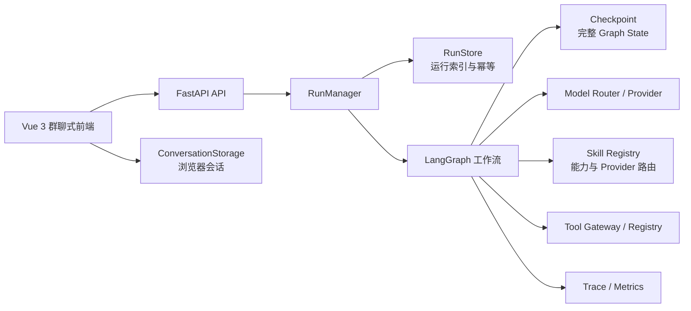

# Work Harness 当前开发进度与接续报告（框架完善后）

> 报告日期：2026-08-19
> 项目目录：`/home/s1amese/work-harness`  
> 当前阶段：本地框架闭环、Provider 兼容合同、模块化 Skill、Windows 单文件封装、可配置的
> 单实例生产部署与 GitHub 开源发布链已完成；真实模型验收、业务系统工具和多实例生产基础设施
> 待接入

## 1. 结论摘要

Work Harness 已经具备一套可运行、可测试、可持久化的多 Agent 编排框架：后端可接收任务并执行完整工作流，四个同构中文 Agent 可以进行任务分配、受限只读工具调用、风险自适应交叉审查、裁决、修复和汇总；所有启用 Provider 必须通过同一协议、相同能力集合和真实能力声明检查；任务能力可通过 Skill 模块化组合，并自动或手动路由到兼容 Provider。Provider 配置、逻辑模型映射及主协调组/逐子 Agent 路由可通过 SQLite Profile 保存；凭据可选择环境变量注入，或由设置页面提交并通过独立密钥加密保存。自定义模型方可选择 OpenAI 协议或 DeepSeek 方言，以及 Chat Completions/Responses 出站端点。后端现在具备完整运行与逐 Provider 背压、事件驱动 SSE、运行级幂等 Tool 缓存、生产 Trace 采样及存活/就绪分离。前端采用 Vue 3、TypeScript 和 Element Plus 实现灰白方框式类群聊交互，并以 SSE 优先、查询补偿的方式展示状态；运行状态、幂等索引、执行租约、Provider Profile 和浏览器会话均有持久化方案。

当前可以用于：

- 本地演示和架构验证；
- 多 Agent 编排逻辑开发；
- API、前端和持久化联调；
- Mock 模型下的回归测试和评估流程验证；
- 在虚拟机中继续开发。
- 以 GitHub Issue/PR 协作，并通过 GitHub Release 与 GHCR 发布版本化产物。

当前还不能直接视为生产系统。以下能力尚未完成真实接入：

- 真实大模型账号与模型路由；
- 实际业务工具及其权限边界；
- 基于真实任务集的质量评估；
- 服务端会话历史和多端同步；
- 多实例共享数据库、可靠任务队列和跨实例故障恢复；
- 完整的身份认证、租户隔离、限流和审计。

因此，当前最准确的进度判断是：**工程框架及单实例本地闭环完成并加固，外部服务与生产接入尚未完成。**

## 2. 已确认的产品与架构约束

后续开发应继续遵循下列已确定方案，除非进行单独的架构变更评审：

1. 前端技术栈保持 Vue 3 + TypeScript + Element Plus，不更换 UI 框架。
2. 界面保持类群聊式多 Agent 编排，不改回传统表单或固定成员面板。
3. Agent 名称和用户可见文案采用中文。
4. 所有执行 Agent 为同构设计，不按“研究员、程序员、审核员”等成员类别建立不同实现。
5. Agent 的差异来自本次任务分配的 `function`、目标、依赖和上下文，不来自固定身份。
6. LangGraph 只负责流程编排；模型、工具、存储、Prompt 和评估通过独立接口接入。
7. 需要机器处理的数据继续使用 Pydantic/JSON 结构化契约，避免依赖自然语言字符串解析。
8. 所有启用 Provider 必须遵守相同协议和完全相同的可移植能力集合；不允许静默能力降级。
9. 任务能力通过 Skill 声明逻辑模型、工具和 Provider 兼容范围，节点不得硬编码 Skill 对某供应商的依赖。

## 3. 当前系统架构



主执行链路：

```text
Normalize
  -> Plan
  -> Worker（同构 Agent 并发执行）
  -> Validate
  -> Review（交叉审查）
  -> Judge
  -> Repair 或 Human Gate
  -> Synthesize
```

核心入口和模块：

| 模块 | 位置 | 当前职责 |
| --- | --- | --- |
| API | `src/work_harness/api/app.py` | 健康检查、能力查询、创建/查询/恢复/取消运行 |
| 运行服务 | `src/work_harness/service.py` | `RunManager`，统一管理运行生命周期 |
| 工作流 | `src/work_harness/workflow/` | Graph 构建、节点执行、状态迁移和终止控制 |
| 节点实现 | `src/work_harness/workflow/nodes.py` | `WorkflowNodes`，实现规划、执行、审查、裁决、修复与汇总 |
| 数据契约 | `src/work_harness/domain/` | 请求、任务、Skill 选择、工件、审查、裁决和最终结果等结构化模型 |
| 模型层 | `src/work_harness/llm/` | Provider 接口、Adapter 注册、兼容报告和逻辑模型路由 |
| Skill 层 | `src/work_harness/skills/`、`skills/` | Skill 加载、静态兼容检查、组合和 Provider/Tool 路由 |
| 工具层 | `src/work_harness/tools/` | Tool Registry、Gateway、权限、超时和审批边界 |
| 运行存储 | `src/work_harness/storage/` | `RunStore` 接口及 Memory/SQLite 实现 |
| 配置 | `src/work_harness/config/`、`config/` | 类型化配置、运行限制、模型、Agent 和工具配置 |
| 评估 | `src/work_harness/evaluation/`、`evaluation/` | 评估用例、批量运行、指标和报告 |
| 前端 | `frontend/src/` | 群聊 UI、会话管理、API 访问、运行详情和本地持久化 |

## 4. 功能进度矩阵

| 能力 | 状态 | 说明 |
| --- | --- | --- |
| FastAPI 服务与基础接口 | 已完成 | 本地接口闭环可运行 |
| LangGraph 根工作流 | 已完成 | 已覆盖计划、执行、审查、裁决、修复、人工门控和汇总 |
| 四个同构 Agent | 已完成 | `worker-01` 至 `worker-04`，显示名为中文，不绑定固定职业分类 |
| 任务分派与依赖 | 已完成 | Planner 生成结构化子任务，支持功能、依赖和并发执行 |
| Agent 交叉审查 | 已完成并优化 | 普通低/中风险做单次综合审查，高/关键风险及研究/决策任务保留三维审查 |
| 结构化数据契约 | 已完成 | 主要输入输出由 Pydantic 模型约束 |
| 模型调用抽象 | 框架完成，待真实验收 | 自定义 OpenAI 协议/DeepSeek 方言支持 Chat Completions/Responses、结构化输出与 Tool Call 转换；无凭据实测 |
| Provider 能力全等 | 已完成 | 启动时校验协议版本、基线能力、启用 Provider 能力集合全等及运行时真实声明 |
| Provider/Tool 插件组装 | 已完成 | 内置注册表加 `work_harness.providers`、`work_harness.tools` 入口点扩展 |
| Provider Profile 持久化 | 已完成 | YAML 默认值叠加 Memory/SQLite；支持 main/逐 worker 路由、环境变量凭据与页面加密凭据，API 不回显 Key |
| 模块化 Skill | 已完成 | 标准 `SKILL.md` 加机器清单，支持能力/工具校验、组合、首选和手动 Provider 路由 |
| 工具注册与网关 | 已完成只读闭环 | 已打通模型 tool call；除 `echo_read` 外新增受限 `workspace_read` |
| Graph Checkpoint | 已完成 | 支持 Memory/SQLite，默认 SQLite |
| RunStore | 已完成 | 支持 Memory/SQLite，默认 SQLite，保存运行索引、状态与幂等信息 |
| 浏览器会话持久化 | 已完成 | `localStorage` 保存会话；仅限当前浏览器 |
| 服务端会话同步 | 未完成 | 尚无账号级会话仓储和多端同步 |
| Vue 群聊式前端 | 已完成 | 灰白方框式三栏群聊、左右消息、群成员栏、中文口语化功能选择、Skill/Provider 选择、状态流、恢复/取消、详情和会话本地保存 |
| 异常运行恢复 | 已完成单实例闭环 | RunStore 租约、心跳、启动扫描；只从已有 Checkpoint 续跑 |
| 实时流式推送 | 已完成状态流 | LangGraph 节点更新主动通知 SSE，空闲连接仅 keepalive；前端断线后查询补偿 |
| 自动化测试 | 已完成扩展集 | 后端 71 项、前端 15 项通过 |
| 评估框架 | 已完成扩展集 | 10 个 Mock 契约用例通过，不代表真实任务质量 |
| 身份、租户、限流 | 部分完成 | 请求体上限和进程内客户端令牌桶已启用；仍无用户身份、租户隔离与分布式限流 |
| 多实例与任务队列 | 未完成 | 当前 SQLite/进程内并发适合单实例开发环境 |
| Docker Compose 单实例部署 | 已实现，待目标机实构建 | 生产模板/校验、非 root/只读运行、资源限制、存活/就绪检查、含凭据密钥的在线备份、日志轮转及 Caddy HTTPS/安全响应头 |
| Windows 单文件封装 | 已完成 | PyInstaller one-file EXE 内置后端、前端和运行资源；可写 SQLite 位于 `%LOCALAPPDATA%`，双击启动并自动打开浏览器 |
| GitHub 开源发布链 | 已完成 | Standard Readme 中英文入口、MIT、社区治理文件、Issue/PR 模板、Dependabot、CI、Release wheel/sdist/Windows EXE、双架构 GHCR 与构建来源证明 |
| Git 版本基线 | 已完成 | `main` 分支已有可回滚基线提交，本轮兼容性改造可独立审查 |

## 5. 多 Agent 编排当前实现

### 5.1 同构 Agent

系统预置四个同构执行实例：

- `worker-01`
- `worker-02`
- `worker-03`
- `worker-04`

它们共享同一套执行能力、工具边界和上下文模型。某个 Agent 本次执行“分析”“检索”“实现”或“风险核查”，由 Planner 生成的任务分配决定，不应在代码中将 Agent ID 硬编码为某种专业身份。

### 5.2 任务指派

Planner 当前可为子任务提供：

- 任务目标；
- 本次功能类型；
- 依赖关系；
- 分配的 Agent；
- 期望产物和验收上下文。

运行时根据依赖关系选择可执行任务，并在配置的并发上限内调度。审查结果可进入裁决和修复轮次，最终由 Synthesizer 汇总。

### 5.3 当前运行限制

`config/runtime.yaml` 的当前默认值如下：

| 配置项 | 当前值 | 用途 |
| --- | ---: | --- |
| `run_max_concurrency` | 4 | 同时执行的完整 Graph Run 上限 |
| `worker_max_concurrency` | 4 | Worker 最大并发数 |
| `reviewer_max_concurrency` | 3 | Reviewer 最大并发数 |
| `review_strategy` | `adaptive` | 低风险综合审查，高风险三维审查 |
| `deep_review_task_types` | `research, decision` | 即使风险标记较低也启用三维审查的任务类型 |
| `max_planned_subtasks` | 4 | 单次规划最大子任务数 |
| `max_repair_rounds` | 1 | 最大修复轮次 |
| `max_node_steps` | 10 | 节点步数限制 |
| `node_timeout_seconds` | 60 | 单节点超时 |
| `run_timeout_seconds` | 300 | 单次运行总超时 |
| `token_budget` | 50000 | Token 预算 |
| `cost_budget_usd` | 5.0 | 成本预算（美元） |
| `max_artifact_chars` | 20000 | 工件最大字符数 |
| `max_tool_result_chars` | 8000 | 工具结果最大字符数 |
| `tool_cache_max_entries` | 256 | 运行级幂等工具缓存上限 |
| `model_retry_attempts` | 2 | 模型重试次数 |
| `sse_keepalive_seconds` | 15 | SSE 空闲保活间隔 |
| `run_lease_seconds` | 30 | 单次运行执行权租约 |
| `heartbeat_interval_seconds` | 10 | 租约心跳间隔 |
| `recovery_scan_interval_seconds` | 10 | 异常运行扫描间隔 |

这些值当前用于本地安全边界。接入真实模型后，应根据真实延迟、成本和任务复杂度重新标定，不能直接作为生产参数。

## 6. 持久化设计与当前边界

系统目前有四个不同职责的持久化层：

| 层 | 默认位置 | 保存内容 | 当前定位 |
| --- | --- | --- | --- |
| Checkpoint | `var/checkpoints.sqlite` | 完整 Graph State、节点进度、恢复所需状态 | 运行状态的事实来源 |
| RunStore | `var/runs.sqlite` | 运行索引、状态、请求指纹、幂等哈希、租约与尝试次数 | 快速查询、幂等和唯一执行权 |
| ProviderProfileStore | `var/providers.sqlite` + `.key` | Adapter、协议变体、端点、凭据通道、可选 Key 密文、模型白名单、逻辑映射与逐 Agent 路由 | 配置与页面凭据重启恢复，API 不回显 Key |
| ConversationStorage | 浏览器 `localStorage` | 会话列表、消息、最近运行信息 | 单浏览器交互体验 |

后端存储通过接口封装，可在配置中选择 Memory 或 SQLite：

- `src/work_harness/storage/base.py`：`RunStore` 协议；
- `src/work_harness/storage/memory.py`：内存实现；
- `src/work_harness/storage/sqlite.py`：SQLite 实现；
- `src/work_harness/storage/provider_base.py`：`ProviderProfileStore` 协议；
- `src/work_harness/storage/provider_memory.py`、`provider_sqlite.py`：Provider Profile 实现；
- `src/work_harness/config/models.py`：存储配置模型。

SQLite 实现已经包含 WAL、busy timeout、参数绑定、进程内异步写锁、数据库唯一索引和条件租约更新。查询完整结果时以 Checkpoint 为准，并将状态同步到 RunStore。旧 Checkpoint 如果缺少运行索引，会在首次查询时补建索引。

当前已知边界：

1. 启动扫描会认领租约为空或过期的未完成运行；有 Checkpoint 时续跑，没有 Checkpoint 时安全标记失败。
2. 当前没有生产任务队列或死信队列；租约方案定位为单实例故障恢复和未来共享 Store 的合同基线。
3. SQLite 适合当前单机/单实例开发；不适合未经改造直接承担多副本并发写入。
4. 浏览器会话没有服务端备份，清除浏览器数据会丢失本地会话列表。

更完整说明见 `docs/persistence.md`。

## 7. API 当前能力

主要接口定义在 `src/work_harness/api/app.py`：

| 方法 | 路径 | 用途 |
| --- | --- | --- |
| GET | `/health/live` | 无鉴权的容器存活探针 |
| GET | `/health` | 服务健康检查 |
| GET | `/health/ready` | 启用 Provider 未就绪时返回 503，区分存活与业务可用性 |
| GET | `/v1/capabilities` | 返回 Agent、模型、工具等可用能力 |
| GET | `/v1/compatibility` | 返回 Provider 合同、Adapter 和 Skill 兼容性报告 |
| GET | `/v1/providers` | 查询 YAML 与持久化 Provider Profile、装载和凭据就绪状态 |
| PUT | `/v1/providers/{name}` | 校验并持久化 Provider Profile，重启后装载 |
| DELETE | `/v1/providers/{name}` | 删除持久化覆盖，重启后回退 YAML |
| POST | `/v1/runs` | 创建一次运行 |
| GET | `/v1/runs` | 分页列出运行 |
| GET | `/v1/runs/{run_id}` | 查询运行详情和结果 |
| GET | `/v1/runs/{run_id}/events` | 订阅 SSE 运行快照 |
| POST | `/v1/runs/{run_id}/resume` | 恢复被人工门控或中断的运行 |
| DELETE | `/v1/runs/{run_id}` | 取消运行 |

前端 API 封装位于 `frontend/src/services/api.ts`。当前优先订阅 SSE 运行快照；连接失败时自动退回有界轮询，现有查询接口继续承担断线恢复和最终一致性补偿。

## 8. 前端当前进度

前端保持 Vue 3 + TypeScript + Element Plus 方案，桌面端采用类似 QQ/微信信息结构的三栏群聊：
左侧群聊列表、中间消息区、右侧群公告和成员；窄屏自动收起成员栏，移动端通过抽屉切换群聊。
视觉已改为低饱和灰白配色、细边框和小圆角方框，用户消息使用右侧浅灰消息框，AI 成员使用
左侧头像与白色消息框，不再采用整体偏绿的主题。

主要文件：

| 文件 | 作用 |
| --- | --- |
| `frontend/src/App.vue` | 应用入口和页面级状态衔接 |
| `frontend/src/components/GroupChatLayout.vue` | 群聊式整体布局 |
| `frontend/src/components/ChatSidebar.vue` | 会话侧栏 |
| `frontend/src/components/MessageBubble.vue` | 用户、系统和 Agent 消息展示 |
| `frontend/src/components/ComposerBox.vue` | 任务输入与发送 |
| `frontend/src/components/RunDetailsDrawer.vue` | 运行详情、步骤和状态查看 |
| `frontend/src/components/ProviderSettingsDrawer.vue` | Provider Profile、协议类型、模型映射和逐 Agent 路由管理 |
| `frontend/src/composables/useConversations.ts` | 会话状态和交互逻辑 |
| `frontend/src/services/conversationStorage.ts` | 浏览器本地持久化封装 |
| `frontend/src/services/api.ts` | 后端 API 封装 |

已具备的交互：

- 新建和切换会话；
- 以左右头像、昵称、时间和消息气泡展示用户任务与 Agent 结果；
- 通过群公告、群成员列表和 `@成员` 营造多人群聊交互；
- 将 `plan` 等内部节点、任务类型、Agent 功能、Skill 和模型角色统一转换为中文口语化文案；
- 查看运行状态和详情；
- 恢复或取消运行；
- 刷新页面后恢复本地会话；
- 调用后端能力和运行接口；
- 为每个会话选择一个或多个 Skill，并自动选择或手动固定可用 Provider；
- 在界面中暂存或启用自定义 Provider，选择环境变量或页面加密凭据，编辑主协调组/逐子 Agent
  模型路由，并查看待重启和就绪状态；
- SSE 实时更新，断线后自动回退到查询轮询。

后续前端重点是服务端会话同步、身份隔离、真实写工具审批和生产错误提示。

## 9. 模型、工具与 Prompt 接入状态

### 9.1 模型

模型层的接口和路由框架已经完成，默认使用两个能力完全相同的 Mock Provider 验证 Provider 选择。所有启用 Provider 需要通过协议 `1.0`、基线能力、能力集合全等和配置/运行时声明一致检查。`openai_compatible` 表示协议 Adapter，而非 OpenAI 官方服务；自定义 Profile 可选择 `openai` 协议或 `deepseek` 方言，以及 `/v1/chat/completions`、`/v1/responses` 端点。`agent_bindings.main` 绑定所有主协调节点，具体 `worker-*` 可各自覆盖 Provider/模型。当前已覆盖消息、结构化输出、Token 参数、Tool Call 多轮状态、Usage、逐 Agent 路由和错误映射的 Mock 合同测试，但仍未配置真实凭据和模型，也没有真实任务质量基线。

当前逻辑模型角色包括：

- `planner-strong`
- `worker-fast`
- `reviewer-independent`
- `judge-stable`
- `synthesizer-general`

这些是逻辑路由角色，不应在业务代码中直接绑定供应商模型名。真实模型名、地址和密钥应通过配置及环境变量注入。

Provider Adapter 由 `ProviderAdapterRegistry` 组装，外部包可通过 `work_harness.providers` 入口点注册。`check-compatibility` 会输出实际 Provider、Adapter、协议和能力报告。

### 9.2 工具

工具层已把 Registry、Gateway、模型 tool call、参数契约、角色白名单、超时、结果截断和审批边界接入主工作流。除测试用 `echo_read` 外，新增受限 `workspace_read`，支持项目内读取、列目录和文本搜索；它限制路径、文件类型、大小、行数和扫描量，并将输入哈希与输出摘要记录到 Graph State。声明为 `idempotent` 的工具会按运行、角色、工具名和规范化参数使用有界缓存，命中状态进入 ToolCallRecord，运行结束即清理。下一阶段应接入一个部署环境中的只读知识或业务查询工具，再逐步增加写操作工具。

Tool Handler 也改为由 `ToolAdapterRegistry` 组装，外部包可使用 `work_harness.tools` 入口点；配置、角色权限与 Gateway 安全边界不因插件化而绕过。

### 9.3 Skill

运行时 Skill 使用标准 `SKILL.md` 指令文件和 `agents/work-harness.yaml` 兼容清单，声明逻辑模型、能力、工具、兼容 Provider、首选顺序和适用职能。启动会拒绝未知或不兼容声明；任务级 Provider 覆盖必须属于 Skill 的实际可用集合。多个 Skill 组合需要共享逻辑模型和至少一个共同 Provider。

仓库内提供 `repository-analysis`、`risk-audit` 两个可运行示例，以及 `create-provider-skill` 编写指南。详细合同见 `docs/provider-skill-compatibility.md`。

### 9.4 Prompt

Prompt 应继续通过集中配置或注册机制管理，并记录版本。任何真实模型调优都应与评估集绑定，不能只依据少量手工对话判断质量提升。

## 10. 2026-08-19 验证基线

本报告生成前完成了下列验证：

| 验证项 | 命令 | 结果 |
| --- | --- | --- |
| 配置检查 | `uv run work-harness check-config` | 通过；本地配置、Agent、模型角色、工具和 SQLite 存储加载正常 |
| Python 静态检查 | `uv run ruff check src tests scripts` | 通过，无检查错误 |
| Provider/Skill 兼容检查 | `uv run work-harness check-compatibility` | 通过；2 个启用 Provider 等能力，2 个运行时 Skill 均有可用 Provider |
| 后端测试 | `uv run pytest` | 71 项通过，包含双凭据通道、密文持久化、生产待配置启动和 readiness 覆盖 |
| 后端 Mock 基准 | `uv run python scripts/benchmark_backend.py --runs 50 --concurrency 4` | 50/50 成功；84.24 runs/s；p50/p95/p99 为 45.03/65.62/76.15 ms；平均 7 次模型调用；仅代表当前机器的框架开销 |
| 单文件封装 | `pyinstaller packaging/work-harness.spec` | Linux 同构 one-file 构建用于本地验证；Windows x64 正式构建由 GitHub Actions 原生 Windows runner 完成 |
| 基础评估 | `uv run work-harness eval` | 10/10 契约检查通过，错误率 0，平均模型调用由 10.8 降至 8.8；不代表真实质量 |
| 前端类型检查 | `npm run type-check` | 通过 |
| 前端测试 | `npm run test -- --run` | 5 个测试文件、15 项测试全部通过，包含中文标签、Provider Key 单向提交、API Key 请求头与鉴权 SSE |
| 前端生产构建 | `npm run build` | 通过；主 CSS/JS 约 143.47/459.77 kB，Provider 管理按需加载约 11.61/52.17 kB |
| 开源发布自检 | `python scripts/check_release.py` | 通过；README 顺序、描述、版本、License、本地链接和社区文件一致 |
| GitHub Actions 校验 | `actionlint` | 通过；CI 与 Release 工作流语法、表达式和依赖关系有效 |
| Python 发布产物 | `python -m build`、`twine check`、`scripts/verify_wheel.py` | sdist 与 wheel 构建及元数据检查通过；wheel 在全新虚拟环境、源码目录外可加载包内配置并执行 CLI |
| Compose 静态检查 | `docker compose --profile public config --quiet` | 文件此前通过静态校验；本轮 WSL 未启用 Docker Desktop 集成，镜像实构建交由 GitHub CI 和目标机执行 |
| SQLite 备份检查 | `python scripts/backup_sqlite.py var <临时目录>` | 通过；三个数据库快照与 manifest SHA-256 一致 |

基础评估当前只验证 Mock 工作流能否稳定闭环：

```text
case_count: 10
success_rate: 1.0
error_rate: 0.0
bad_case_count: 0
average_latency_ms: 13.7
p95_latency_ms: 16.0
structured_parse_error_rate: 0.0
average_steps_proxy: 8.8
total_estimated_cost_usd: 0.0
quality_claim: false
```

`quality_claim: false` 很重要：这组结果不能证明回答质量、真实工具准确率或生产稳定性，只能作为框架冒烟基线。

## 11. 当前问题与风险优先级

### P0（已完成）：建立版本基线

**位置：** 项目根目录。  
**现状：** 已初始化 Git，默认分支为 `main`；`.gitignore` 排除 `.env`、SQLite 运行文件、依赖目录、构建产物和 Windows Zone.Identifier。  
**验证：** 基线提交包含源码、配置模板、测试和文档，不包含数据库运行文件、依赖目录和密钥。

### P1（协议与持久化已完成）：真实模型接入与真实评估缺失

**位置：** `src/work_harness/llm/`、`config/models.yaml`、`evaluation/`。
**现状：** OpenAI 协议/DeepSeek 方言、Chat Completions/Responses、Provider Profile 和环境变量/
页面加密凭据双通道已完成 Mock 合同；仓库不配置真实密钥，真实调用留待手动测试。
**影响：** 目前无法判断多 Agent 编排的实际答案质量、成本、延迟和稳定性。  
**建议：** 接入一个 OpenAI-compatible 测试模型，建立 10–20 条人工标注的最小真实评估集，再调整 Prompt、并发和修复策略。  
**风险：** 真实模型输出、速率限制、结构化响应兼容性和成本可能暴露新问题。

### P1（部分完成）：真实业务工具仍待部署环境接入

**位置：** `src/work_harness/tools/`、`config/tools.yaml`。  
**现状：** 已完成受限工作区读取工具及端到端模型调用，可执行代码/文档读取；尚无内部知识库或业务系统查询。  
**建议：** 下一工具继续选择只读能力，严格定义输入 schema、超时、输出摘要、敏感信息过滤和审计日志。  
**风险：** 过早开放写工具会扩大误操作和 Prompt 注入影响面。

### P1：服务端会话和多用户能力缺失

**位置：** 前端 `ConversationStorage` 与后端 API/存储层。  
**影响：** 会话只保存在单一浏览器，无法跨设备、跨用户或团队协作。  
**建议：** 新增 `ConversationRepository` 接口、会话/消息表和分页 API，再让前端本地存储退化为缓存。  
**风险：** 需要同时设计身份、租户、数据保留和删除策略。

### P1（已完成单实例闭环）：异常退出自动恢复

**位置：** `RunStore`、启动流程和未来任务队列。  
**现状：** 已增加 Memory/SQLite 租约、心跳、启动扫描和可重入恢复；恢复前检查 Checkpoint，孤立索引安全失败。  
**剩余：** 生产多实例仍需共享 Store、可靠队列、死信和故障注入验证。  
**风险：** 恢复机制仍必须依赖原子幂等和唯一执行权，避免重复运行。

### P1：单实例存储不适合直接横向扩展

**位置：** SQLite Checkpoint 与 SQLite RunStore。  
**影响：** 多副本部署会遇到共享文件、锁竞争和任务归属问题。  
**建议：** 生产阶段实现 PostgreSQL 版 Store/Checkpoint，并引入可靠任务队列或调度租约。  
**风险：** 数据迁移和状态恢复语义必须先通过集成测试。

### P2（已完成状态流）：流式事件通道

**位置：** API 与 `frontend/src/services/api.ts`。  
**现状：** API 已提供 SSE 运行快照，节点更新通过进程内合并信号触发快照读取，已移除每连接 250 ms Checkpoint 轮询；前端断线时自动回退轮询，查询接口保留为补偿机制。
**剩余：** 如需节点级增量事件和跨实例回放，应增加持久事件序列或消息总线。

### P2：生产可观测性与端到端测试不足

**位置：** Trace、API、前端和部署层。  
**影响：** 当前测试能覆盖框架基础行为，但对真实模型、数据库迁移、浏览器交互和故障恢复的覆盖不足。  
**建议：** 增加真实 Provider 契约测试、SQLite/PostgreSQL 集成测试、浏览器 E2E、故障注入和 OpenTelemetry 指标。

## 12. 推荐的接续开发顺序

### 阶段 0：虚拟机复现和版本基线

目标：证明迁移后的环境与当前基线一致。

1. 解压项目开发包。
2. 从 `.env.example` 创建本机 `.env`，不要复制真实密钥文件。
3. 安装 Python 与前端依赖。
4. 运行配置检查、后端测试、前端测试和构建。
5. 初始化 Git，提交当前基线。

完成标准：后端 71 项测试和前端 15 项测试通过，10/10 Mock 契约评估通过，生产构建成功，Git 工作区干净。

### 阶段 1：接入一个真实模型并建立质量基线

目标：把“框架可运行”推进为“真实任务可测量”。

1. 配置一个 OpenAI-compatible Provider。
2. 先只为一个逻辑角色启用真实模型，保留 Mock 作为回退和单元测试依赖。
3. 添加 10–20 条人工标注评估用例，覆盖简单任务、依赖任务、冲突审查、修复和失败路径。
4. 记录成功率、结构化解析错误、平均步骤、延迟、Token、成本和 bad case。
5. 固定 Prompt 版本和模型参数，再开始优化。

完成标准：真实评估可重复运行，每条失败均可定位到运行 Trace、模型输出或工具结果。

### 阶段 2：接入第一个只读业务工具（本地文件场景已完成）

目标：验证 Tool Registry、权限、超时和上下文截断在真实场景下工作。

优先选择：受限目录文件读取、内部知识查询或只读 HTTP 检索中的一种。不要把任意 Shell 或任意网络访问作为第一个生产工具。

当前结果：`workspace_read` 已完成参数校验、权限拒绝、路径隔离、超时、审计摘要和端到端 tool call 测试；部署环境中的知识或业务查询工具仍待选择。

### 阶段 3：服务端会话持久化

目标：会话不再依赖单浏览器 `localStorage`。

1. 定义 `ConversationRepository` 协议。
2. 增加会话、消息、运行关联和分页查询。
3. 前端将本地存储作为缓存，并实现服务端同步和冲突策略。
4. 明确删除、导出和保留策略。

完成标准：更换浏览器或设备后能恢复同一账号的会话，且不同用户数据隔离。

### 阶段 4：生产加固

目标：支持真实多用户和多实例运行。

重点包括：PostgreSQL、可靠任务队列、身份认证、租户隔离、限流、敏感信息脱敏、备份恢复、持久事件回放、OpenTelemetry 和部署健康检查。

## 13. 建议的首批开发任务（1–2 个工作日）

建议下一轮只做以下外部接入闭环，不同时展开所有生产能力：

1. 在虚拟机跑通现有全部验证并初始化 Git。
2. 使用现有 production Profile 配置一个 OpenAI-compatible 测试模型。
3. 在现有 10 条 Mock 契约用例之外，新增 10–20 条人工标注真实质量用例。
4. 完成首次真实模型评估，输出独立 baseline 报告和 bad case。
5. 根据 bad case 只修复最明确的 P1 问题，不立即大规模改工作流。

这一轮暂不建议同时修改前端布局、引入 PostgreSQL或开放写工具，否则难以确认质量变化来自哪一项改动。

## 14. 本地与虚拟机运行方式

### 14.1 环境要求

- Python 3.11 或更高版本；
- `uv`；
- Node.js 20.19+ 或 22.12+；
- npm 10+。

### 14.2 后端

```powershell
cd F:\code\ai\work-harness
Copy-Item .env.example .env
uv sync --extra dev --frozen
uv run work-harness check-config
uv run ruff check src tests
uv run pytest
uv run work-harness eval
uv run work-harness serve
```

### 14.3 前端

```powershell
cd F:\code\ai\work-harness\frontend
npm ci
npm run type-check
npm run test -- --run
npm run build
npm run dev
```

如果虚拟机路径不同，只替换 `cd` 路径，不要把绝对路径写入项目配置。详细迁移方式见 `docs/vm-handoff.md`。

## 15. 扩展入口

### 新增或切换模型

1. 实现或复用 `src/work_harness/llm/` 的 Provider 接口，并通过 `ProviderAdapterRegistry` 或 `work_harness.providers` 入口点注册。
2. 在模型配置中维护逻辑角色到实际模型的映射，并保持所有启用 Provider 能力集合全等。
3. 密钥只从环境变量读取。
4. 增加结构化响应、重试、超时和错误映射的契约测试。
5. 运行真实评估并保存 baseline，不以单次对话作为验收。

### 新增 Skill

1. 使用 `skills/create-provider-skill` 创建标准 `SKILL.md` 与 `agents/work-harness.yaml`。
2. 只声明实际需要的能力和 Tool，并列出已验证的兼容 Provider。
3. 运行 `work-harness skills validate` 和 `work-harness check-compatibility`。
4. 为自动 Provider 路由与手动 Provider 选择补充测试。

### 新增工具

1. 定义严格的输入/输出 schema。
2. 在 `src/work_harness/tools/` 中实现，并通过 `ToolAdapterRegistry` 或 `work_harness.tools` 入口点注册。
3. 在 `config/tools.yaml` 配置权限和可用范围。
4. 对参数错误、越权、超时、长输出和敏感信息进行测试。
5. 写操作工具默认要求显式审批和更细权限。

### 新增 Prompt

1. 通过集中管理位置增加版本化 Prompt，不在节点代码中散落长字符串。
2. 明确 system/user/tool 消息边界和输出 schema。
3. 在 Trace 中记录 Prompt 版本，而不是记录敏感原始上下文。
4. 用固定评估集比较变更前后结果。

### 新增存储实现

1. 实现 `RunStore` 协议，不让 API 或 Workflow 直接依赖具体数据库。
2. 保持幂等预留的原子性和唯一约束。
3. 明确 Checkpoint 与 RunStore 的事实来源和同步顺序。
4. 增加并发、恢复、迁移和故障注入测试。

## 16. 后续开发不可破坏的工程约束

1. Checkpoint 是完整运行状态的事实来源，RunStore 是索引和幂等层，不得混为一个隐式存储。
2. 幂等键只能以哈希等安全形式进入索引和日志，不能无必要重复保存原文。
3. Agent ID 不得硬编码为职业身份；Agent 的功能来自本次任务分配。
4. 模型、工具、存储和 Prompt 必须可替换，工作流节点不得直接绑定具体供应商 SDK。
5. 所有外部输入、模型结构化输出和工具参数必须经过 schema 校验。
6. API Key、Token、Cookie、密码和私钥不得进入代码、前端包、数据库样例或日志。
7. 接入真实模型后，单元测试继续使用 Mock，避免测试变慢、收费和不稳定。
8. 没有真实评估对比时，不得声称效果提升。
9. 任何恢复机制都必须与原子幂等、租约或唯一执行权配套，避免重复运行。
10. 前端新增实时通道时必须保留查询补偿能力，不能只依赖临时连接中的事件。

## 17. 交接包与文件状态

已有开发交接包：

```text
F:\code\ai\work-harness-dev-bundle-20260818.zip
SHA-256: b23083d95af2859fd445ef3c26ea04bac8ee30ddad021636523c2fa7a8f78b57
```

该压缩包生成时间早于本报告，因此不包含 `docs/development-status.md`。继续迁移时可将本报告单独复制到虚拟机；如需重新打包，应生成一个新文件名和新的 SHA-256，不要覆盖旧包，以保留可追溯性。

## 18. 下一里程碑定义

建议下一里程碑命名为：**真实模型与部署环境只读工具质量闭环**。

里程碑完成条件：

- 至少一个真实模型 Provider 可稳定调用；
- 至少一个部署环境中的真实只读工具通过权限和异常测试（本地 `workspace_read` 已完成）；
- 有 10–20 条人工标注真实评估用例；
- 能输出成功率、解析错误率、工具调用准确性、步骤、延迟、Token、成本和 bad case；
- 每次运行可通过 `run_id` 查询完整 Trace 和最终结果；
- Mock 单元测试、前后端现有测试与生产构建继续通过；
- 所有改动在 Git 中可审查、可回滚。

完成这个里程碑后，再进入服务端会话、多用户和多实例生产化，会比继续扩展 UI 或一次性重写工作流更容易验证和控制风险。
