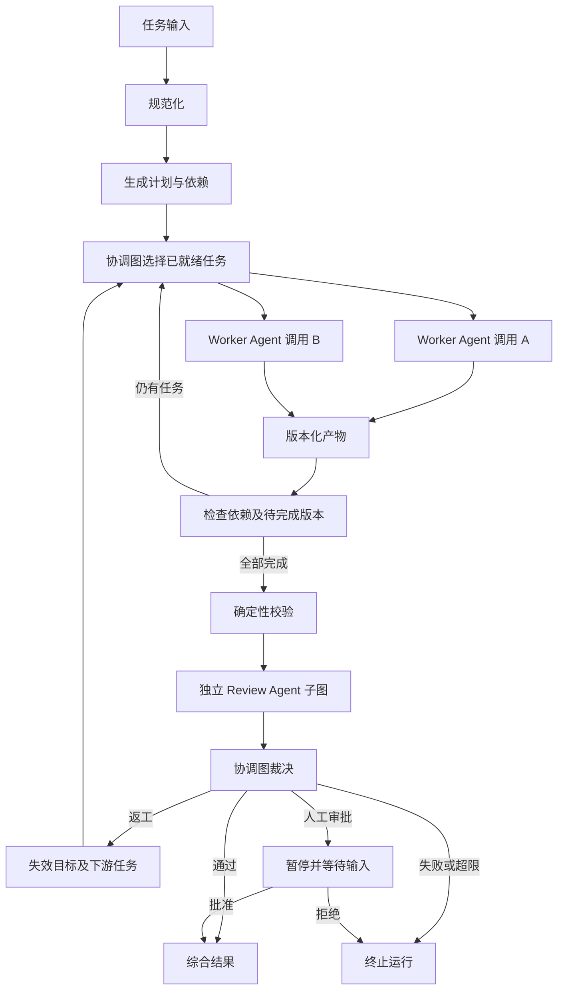

# LangGraph 多 Agent 协作核心设计

> 本文描述当前 `agent-subgraphs-v1` 实现。下一阶段采用 Fact、Intent、Hint 黑板架构，
> 待实施方案与迁移步骤见[黑板架构设计与实施计划](blackboard-design.md)。

Work Harness 使用一个协调图管理一次 Run，多次 Worker Agent 和 Review Agent 子图调用
完成执行与复核。四个同构成员通过本轮分工、模型路由和工具权限区分行为。协调图拥有计划、
依赖、版本、返工范围、人工审批及最终状态；子图通过明确的输入输出契约交换结果。

本设计对应 `agent-subgraphs-v1`，实现入口为
[`workflow/graph.py`](../src/work_harness/workflow/graph.py)。

## 协调图与子图



`Dispatch` 表示协调图的条件路由逻辑，通过 LangGraph `Send` 启动就绪的子图调用。
同一成员可以同时执行多个独立子任务，每次调用拥有自己的状态及 Checkpoint 命名空间。
`worker` 与 `reviewer` 是直接挂在 Root Graph 上的已编译子图，可通过 `get_subgraphs()` 检查。

| 层次 | 代码 | 责任 |
| --- | --- | --- |
| 图拓扑 | `workflow/graph.py` | 组合节点和子图，约束跳转路径 |
| 协调节点 | `workflow/nodes.py` | 计划、验证、裁决、返工、审批和综合 |
| 派发规则 | `workflow/routing.py` | 按依赖和版本构造任务，选择复核维度 |
| 交互契约 | `workflow/contracts.py` | 校验交接数据，生成稳定标识 |
| Agent 子图 | `workflow/agents.py` | 私有模型与工具循环、独立复核 |
| 共享能力 | `workflow/agent_services.py` | 网关、Prompt、Skill、并发限制及调用记录 |
| 运行生命周期 | `service.py` | 队列、租约、超时、取消、恢复、SSE 与结果查询 |

## Agent 内部执行

Worker 使用 `prepare → model → tools → model → publish`。`prepare` 创建私有上下文，
`model` 通过现有 ModelGateway 调用成员模型，`tools` 每个节点执行一个获准工具，
`publish` 校验并交付产物。没有工具请求时，模型可以直接进入 `publish`。

模型调用次数与工具调用总数分别受 `min(agent.max_steps, runtime.max_node_steps)` 限制。
Token 和费用按本次子任务累计计算，每次请求携带剩余预算；超限返回失败产物并保留已有用量。
模型和工具节点共享 Worker 并发信号量，Provider 层保留独立并发限制。Run 总时限及全局预算
检查继续由运行层及协调节点执行。

Review Agent 使用 `review → publish`，接收目标产物、任务、子任务验收条件和复核维度。
它提交 Review，不接收 Worker 的私有模型消息，也不修改被审查的产物。

## 任务与反馈协议

Worker 的输入为 `WorkerAssignment`，Review 的输入为 `ReviewAssignment`，均使用
Pydantic 校验并导出 JSON Schema。

| Worker 输入 | 用途 |
| --- | --- |
| `run_id`、`task`、`subtask` | 所属运行、目标、成员、模型、工具及验收条件 |
| `artifact_version`、`repair_round` | 本次要交付的版本及返工轮次 |
| `dependency_artifacts` | 本任务声明的直接上游产物 |
| `previous_artifact` | 本子任务的上一版结果 |
| `feedback` | 针对上一版产物的 Review |
| `validation_issues`、`repair_reasons` | 确定性问题及裁决理由 |

依赖必须来自同一 Run、状态为成功、与声明的依赖集合完全一致。反馈必须指向上一版产物
的 ID 和版本。协调图只会派发已经满足所需版本的依赖。工具输出及其他 Agent 的产物作为
证据传入，不获得修改系统指令、工具权限或全局调度的权力。

模型决定内容、证据和置信度。产物 ID、Run、子任务、生产者和版本由 Harness 赋值；同一
子任务的多版产物保持相同 ID。Review 的 ID、目标、版本、复核人和维度也由 Harness 赋值。

## 版本化返工

设计划为 `A → B → C`，另有独立任务 D。第一轮 A 完成后，B 收到 A 的第 1 版；B 完成后，
C 收到 B 的第 1 版。当裁决要求修正 A，协调图同时使 B、C 的旧结果失效，把 A、B、C 的
`required_versions` 提升到 2。

A 先收到自己的上一版产物、复核意见和裁决理由。只有 A 的第 2 版完成，B 才能启动；C
同样等待 B 的第 2 版。D 的成果与复核继续使用。这个规则避免下游使用过期证据，也避免
调度器把返工前的成功状态当作本轮完成。

复核只针对尚未检查过的当前产物版本。`failed` 或 `partial` 的 Worker 结果使本次运行
明确失败，避免在依赖队列中无限重新执行。未知返工目标直接报错。

## 状态及恢复

Root Graph 保存计划、所需版本、产物、Review、裁决、用量及协作记录。子图保存本次调用
的消息、模型响应、工具游标和局部记录。输出 Schema 只允许交付结果字段，私有模型消息
不会合并到 Root Graph 或暴露在 `RunResult` 中。

子图采用每次调用独立的持久化方式，`compile()` 继承父图 Checkpointer。这支持并行调用
与调用内恢复，符合独立子任务的需求，见
[LangGraph 子图持久化文档](https://docs.langchain.com/oss/python/langgraph/use-subgraphs#subgraph-persistence)。
本地继续使用 Memory/SQLite，分布式继续使用 PostgreSQL Checkpoint 与既有可靠队列。

已经完成并提交 Checkpoint 的工具节点在恢复时无需重跑。如果进程恰在外部工具完成、
Checkpoint 尚未提交之间退出，工具仍可能重试，因此有副作用的工具依然需要业务幂等。
私有子图消息会进入 Checkpoint 存储，数据访问与保留规则应覆盖这些记录。

`RunResult.agent_interactions` 提供派发、依赖、返工反馈、提交和复核的引用记录，任务
详情显示发送方、接收方、任务和产物版本。记录 ID 稳定，父图按 ID 合并。这些记录和调用
用量在子图完成时提交；它们记录已完成交互，不是逐 Token 聊天流，也不替代持久事件总线。

## 版本与升级

`WORKFLOW_REVISION` 标识拓扑及交接协议版本。分布式执行指纹包含该版本、实际加载的
Prompt 内容及原有配置，使新旧 Worker 不会领取不兼容的 Job。

新 Run 的 Checkpoint 记录工作流版本，恢复已有计划时会验证版本。不兼容的人工审批恢复
请求返回 409，保持原有等待状态；历史结果仍可查询。本次没有自动迁移旧版执行中的
Checkpoint：升级前应排空旧任务，含等待审批的任务，并备份数据。需要继续旧任务时使用
原版本及对应 Prompt/配置，不能只修改队列指纹来强行接管。

后续改变子图状态、节点名或契约时，必须升级 `WORKFLOW_REVISION`，明确迁移或排空策略。
新增 Agent 类型需定义输入输出、预算、权限和恢复测试，再由协调图显式派发。主动问答、
动态委派和跨 Run 长期记忆属于后续扩展。

## 验证

`tests/test_agent_interactions.py` 覆盖依赖上下文、同成员并发隔离、三层返工传播、未变更
产物的复核复用、SQLite 子图中断恢复、累计预算、工具步数、部分失败终止、跨 Run 数据
拒绝、执行指纹、旧版恢复拒绝及长依赖链。

```bash
uv run pytest tests/test_agent_interactions.py tests/test_workflow.py
uv run ruff check src tests scripts
npm --prefix frontend test
npm --prefix frontend run build
```

PostgreSQL 事务、并发、租约接管及 API/Worker 集成继续由 `tests/test_postgres_queue.py`
验证，必须指向专用测试数据库。模型测试使用 Mock；真实 Provider 的质量、费用及时延需
单独验收。
